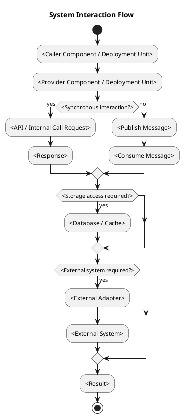
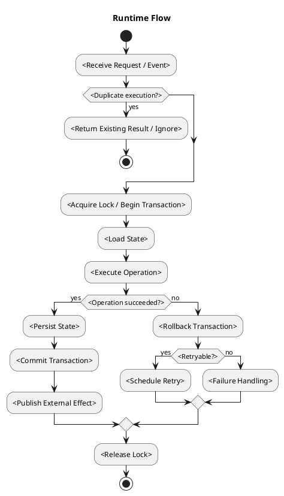
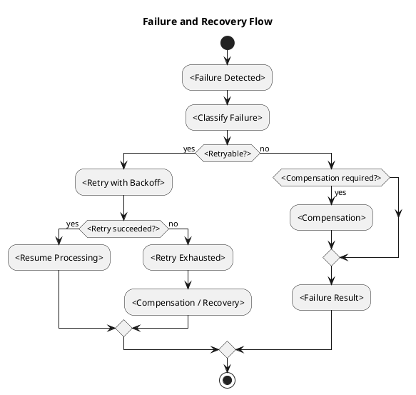

# Architecture Spec

# 1. 설계 범위와 현재 모델

요청과 Product Spec의 범위·기존 구현·변경 대상·영향 데이터 및 기존 제약을 요약한다. 현재 구현과 승인 target을 구분하고 source/commit 근거를 기록한다. 요구사항 ID는 해당 모델과 흐름에 연결한다.

# 2. Domain

영향받는 업무 개념과 공유 용어를 설명한다. 각 Entity의 identity·상태·도메인 메서드와 각 Value Object의 값·불변성·검증·행위를 기록하고, 해당 규칙 ID와 변경 진입점을 같은 항목에 둔다. 단일 객체에 자연스럽게 속하지 않는 판단은 필요한 경우 Domain Service에 기록한다. Entity와 Value Object의 소속 Aggregate 및 관계를 명시한다. 규칙이 모델에 명확히 표현되면 별도 ownership 표를 반복하지 않는다.

| 도메인 모델 | 종류 (Entity / Value Object / Domain Service) | 상태·값·identity | 행위와 업무 규칙 / 요구 ID | Aggregate 및 관계 |
|---|---|---|---|---|
| `<모델>` | `<종류>` | `<상태>` | `<메서드·규칙>` | `<소속·참조>` |

업무 흐름에서 발생하는 명령·사건·정책과 필요한 외부 상호작용은 해당 모델이나 서비스 흐름에 통합한다. Event Storming의 미해결 hotspot만 질문과 결정 필요 근거를 남긴다. 해소된 hotspot은 해당 모델이나 결정에 반영하고 별도 목록을 반복하지 않는다.

## 도메인 클래스 다이어그램

Entity, Value Object, Aggregate Root, Domain Service의 관계와 책임을 표현한다. 독립 원본은 `docs/specs/<plan-set-id>/diagrams/architecture/<context>.class.puml`, SVG는 같은 basename을 사용한다. 적용되지 않으면 이유를 기록한다.

# 3. Aggregate

설계 대상 도메인에 하나 이상의 Aggregate를 정의하고 Entity와 Value Object의 소속 Aggregate를 명시한다. 모든 Aggregate에는 Root Entity, 구성 Entity·Value Object, 공개 도메인 메서드, 불변 조건과 일관성·transaction 경계를 기록한다. 단일 Root Entity만으로 Aggregate가 될 수 있다. Aggregate 간 참조와 저장소 접근도 밝힌다. 현재 구현에 Aggregate가 없으면 사실을 그대로 보존하고 목표 설계의 Aggregate를 별도로 제안한다. Aggregate 경계와 Bounded Context 경계는 동일하다고 가정하지 않는다.

| Aggregate | Root / identity | 구성 Entity·Value Object | 도메인 메서드·불변 조건 / 요구 ID | 일관성·저장 경계 | 다른 Aggregate 참조 |
|---|---|---|---|---|---|
| `<aggregate>` | `<root>` | `<구성>` | `<행위·규칙>` | `<transaction / repository>` | `<참조>` |

변경되는 상태 보유 operation은 정상·경쟁·중복/재시도·부분 실패·재시작·취소/복구의 허용 전이와 guard, 원자적 저장 조건, 실패 후 상태, 복구 주체와 검증 사례를 함께 기록한다. 적용되지 않는 경로는 이유를 기록한다. 예약·잠금·version 도입 시 진행 중 writer와 허용 작업, 외부 성공 후 저장 실패, 미확인 상태 복구 및 해제 후 새 작업을 대조한다.

| 현재 상태·사건 | 허용 전이·거부·event | Root 메서드·원자적 저장 조건 | 실패 후 상태 | 재시도·복구와 다음 명령 | 요구 ID·검증 |
|---|---|---|---|---|---|
| `<state / command>` | `<전이>` | `<method / transaction>` | `<state>` | `<복구>` | `<ID / 결과>` |

상태 다이어그램이 필요한 경우 독립 원본 `docs/specs/<plan-set-id>/diagrams/architecture/<concept>.state.puml`과 같은 basename SVG를 링크한다. 불필요하면 이유를 적는다.

# 4. Application Service

각 유스케이스의 서비스 책임, 입력·출력, 호출할 Aggregate와 repository·외부 의존성, transaction, 실패와 복구를 정한다. 서비스는 흐름을 조합하고 업무 판단과 불변 조건은 해당 도메인 메서드에 위임한다. 독립 계층을 문서화하되 불필요한 전달 전용 wrapper를 강요하지 않는다.

| 서비스 / 유스케이스 | 입력 → 결과 | 호출 Aggregate·저장소·외부 시스템 | transaction·실패 | 요구 ID |
|---|---|---|---|---|
| `<service>` | `<input / output>` | `<collaborators>` | `<boundary / failure>` | `<IDs>` |

## Application Flow

각 유스케이스를 순서 있는 목록으로 작성한다. 인증·입력 확인, Aggregate 로드·도메인 메서드 호출, 저장·외부 효과, 응답과 실패 경로를 필요한 만큼 명시한다.

1. `<요청과 입력 확인>`
2. `<Aggregate 로드 및 도메인 메서드 호출>`
3. `<저장·외부 효과 및 결과 또는 실패>`

컴포넌트 간 입력·출력·오류·side effect·멱등성 등은 필요한 경계의 해당 흐름에 기록한다. 별도 호출 계약 표는 경계가 복잡하거나 여러 소비자가 있어 실제로 필요한 경우에만 작성한다. 허용/금지 의존성과 오류 전파도 관련 흐름에 기록한다.

# 5. Bounded Context

앞에서 기술한 모델·Aggregate·서비스를 바탕으로 Context 후보별 언어·모델·업무 규칙·데이터 소유권과 생명주기·일관성·변경 독립성·경계 간 변환을 비교한다. 기존 Context에 포함하는 안과 별도 Context 안을 근거와 trade-off로 비교하고, 신규 프로젝트는 복수 후보를 공정하게 비교한다. Context 판단과 코드 모듈·별도 배포 판단은 구별한다. 기능 이름, Aggregate 수, framework 또는 배포 단위만으로 Context를 결정하지 않는다.

| Bounded Context | 책임·공유 언어 | 소유 Aggregate·데이터 | 외부 Context와 관계·변환 | 대안 및 결정 근거 |
|---|---|---|---|---|
| `<context>` | `<책임 / 용어>` | `<모델 / 데이터>` | `<관계 / 계약>` | `<비교 / 이유>` |

Context Map은 실제 경계가 둘 이상이거나 외부 연계가 설계상 중요할 때 관계와 translation을 보여준다. Context마다 독립 배포를 가정하지 않는다.

---

# 6. Technical Architecture

## 6.1 Boundary Mapping

Bounded Context, 업무 기능, 코드 모듈과 배포 서비스를 1:1로 매핑하지 않는다. Context 결정과 코드·배포 경계를 별도 근거로 설명한다.

| Bounded Context | 업무 기능 | Code Boundary                 | Deployment Unit | Boundary Rationale     |
| --------------- | ------------------- | ----------------------------- | --------------- | ---------------------- |
| `<context>`     | `<기능>`      | Package / Module / Process    | `<runtime>`     | `<why this strength>`  |

## 6.2 Code and Deployment Boundary Decisions

| Candidate     | Owner Context | Chosen Boundary                                  | Why Not Weaker?         | Why Not Stronger?        | Introduced Cost                    |
| ------------- | ------------- | ------------------------------------------------ | ----------------------- | ------------------------ | ---------------------------------- |
| `<candidate>` | `<context>`   | Package / Module / Service     | `<insufficient reason>` | `<unnecessary reason>`   | `<contract/build/runtime overhead>` |

새 module 또는 service는 기능 이름을 물리적 경계로 옮기기 위해 만들지 않는다. Package보다 module이 필요한 이유, module보다 service가 필요한 이유를 각각 증명한다. 미래 MSA 추출 가능성은 소유권과 seam을 보존하는 근거이지 모든 capability를 service 형태로 미리 만드는 근거가 아니다.

## 6.3 System Interaction Flow



## 6.4 Synchronous Communication

변경된 연결마다 현재 경로와 선택 근거를 source/ADR/System Target으로 연결한다. 내부 public API 직접 호출, 동기 원격 호출, 비동기의 대안과 선택 이유를 기록한다. 같은 프로세스의 호출에 broker나 network API를 자동 추가하지 않는다. commit/publish 경계와 transaction 참여·부분 실패·복구 책임은 선택한 방식에 맞춰 명시한다.

| Caller     | Provider     | Protocol               | Operation     | Request     | Response     | Timeout     |
| ---------- | ------------ | ---------------------- | ------------- | ----------- | ------------ | ----------- |
| `<caller>` | `<provider>` | HTTP / gRPC / Internal | `<operation>` | `<request>` | `<response>` | `<timeout>` |

## 6.5 API Contracts

### `<METHOD /path>`

#### Request

```json
{
  "<field>": "<value>"
}
```

#### Response

```json
{
  "<field>": "<value>"
}
```

#### Errors

| Condition     | Status / Code     | Response     |
| ------------- | ----------------- | ------------ |
| `<condition>` | `<status / code>` | `<response>` |

#### Properties

| Property       | Value          |
| -------------- | -------------- |
| Authentication | `<mechanism>`  |
| Authorization  | `<policy>`     |
| Idempotency    | `<key / none>` |
| Timeout        | `<duration>`   |
| Compatibility  | `<strategy>`   |

## 6.6 Asynchronous Communication

| Producer     | Consumer     | Channel                    | Message     | Delivery                     | Ordering  |
| ------------ | ------------ | -------------------------- | ----------- | ---------------------------- | --------- |
| `<producer>` | `<consumer>` | `<topic / queue / stream>` | `<message>` | at-most-once / at-least-once | `<scope>` |

## 6.7 Message Contracts

### `<MessageName>`

```json
{
  "messageId": "<id>",
  "aggregateId": "<id>",
  "version": "<version>",
  "occurredAt": "<timestamp>",
  "payload": {}
}
```

| Property           | Value        |
| ------------------ | ------------ |
| Message ID         | `<field>`    |
| Aggregate ID       | `<field>`    |
| Schema Version     | `<version>`  |
| Idempotency Key    | `<field>`    |
| Ordering Key       | `<field>`    |
| Duplicate Handling | `<behavior>` |
| Failure Handling   | `<behavior>` |
| Compatibility      | `<strategy>` |

## 6.8 Data Ownership

| Data     | Owner                 | Storage     | Key / Schema     | Readers     | Writers     |
| -------- | --------------------- | ----------- | ---------------- | ----------- | ----------- |
| `<data>` | `<context / service>` | `<storage>` | `<key / schema>` | `<readers>` | `<writers>` |

## 6.9 Schema Changes

| Target                     | Action                | Schema Change | Migration     | Compatibility     |
| -------------------------- | --------------------- | ------------- | ------------- | ----------------- |
| `<table / key / document>` | Add / Modify / Delete | `<change>`    | `<migration>` | `<compatibility>` |

## 6.10 Consistency Model

| Operation     | Consistency       | Source of Truth | Synchronization | Recovery     |
| ------------- | ----------------- | --------------- | --------------- | ------------ |
| `<operation>` | Strong / Eventual | `<source>`      | `<mechanism>`   | `<strategy>` |

## 6.11 Infrastructure Dependencies

각 requirement에 필요한 저장·조회·비동기·파일·외부 provider capability를 기존 자원 재사용 또는 신규 infrastructure로 빠짐없이 연결한다.

| Requirement / Target | Required Capability | Selected Existing / New Dependency | Owner / Query or Call Path | Evidence / Decision | Failure / Operations |
| -------------------- | ------------------- | ---------------------------------- | ------------------------- | ------------------- | -------------------- |
| `<REQ / UC / BR / target>` | `<persist / relational query / queue / blob / provider>` | `<technology / existing platform capability>` | `<domain owner → port/repository → adapter → schema/query/runtime>` | `<source ID or exact URL + locator; decision ID>` | `<consistency / recovery / config / readiness>` |

관계 데이터와 질의 조건이 Product 요구에 있으면 저장소 종류, 관계/schema, query path와 검증 사례를 적는다. 해당 capability가 불필요하면 그 근거를 기록한다.

## 6.12 External Dependency Isolation

| External Dependency | Port     | Adapter     | Internal Model | Conversion Point |
| ------------------- | -------- | ----------- | -------------- | ---------------- |
| `<dependency>`      | `<port>` | `<adapter>` | `<model>`      | `<converter>`    |

## 6.13 File and Module Structure

각 영향받는 deployment unit의 현재/target을 구분하고, 같은 프로세스 유지 또는 분리 배포의 근거를 연결한다. 독립 scaling·release·장애 격리·규제 등 확인된 요구가 없으면 현재 모듈형 모노리스 배포를 유지하는 안부터 검토한다. 추출 조건은 관찰 가능한 trigger/System Target으로 남기며, 수치를 추측하지 않는다.

### Existing Structure

```text
<existing structure>
```

### Target Structure

```text
<target structure>
```

### File Change Map

| Path     | Action                | Type / Component | Responsibility     |
| -------- | --------------------- | ---------------- | ------------------ |
| `<path>` | Add / Modify / Delete | `<type>`         | `<responsibility>` |

---

# 7. Runtime Design

## 7.1 Runtime Flow



## 7.2 Concurrent Access

| Shared Resource | Concurrent Actors | Conflict                                  |
| --------------- | ----------------- | ----------------------------------------- |
| `<resource>`    | `<actors>`        | Race / Duplicate / Lost Update / Ordering |

## 7.3 Concurrency Control

| Target     | Control Unit | Strategy                                  | Owner     | Timeout     |
| ---------- | ------------ | ----------------------------------------- | --------- | ----------- |
| `<target>` | `<unit>`     | Lock / Atomic Operation / Optimistic Lock | `<owner>` | `<timeout>` |

## 7.4 Ordering

| Operation     | Ordering Scope                    | Ordering Key | Enforcement   |
| ------------- | --------------------------------- | ------------ | ------------- |
| `<operation>` | Global / Aggregate / Event / User | `<key>`      | `<mechanism>` |

## 7.5 Transaction Boundaries

| Transaction     | Owner     | Operations     | Commit Condition | Rollback Condition |
| --------------- | --------- | -------------- | ---------------- | ------------------ |
| `<transaction>` | `<owner>` | `<operations>` | `<commit>`       | `<rollback>`       |

## 7.6 Idempotency

| Operation     | Idempotency Key | Detection Point         | Duplicate Result |
| ------------- | --------------- | ----------------------- | ---------------- |
| `<operation>` | `<key>`         | `<component / storage>` | `<result>`       |

## 7.7 Partial Failure

| Failure Situation | Persisted State | External State | Recovery     |
| ----------------- | --------------- | -------------- | ------------ |
| `<failure>`       | `<state>`       | `<state>`      | `<recovery>` |

---

# 8. Error Handling and Recovery

## 8.1 Failure and Recovery Flow



## 8.2 Error Classification

| Error     | Category                                        | Retryable | Handler     | Caller Result |
| --------- | ----------------------------------------------- | --------- | ----------- | ------------- |
| `<error>` | Validation / Domain / Conflict / Infrastructure | Yes / No  | `<handler>` | `<result>`    |

## 8.3 Retry Policy

| Operation     | Retry Condition | Max Attempts | Backoff      | Exhausted Result |
| ------------- | --------------- | -----------: | ------------ | ---------------- |
| `<operation>` | `<condition>`   |    `<count>` | `<strategy>` | `<result>`       |

## 8.4 Compensation

| Failure     | Trigger     | Compensation | Compensation Failure |
| ----------- | ----------- | ------------ | -------------------- |
| `<failure>` | `<trigger>` | `<action>`   | `<follow-up>`        |

## 8.5 Recovery

| Failure     | Recovery Point | Recovery Input | Recovery Action |
| ----------- | -------------- | -------------- | --------------- |
| `<failure>` | `<point>`      | `<input>`      | `<action>`      |

## 8.6 Rollback

| Target                             | Rollback Strategy | Data Handling | Compatibility     |
| ---------------------------------- | ----------------- | ------------- | ----------------- |
| `<application / schema / message>` | `<strategy>`      | `<handling>`  | `<compatibility>` |

---

# 9. Security

## 9.1 Authentication and Authorization

| Entry Point     | Authentication | Authorization | Failure    |
| --------------- | -------------- | ------------- | ---------- |
| `<entry point>` | `<mechanism>`  | `<policy>`    | `<result>` |

## 9.2 Input Validation

| Input     | Validation     | Sanitization     | Size Limit |
| --------- | -------------- | ---------------- | ---------- |
| `<input>` | `<validation>` | `<sanitization>` | `<limit>`  |

## 9.3 Sensitive Data

| Data     | Storage Protection | Transport Protection | Log Policy  |
| -------- | ------------------ | -------------------- | ----------- |
| `<data>` | `<protection>`     | `<protection>`       | `<masking>` |

## 9.4 Secrets

| Secret     | Storage     | Consumer     | Rotation     |
| ---------- | ----------- | ------------ | ------------ |
| `<secret>` | `<storage>` | `<consumer>` | `<rotation>` |

---

# 10. Observability

## 10.1 Logs

| Component     | Event     | Level               | Context         |
| ------------- | --------- | ------------------- | --------------- |
| `<component>` | `<event>` | INFO / WARN / ERROR | `<identifiers>` |

## 10.2 Metrics

| Metric     | Type                        | Labels     | Trigger Point |
| ---------- | --------------------------- | ---------- | ------------- |
| `<metric>` | Counter / Gauge / Histogram | `<labels>` | `<component>` |

## 10.3 Tracing

| Span     | Parent     | Attributes     | Error Condition |
| -------- | ---------- | -------------- | --------------- |
| `<span>` | `<parent>` | `<attributes>` | `<condition>`   |

## 10.4 Alerts

| Alert     | Condition     | Severity           | Action     |
| --------- | ------------- | ------------------ | ---------- |
| `<alert>` | `<condition>` | Warning / Critical | `<action>` |

---

# 11. Change Boundaries

## 11.1 Allowed Changes

| Target                       | Allowed Change |
| ---------------------------- | -------------- |
| `<module / file / contract>` | `<change>`     |

## 11.2 Forbidden Changes

| Target                       | Forbidden Change |
| ---------------------------- | ---------------- |
| `<module / file / contract>` | `<change>`       |

## 11.3 Conditional Changes

| Target     | Condition     | Required Decision |
| ---------- | ------------- | ----------------- |
| `<target>` | `<condition>` | `<decision>`      |

---

# 12. Verification Requirements

## 12.1 Domain Verification

| UC / BR / AC | Domain Owner / Behavior | Business Condition / Action | Expected Business Result | Unit Test Intent |
| ------------ | ----------------------- | --------------------------- | ------------------------ | ---------------- |
| `<ID>`       | `<aggregate/entity/value object/domain service>` | `<meaningful rule branch>` | `<domain result / next state / business refusal>` | `<independent example; external dependencies mocked>` |

단위 테스트 사례는 업무 판단·행위·결과를 실행 가능한 명세로 표현한다. 일반적인 자료형 오류, framework/serialization/wiring, 단순 위임, mock 호출 횟수는 이 표에 포함하지 않는다. 해당 business rule이 없는 항목에는 테스트를 강제하지 않는다.

## 12.2 Program Verification

| Target                       | Verification     |
| ---------------------------- | ---------------- |
| `<component responsibility>` | `<verification>` |
| `<call contract>`            | `<verification>` |
| `<interface signature>`      | `<verification>` |
| `<dependency rule>`          | `<verification>` |

## 12.3 Technical Contract Verification

| Contract                                 | Test Level             | Verification     |
| ---------------------------------------- | ---------------------- | ---------------- |
| `<API / message / persistence contract>` | Integration / Contract | `<verification>` |

## 12.4 Runtime Verification

| Condition                                             | Execution Model | Expected Result |
| ----------------------------------------------------- | --------------- | --------------- |
| `<concurrency / transaction / idempotency condition>` | `<execution>`   | `<result>`       |

## 12.5 Recovery Verification

| Failure     | Injection Method | Expected Recovery |
| ----------- | ---------------- | ----------------- |
| `<failure>` | `<method>`       | `<recovery>`      |

## 12.6 Agent Verifier Criteria

### Domain

* [ ] 업무 기능과 Bounded Context가 구분되어 있음
* [ ] 합친 Context와 분리된 Context 후보를 언어·모델·소유권·생명주기·변환 근거로 비교함
* [ ] Bounded Context 책임 준수
* [ ] 도메인 Entity·Value Object의 Aggregate 소속과 Root·메서드·불변 조건이 명확함
* [ ] 비즈니스 규칙 소유권 준수
* [ ] 상태 전이 및 불변식 준수

### Program Design

* [ ] 주요 컴포넌트 책임 일치
* [ ] 인터페이스와 함수 시그니처 일치
* [ ] 호출 흐름 일치
* [ ] 오류 전파 방식 일치
* [ ] 의존성 규칙 준수

### Technical Architecture

* [ ] Bounded Context / 업무 기능 / code boundary / deployment unit 매핑 일치
* [ ] 새 module 또는 service 경계가 weaker boundary로 충분하지 않은 근거를 가짐
* [ ] API와 메시지 계약 준수
* [ ] 데이터 소유권 준수
* [ ] 외부 의존성 격리
* [ ] 파일과 모듈 구조 일치

### Runtime

* [ ] 동시성 제어 준수
* [ ] 트랜잭션 경계 준수
* [ ] 순서 보장 준수
* [ ] 멱등성 준수
* [ ] 실패 복구 준수

### Scope

* [ ] 허용된 변경 범위 준수
* [ ] 금지된 변경 없음
* [ ] 불필요한 구조 변경 없음

### Evidence

* 실행 명령:
* 테스트 결과:
* 변경 파일:
* Architecture 위반:
* Contract 위반:
* 미검증 항목:
* Human Review 항목:

---

# 13. Alternatives and Trade-offs

| Decision     | Option     | Advantages     | Disadvantages     | Result                 |
| ------------ | ---------- | -------------- | ----------------- | ---------------------- |
| `<decision and criteria>` | `<option and evidence conditions>` | `<meets / unmet / unknown>` | `<operational responsibility and accepted trade-offs>` | Adopt / Reject / Defer and reason |

---

# 14. Risks and Open Questions

## 14.1 Risks

| Risk     | Impact              | Probability         | Mitigation     |
| -------- | ------------------- | ------------------- | -------------- |
| `<risk>` | High / Medium / Low | High / Medium / Low | `<mitigation>` |

## 14.2 Open Questions

| Question     | Blocking | Resolution     |
| ------------ | -------- | -------------- |
| `<question>` | Yes / No | `<resolution>` |

# 부록: Product Spec 대응 관계

본문의 모델·Aggregate·서비스 흐름에 요구사항 ID를 연결한다. 전체 대응표가 누락 검토에 도움이 될 때만 이 부록을 사용하며 본문과 중복하지 않는다.

| Product 요구 / 규칙 | 모델·흐름·검증 위치 |
|---|---|
| `<ID>` | `<위치>` |

## Architecture 다이어그램 계약

- 구조 모델이 적용되면 독립적인 `docs/specs/<plan-set-id>/diagrams/architecture/<context>.class.puml`과 같은 basename의 `.svg`를 만든다. 원본에는 관련 요구사항 또는 유스케이스 ID를 기록한다.
- 클래스 다이어그램의 클래스·컴포넌트·인터페이스·열거형 이름, 메서드·변수·상수 명, 타입, 매개변수, 반환 타입, 전체 시그니처는 원문 그대로 작성한다. 이를 번역하거나 한글 음역·변환하지 않는다. visibility 심볼과 타입·제네릭·연산자·관계 심볼도 코드 및 PlantUML 원문 그대로 유지하고, 한글은 note 또는 관계 라벨 같은 설명 텍스트에만 사용한다.
- 설계 상태(design-state)는 설계 책임의 상태 전이가 Product 업무 상태와 다른 목적을 가질 때만 `<concept>.state.puml`과 `.svg`로 만든다. 같은 상태 모델이면 중복하지 않고 `해당 없음 — Product business-state와 동일한 목적`을 기록한다.
- `.puml`가 유일한 편집 원본이며 문서에는 생성된 SVG 링크만 둔다. 렌더·링크·내용 일치 검토가 완료 조건이고, 렌더 실패는 완료를 막는다.
- Product 단계의 클래스 다이어그램은 이 계약에 포함되지 않는다.
