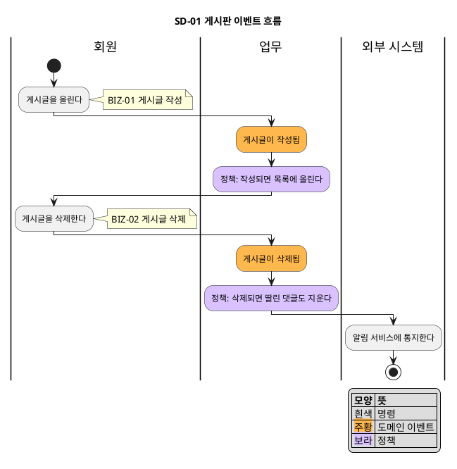
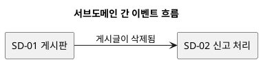

# 이벤트 다이어그램

`event-storming`이 서브도메인 후보마다 하나, 서브도메인 간 하나를 PlantUML로 쓰고 직접 렌더한다. 다이어그램은 `requirements.md`의 이벤트 흐름 표를 그림으로 옮긴 것이며, 표가 정본이다. 그림에 표에 없는 단계를 더하지 않는다.

## 파일

- 위치는 `docs/specs/<plan-set-id>/diagrams/events/`다. 서브도메인 후보마다 `SD-xx.events.puml`, 서브도메인 간 이벤트는 `cross-subdomain.events.puml`이고 같은 basename의 `.svg`를 렌더한다.
- `.puml`이 유일한 편집 원본이다. `.svg`를 직접 고치지 않는다.
- 제목, 행위자, 이벤트, 정책 같은 설명 텍스트는 한글로 쓰고 ID와 PlantUML 키워드는 원형을 유지한다. 원본 첫 줄 주석에 포함한 `SD`·`BIZ` ID를 적는다.
- `requirements.md`의 `## 4`에 `.puml`과 `.svg`를 모두 상대 경로 Markdown 링크로 건다. 링크 모양은 [템플릿](../../requirements-fix/references/template.md)을 따른다.
- 외부 URL이나 워크스페이스 밖을 가리키는 `!include`는 쓰지 않는다.

## 서브도메인 후보별 다이어그램

행위자별 swimlane 활동 다이어그램이다. 레인은 그 서브도메인 `BIZ`의 행위자, 이벤트와 정책이 놓이는 `업무`, 사용한 외부 시스템 순으로 둔다. 표의 순서대로 `명령 → 도메인 이벤트 → 정책`을 잇고, `BIZ`의 첫 명령에 그 `BIZ` 이름을 노트로 붙인다. 명령은 기본색, 이벤트는 주황 `#FFB84D`, 정책은 보라 `#D9C2FF`로 칠한다.

## 서브도메인 간 다이어그램

`## 4` 표의 이벤트만 그린다. 서브도메인은 사각형, 이벤트는 발생 쪽에서 받는 쪽으로 가는 화살표이며 라벨이 이벤트 이름이다.

## 렌더

1. Java와 Graphviz가 필요하다. PlantUML jar는 `${XDG_CACHE_HOME:-~/.cache}/harness-codex/plantuml/plantuml-1.2024.7.jar`에 둔다. 없으면 `node .harness/tools/plantuml-bootstrap.mjs`가 고정 버전을 받아 해시를 검증하고 경로를 출력한다.
2. 파일마다 `node .harness/tools/plantuml-render.mjs --workspace <workspace_root> --jar <jar> <파일>.puml`을 실행한다. 같은 위치에 `.svg`가 생긴다.
3. 종료 코드가 0이 아니면 그 다이어그램은 실패다. 문법 오류는 오류 그림이 든 `.svg`를 남기므로 지우고, 메시지가 가리키는 행의 `.puml`을 고쳐 다시 렌더한다.
4. Java, Graphviz, jar를 쓸 수 없거나 받을 수 없으면 `blocked` / `ENVIRONMENT_UNAVAILABLE`로 렌더러의 메시지를 반환한다. `.svg`가 없거나 비었거나 렌더가 실패한 채로 완료하지 않는다.
