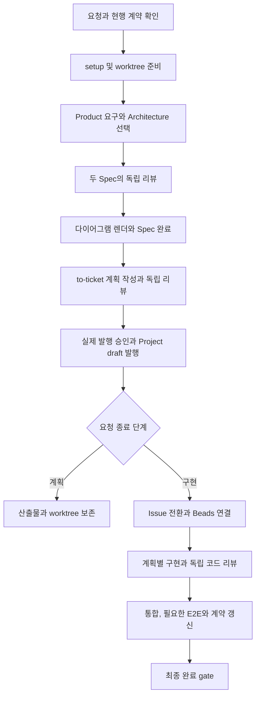

# Spec부터 구현 종료까지의 workflow

실행자가 읽는 공통 경로는 [workflow 지도](../../.codex/internal-skills/skill-execution/references/workflow-map.md)다. 이 문서는 source 유지보수자가 정본과 검사 경계를 찾기 위한 안내다.

작업 위치와 stage는 `<workspace>/.io/worktree.json`과 `runtime/orchestrator/`의 정본을 사용한다. `workflow-compose`가 생성·재사용을 담당하며, `spec-me`와 `to-ticket`은 같은 worktree를 유지한다. 정상 완료·실패·중단 후에도 worktree를 보존하고 명시적 사용자 요청에만 삭제한다. stage result와 리뷰 기록, 발행 journal은 `.io` 아래에 남는다. tracker 상태와 실행 상태는 서로 다른 정본이다.

`spec-me`의 reviewer는 Product·Architecture Spec만, 계획 reviewer는 두 Spec·계획 index·전체 split plan만 검토한다. 본문 변경은 stale로 처리하고 계획의 lifecycle status 변경과 외부 링크 대상 변경은 해당 리뷰를 무효화하지 않는다. 코드 구현은 독립 Spec·Standards 리뷰를 받는다. 의미적 요구 충족은 reviewer가 판단하고 해시는 문서 현재성만 확인한다.

질문별 기존 답변과 위임을 재사용하고 독립 질문을 묶는다. 기술 선택은 필요할 때만 내부 GUIDE를 읽고 일반 출처를 인용한다. 사용자 발행 승인, 독립 리뷰, 프로세스 중복 방지와 실행 전제는 생략하지 않는다. 같은 provider/session을 재개하고 process가 살아 있으면 새 실행을 만들지 않는다. 리뷰·gate·발행 실패는 해당 정본을 보존하고 소유 단계로 돌려보낸다.

Spec·계획 단계는 통합 계약을 읽기만 하며 최종 구현에서 갱신한다. 구현의 테스트·리뷰와 완료 gate는 각 소유 GUIDE와 [enforcement](enforcement.md)를 따른다. 프로젝트 runtime 설정은 [EXEC](../agents/EXEC.md)에 둔다.
