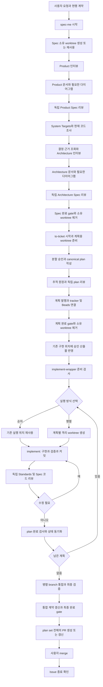
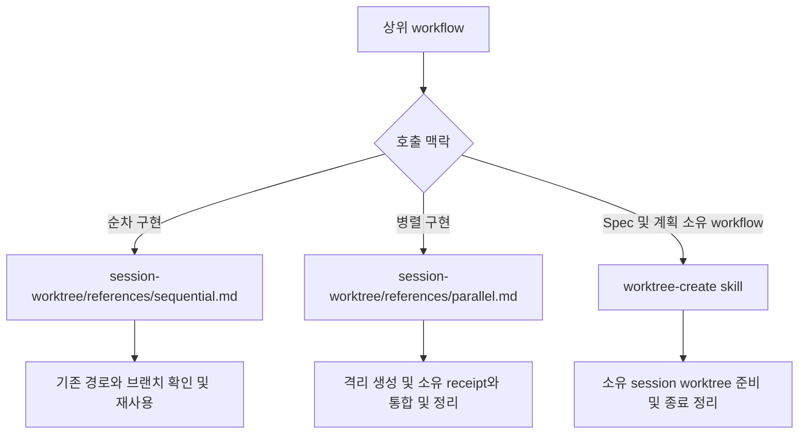
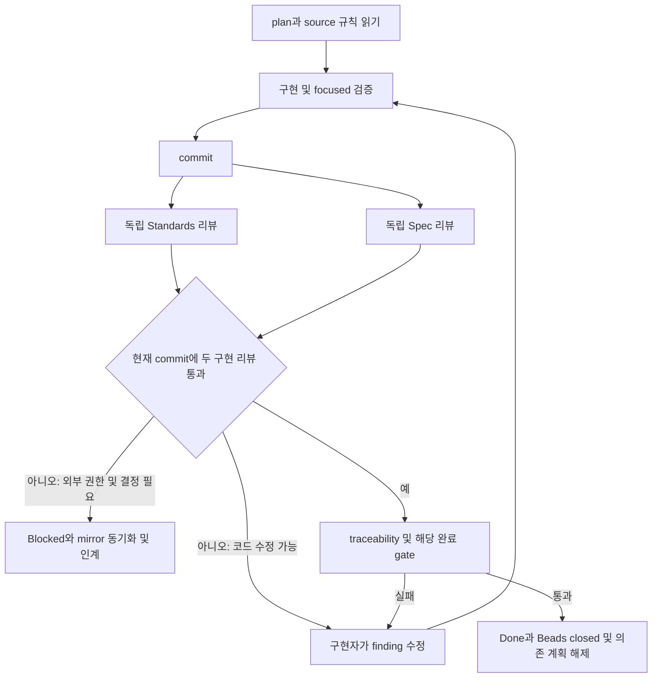
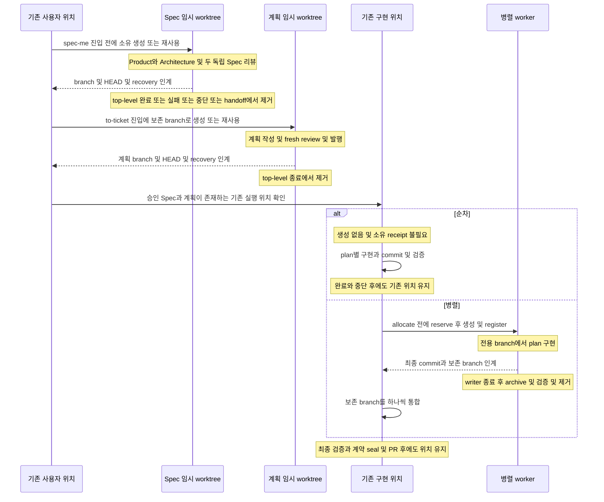
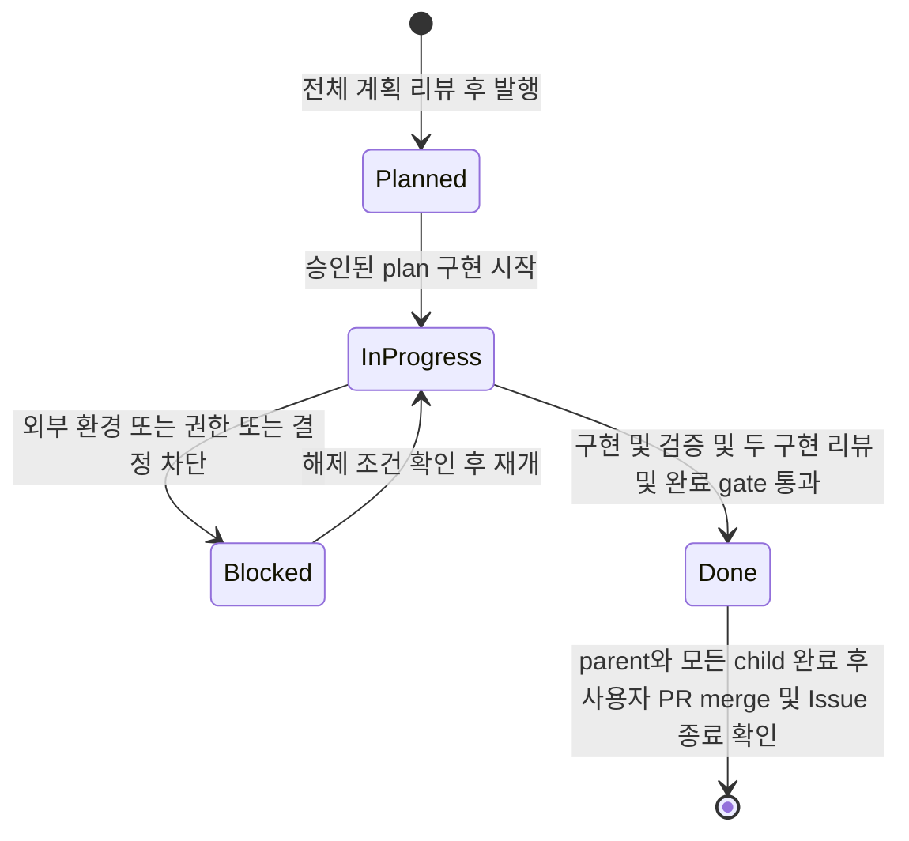

# Spec부터 구현 종료까지의 workflow

기준: 2026-10-23 현재 작업 트리의 스킬·reference·workflow manifest·runtime source. 아래는 지침상 절차와 코드로 강제하는 동작을 구분한 조사 문서다.

## 전체 흐름



## 실행 방식별 읽기 분기



각 구현 슬롯은 선택한 reference 하나만 읽고, `workspace_mode`와 절대 `workspace_reference`를 구현·리뷰·검증 단계에 전달한다. 두 모드를 모두 읽거나 소유 receipt로 모드를 추론하지 않는다.

## 경로와 상태의 의미

| 기호·값 | 의미 | 결정·저장 근거 |
|---|---|---|
| `U` | 사용자가 처음 작업하던 기존 프로젝트 위치 | 현재 요청과 실제 Git root |
| `S` | `spec-me`가 소유하는 임시 worktree | `createWorkflowWorktree` 반환값 |
| `P` | `to-ticket`이 소유하는 임시 worktree | 보존한 Spec branch를 다시 checkout한 경로 |
| `E` | 순차 구현 위치이자 병렬 구현의 최종 통합 위치 | 각 plan의 `workspace_root`·`workspace_branch`, index의 같은 값 |
| `W_i` | 병렬 계획 하나의 격리 worker worktree | `WorktreeManager.allocate` 반환값 |
| `shared_guidance_root` | 구현·테스트 지침의 원래 프로젝트 위치 | 상위가 전달한 절대 경로. managed workflow에서는 `return_root` |
| `session_directory(X)` | 경로 X의 로컬 로그·증거·복구 저장소 | `harness-session-output.mjs --root X` 결과 |
| `review_fixed_point` | 구현 시작 직전 HEAD. 수정 리뷰에서도 유지 | 구현자가 한 번 캡처하고 checkpoint에 보존 |
| `workspace_mode` | 구현 슬롯의 `sequential` 또는 `parallel` | wrapper의 의존성·공유 자원 판단 |
| `workspace_reference` | 선택한 방식의 reference 절대 경로 | wrapper가 생성한 prompt와 하위 인계 |

`session_directory`는 대화 ID가 아니다. Git 프로젝트에서는 Git common directory 아래 `harness-workflows/sessions/<sha256(절대 workspace 경로)>/`다. linked worktree를 제거해도 로그·복구 자료는 남는다. 비 Git 위치의 fallback은 `<root>/.codex/sessions/<hash>/`다.

`return_root`도 현재 구현 위치와 자동으로 같지 않다. 현재 `createWorkflowWorktree` 코드는 Git의 primary worktree를 골라 반환한다. 사용자가 시작한 linked worktree와 다를 수 있으므로 구현 위치는 plan의 경로·브랜치를 별도로 검증해야 한다.

### 서로 다른 상태 저장소

| 종류 | 저장 위치 | 의미 |
|---|---|---|
| 선택 tracker 상태 | GitHub Project의 설정된 `Workflow Status`, 또는 local-markdown ticket frontmatter | `Planned`, `In Progress`, `Blocked`, `Done` 또는 대응 소문자 상태 |
| Beads mirror | 같은 Git common directory를 공유하는 Beads workspace | `open`, `in_progress`, `blocked`, `closed` |
| 실행 조율 상태 | `session_directory/runtime/plans/<id>/checkpoint.md`, `events.jsonl` | `running`, `handoff-required`, `conflict-paused`, `priority-routed` 등. tracker 상태와 별개 |
| worktree 소유 상태 | 해당 session의 `receipt.json` | `allocating`, `active`, `archived`, `removed`. 생성·정리 대상 식별 |
| workflow 완료 상태 | `runtime/workflow-completion/<workflow>-<base>.jsonl`와 CLI 출력 | gate의 `completed` 또는 `in-progress`와 `completion_kind` |
| 검증 결과 | `runtime/execution/<profile>-<uuid>/receipt.json` | `passed`, `failed`, `blocked`, `interrupted` |
| Spec 리뷰 | `runtime/spec-reviews/`의 caller가 정한 JSON | axis, reviewer ID, hash snapshot, verdict, findings |
| 계획 리뷰 | `docs/plans/<set>/traceability.json`의 `review` | 전체 계획과 입력의 독립 리뷰 snapshot |

`architecture-reviews/session.json`은 일부 작업이 남긴 설계 검토 상태 파일이며 실행 위치의 정본이 아니다. runtime의 설계 리뷰 이력은 `runtime/decision-review/<session-id>/events.jsonl`에도 기록된다. plan은 이 파일의 `session_worktree` 대신 자신의 `workspace_root`·`workspace_branch`를 사용한다.

## 1. 진입 준비와 공통 입력

| 항목 | 읽거나 받는 내용 | 출력·변경 |
|---|---|---|
| 사용자 입력 | 요청 원문, 확정 답변, 범위, 권한, 지정 작업 위치 | 후속 request.md의 근거 |
| 프로젝트 설정 | `.codex/harness.yaml` | tracker mode, agent model/effort, Project·assignee 설정 해석 |
| 현행 업무 계약 | `docs/contracts/product.md`, `architecture.md`, `manifest.json`, 연결 diagram | 읽기 전용 baseline. Spec·계획 단계에서 seal하지 않음 |
| 용어·모델 | `CONTEXT.md`, `CONTEXT-MAP.md`, `docs/architecture/domain-model.md`, 관련 ADR·constraints | 현재 구현 사실과 승인 target 구분 |
| 공용 사용자 지침 | 원래 프로젝트의 `docs/agents/implementation-guidance.md`, `testing-guidance.md` | 명시적인 재사용 선호가 생긴 경우에만 provenance와 함께 갱신 |
| 실행 계약 | 활성 root의 `docs/agents/EXEC.md`, `execution.json` | 필요한 profile·설정·readiness 누락을 복구하거나 시작 차단 |
| runtime 미설치·필수 설정 누락 | `setup/SKILL.md` | 설치·설정·기본 문서 준비 후 재검사. 추정한 model이나 직접 실행으로 우회하지 않음 |

공개 스킬은 원본 저장소에서 `.codex/skills/<name>/SKILL.md`, 설치된 프로젝트에서 `.agents/skills/<name>/SKILL.md`다. 내부 스킬은 양쪽 모두 `.codex/internal-skills/<name>/GUIDE.md`다. 이 문서의 파일 목록은 원본 경로를 사용한다.

## 2. spec-me: Product·Architecture Spec

실행 선언: `.codex/workflows/spec-me.yaml`. 상위는 `agents.high_performance_model`·`high_performance_reasoning_effort`를 해석한다. writer·diagram·code researcher는 선언된 경량 모델, fresh Spec reviewer는 고성능 모델을 실제 ID로 전달받는다.

| 순서 | 실행 스킬·역할 | 필수 입력·읽는 파일 | 출력·생성 파일 | 상태·gate·worktree |
|---|---|---|---|---|
| S1 | `spec-me` → `worktree-create` | `source_workspace`, create CLI 결과, 생성 worktree preflight | 절대 `S`, branch, HEAD, `return_root`, session_directory, 자동 발급 `worktree_id` | 생성 CLI와 preflight CLI를 workflow 진입에서 실행 |
| S2 | `product-spec` → `grill-with-docs` | 사용자 요청·확정 답변, 현행 Product 계약·용어·Context map, Product topics/template, how-to-grill, language-lifecycle | topic별 `SETTLED/PARTIAL/UNRESOLVED/NOT_APPLICABLE`, 확정 Product 결정 | material 미확정이면 한 질문씩 사용자 응답 대기. Product는 source/test 직접 조사 금지 |
| S3 | `spec_document_writer` | 확정 Product 결정, ticket ID, template, 다이어그램 inventory, `S` | caller가 보존한 request.md를 입력받아 `docs/specs/<ticket>/product-spec.md` 작성 | writer는 새 요구·결정 생성 금지. 산출물이 S 안인지 확인 |
| S4 | Product Spec coverage gate | request.md, Product Spec·topics/template·용어·현행 계약, 정확한 S/cwd | coverage 판정과 source/hash evidence | 누락·요구 충돌은 작성 단계에서 해결. 독립 Product review는 수행하지 않음 |
| S6 | `define-system-targets` | Product coverage gate 통과, interaction/workload/state/consistency/availability/growth와 관련 NFR 답변 | `docs/specs/<ticket>/system-targets.yaml` | `system_targets_complete`. 알려진 값 resolved, 모르는 값은 근거와 unresolved. 무관한 그룹은 비움 |
| S7 | `code_researcher` → `code-research` | Product, 현행 모델·ADR·source/callers/tests·실행 계약, 조사 commit | 현재 owner·상태·규칙·통신·배포·구현 gap 보고서 | source 사실 조사만. 미래 설계 선택을 대신 확정하지 않음 |
| S8 | `spec-me/references/decision-knowledge.md` | 결정 질문·targets·baseline, 승인된 Principle/Evidence registry | 질문별 충분/부분/없음 판정, 재사용할 근거 ID, 부족분 | 부족한 질문만 knowledge-harvest. 승인 대기·불충분이면 해당 결정 보류 |
| S9 | `architecture-spec` → `grill-with-docs` | Product·targets·baseline·ADR·Architecture topics/template·model-continuity | 확정 설계·owner·실패/통신/배포/실행 계약 | 필요 시 event-storming → ddd-design → codebase-design. material topic 미확정이면 계속 인터뷰 |
| S10 | `spec_document_writer`, 조건부 `architecture-review` | 확정 설계·template·결정 근거·S | `architecture-spec.md`; opt-in Decision·ReviewRecord·자료 사용 승인 artifact | Learning은 사용자 방어·근거 심사. Normal은 그 challenge loop만 생략. 두 모드 모두 decision gate와 fresh Spec 리뷰 적용 |
| S11 | Architecture Spec 확정 | 승인 결정과 최종 Architecture Spec | Architecture Spec 및 그림 inventory | 리뷰 가능한 문서 상태로 고정. 이 단계에서는 그림을 생성하지 않음 |
| S12 | 서로 다른 fresh Architecture reviewer → `spec-review` | 현재 request·Product·Architecture·source/ADR baseline·계약 | Architecture axis JSON과 현재 hash snapshot | DDD 분류, 규칙 owner, 비즈니스 로직 단위 테스트 명세, 근거 연결, 필수 인프라 완전성을 검토. Normal에서도 필수 |
| S13 | `diagram_creator` → `plantuml-diagrams` | Architecture review를 통과한 최종 Product·Architecture Spec과 inventory | 적용 가능한 `diagrams/product/**`·`diagrams/architecture/**`의 PlantUML·SVG·Markdown 링크 | 두 Spec을 확정한 뒤 한 번 생성. 렌더·링크·내용 일치 gate 통과 후 완료 |
| S14 | `spec-me` 완료 | coverage·최종 그림·Architecture review, 시작 base SHA, completion state | `spec_ready_for_planning` receipt, 보존 branch/HEAD/recovery_path/return_root 인계 | 공통 완료 gate 뒤 S archive·검증·제거. 기능 구현 완료가 아님. to-ticket을 권고하며 자동 구현하지 않음 |

### Spec 조건부 작업

- `domain-modeling`: 확정 canonical 용어는 `CONTEXT.md`, bounded-context 이름·관계는 `CONTEXT-MAP.md`에 기록한다. Spec 전용 임시 표현은 ticket 문서에 둔다.
- `implementation-guidance`·`testing-guidance`: 사용자 명시 선호만 원래 프로젝트의 공용 문서에 기록한다. S 안의 사본을 정본으로 수정하지 않는다.
- ADR: 보존할 가치가 있는 되돌리기 어려운 결정만 작성한다. 정해진 모든 결정에 ADR 파일을 강제하지 않는다.
- opt-in `decision_layer_version: 1`: `architecture-decisions/<id>.yaml`, `architecture-reviews/<id>.yaml`, `architecture-reviews/material-approvals/<id>.yaml`를 ticket 디렉터리에 기록한다. 기존 legacy artifact를 자동 migration하지 않는다.
- `knowledge-harvest`: discover → qualify → collect → extract → corroboration → countersearch → synthesis → review → humanapprove → publish. Source/Claim, candidate/reviewed/approved Principle 및 Evidence의 사용자 승인을 구분한다. 최종 registry는 `knowledge/sources/`, `claims/`, `principles/`, `evidence/`; 임시 Evidence는 session의 `runtime/knowledge/evidence/`에 둔다.
- 기존 plan set의 Spec을 바꾸면 `harness-plan-traceability.mjs impact`로 영향 계획을 확인하고 fresh plan review 전 dispatch를 차단한다.
- Spec reviewer는 각 axis마다 새 agent이며 수정본도 새 reviewer를 사용한다. 같은 범위 최대 2회 보정 뒤 중대 쟁점이 남으면 blocked 인계한다.

## 3. to-ticket: 승인 Spec을 실행 계획으로 전환

실행 선언: `.codex/workflows/to-ticket.yaml`. 상위/작성자는 `agents.high_performance_model`·effort를 사용한다. Spec의 보존 branch·review evidence를 입력받으며, Spec 완료가 계획 작성 승인·계획 발행 완료를 뜻하지 않는다.

| 순서 | 스킬·역할 | 입력·읽는 파일 | 출력·생성 파일 | 상태·gate·worktree |
|---|---|---|---|---|
| P1 | `to-ticket` → `worktree-create` | 보존 Spec branch·HEAD·recovery·return_root, 현재 Git 상태 | 절대 P와 계획 session 출력 위치 | 관리형 spec-me 실행은 기존 worktree를 이어가고, 직접 진입은 생성 skill을 사용 |
| P2 | Spec review 검사·`code-research` | 현재 Product/Architecture·원문·그림·review snapshot, 조사 baseline | 현재 코드 대비 구현 slice 후보 | P에서 `--defer-tracker-sync` preflight. 리뷰 전 GitHub 조회를 미룸. 실패하면 하위 단계 시작 금지 |
| P3 | 계획 분할과 사용자 승인 | Smart Zone, vertical slice, 의존성·공유 자원, testing-guidance, verification-policy | 승인된 계획 집합·검증/E2E disposition | 사용자 승인 전 canonical plan·tracker mutation 금지 |
| P4 | `beads` | CLI/workspace 확인, 기존 `harness_plan_id` 목록 | parent epic·child Beads task, scope·AC·test contract·dependencies | GitHub mode parent는 epic. 아직 external_ref·v1 lifecycle marker를 붙이지 않음. 별도 DB 초기화 금지 |
| P5 | `to-ticket` | 승인 Spec과 분할 결정, execution-evidence·issue-template·traceability-ledger | `docs/plans/<set>/<plan>.md`, `plans.md`, `traceability.json` v2; session의 drafts | 각 plan 범위 첫 두 항목에 `workspace_root`, `workspace_branch`; index에도 같은 실행 위치. 구현 대상 E는 종료할 planning 경로 P와 구분 |
| P6 | 독립 `plan_reviewer` → `plan-review` | 요청 원문·두 Spec·결정·그림·모든 canonical plan·추적 원장·정확한 root | reviewer JSON, traceability의 `review` snapshot·findings | 작성 맥락 없는 fresh reviewer. requirement·반례·handoff·실행 위치 검토. major 수정은 새 reviewer. 계획·index·Spec current-input gate |
| P7 | GitHub batch publish 또는 local-markdown 발행 | 전체 로컬 계획과 최신 리뷰 pass, 렌더된 초안 | GitHub parent/child Issue·관계·Project membership·Planned, 또는 local ticket planned | 이 단계 전 GitHub Issue/Project API 조회·변경 금지. GitHub 초안·응답은 `runtime/to-ticket/`에 보존 |
| P8 | Beads mirror 연결 | 실제 parent/child Issue URL·번호·상태 | `external_ref`, `harness_tracker_version=1`, classification=committed, phase=planning | canonical content 재작성 없이 index의 실제 Issue 링크 채움. 완료 tracker_sync는 전체 plan set batch 조회 |
| P9 | 계획 완료 | 시작 SHA, 현재 Spec reviews·계획 리뷰·index·추적 원장·tracker refs | `plan_set_ready_for_implementation` receipt, 계획 branch·HEAD·recovery 인계 | 정상 완료·실패·취소·handoff에서 owned P 정리. 대기는 P 유지. 계획 PR은 이 경로에서 만들지 않음 |
| P10 | 기존 구현 위치로 인계 | canonical plan의 E/branch, 보존 Spec·계획 branch/HEAD | E에 승인 산출물이 존재하는 상태 | 서로 다른 branch이면 통합이 필요함을 인계. 반영 전 dispatch 차단. 이를 위해 순차 구현 worktree를 새로 만들지 않음 |

### 계획의 실행 위치 예시

```markdown
## 범위

- workspace_root: `/absolute/existing/project-worktree`
- workspace_branch: `existing-implementation-branch`
- 해당 vertical slice의 업무 범위
```

이 값은 순차에서는 실제 구현 위치, 병렬에서는 최종 통합 위치다. 병렬 worker의 임시 경로·branch는 배정 뒤 checkpoint에 기록한다. GitHub structured-source에는 새로운 key를 넣지 않고 기존 `scope` 문자열에 두 항목을 담아 Issue renderer가 보존한다. 값 누락·충돌·변경은 계획 보완과 fresh review 대상이다.

## 4. implement-wrapper: 실행 위치와 방식 선택

실행 선언: `.codex/workflows/implement-wrapper.yaml`. wrapper는 scheduling·dispatch·handoff·conflict routing을 맡고 각 plan의 구현·수정은 fresh `implementation_agent`에 맡긴다.

| 순서 | 수행·읽는 파일 | 입력 | 출력·변경 | 차단 조건 |
|---|---|---|---|---|
| W1 | wrapper와 setup의 구현 준비 복구 | E, `.codex/harness.yaml`, EXEC/execution.json, 현행 계약 | `--for-implementation` preflight의 실제 pass | tracker 전환·fixed point·분기·코드 수정·spawn 전에 준비. source snapshot drift만 deferred, 구조·실행 준비 오류는 차단 |
| W2 | plan index·canonical body·traceability·선택 tracker | 승인·상태·dependencies·resources·현재 review hashes | ready/waiting plans, parallel groups, slot과 선택 사유 | tracker 조회 실패는 unknown. Planned만으로 승인으로 간주하지 않음 |
| W3 | `실행 방식 선택` 분기 | 자원 충돌·불확실성·실제 동시 실행 필요 | sequential 또는 parallel, 선택 reference 절대 경로 | 독립 reviewer 두 개를 동시에 띄운다고 병렬 구현으로 바꾸지 않음 |
| W4-S | `session-worktree/references/sequential.md`만 읽음 | plan/index의 E·branch | 같은 E, owned=false, 기존 branch | 생성·reserve/register·소유 receipt 요구 없음. root/branch 불일치면 중단 |
| W4-P | `session-worktree/references/parallel.md`만 읽음 | 기존 E·branch, parallel group·고정 base | W_i와 전용 branch·소유 receipt | 배정된 group/base/branch/root/등록을 검증한 뒤 dispatch |
| W5 | Beads parent 관리·dispatch gate | 실행 가능한 child, 정확한 tracker mirror | parent epic in_progress; workspace·tracker·준비·permission gate 결과 | parent만 먼저 실행 중으로 조정. child의 실행 상태 변경 주체는 아래 불일치 항목 참조 |
| W6 | `buildImplementPrompt` → fresh 구현 agent | 모델/effort, 정확한 plan·Spec·checkpoint·의존성·자원·retirement | agent 한 개에 plan 한 개, 명시 cwd·workspace_root·mode/reference | stale/missing plan review면 실제 spawn 금지. 모델이 없으면 setup |
| W7 | checkpoint 및 Smart Zone | 실제 Git/test 상태·이전 실패·남은 맥락 | 같은 plan 재시도용 fresh agent 또는 다음 plan용 fresh agent | plan 간 agent 재사용 금지. context 한도 자체는 tracker Blocked 사유가 아님 |

필수 dispatch 입력은 repository, 절대 workspace_root/cwd, plan_set_id/plan_id, canonical plan reference, Product/Architecture 경로, traceability refs, shared_guidance_root, session_directory, workspace_mode/reference, 고정점, checkpoint, dependency/resource facts, model/effort다. 병렬 worker에는 별도 workspace_branch와 group/base가 들어간다. 제거 대상으로 승인된 경로는 runtime `retirement.removed_paths`와 reason으로 전달한다.

현재 prompt builder는 전달된 방식에 맞는 reference 한 개의 절대 경로를 넣고, 다른 방식이나 worktree-creation 절차를 추가 로드하지 말라고 명시한다. 순차·병렬 결정은 runtime의 scheduling 결과에서 전달된다.

## 5. implement: plan 한 개의 구현·검증·리뷰 반복

사용 파일: `.codex/internal-skills/implement/GUIDE.md`, `.codex/agents/implementation_agent.toml`. 시작 전에 설치된 Ponytail plugin의 `ponytail` full 지침을 적용한다.

| 순서 | 스킬·역할 | 읽는 입력 | 생성·변경 출력 | 상태·위치 |
|---|---|---|---|---|
| I1 | 구현 agent 시작 | 해당 plan·원문 requirement·두 Spec·원장·checkpoint·선택 reference·실제 root/branch | 검증된 root/branch와 시작 HEAD | workspace 불일치면 파일 수정 전 중단. 선택한 방식 하나만 적용 |
| I2 | tracker lifecycle 시작 | 승인된 plan, 선택 tracker와 exact external_ref | child In Progress/in-progress와 Beads in_progress | v1은 공통 tracker sync 사용. 기존 legacy는 자동 migration하지 않음 |
| I3 | 지침·모델 확인 | 원래 shared root의 구현/테스트 지침, model-continuity, plan execution-evidence, verification-policy, source/callers/tests | 변경 범위·규칙 owner·baseline·필요 검증 | 기존 owner 확장 우선. 승인 범위를 넘는 설계·계획 결정은 중단·상위 인계 |
| I4 | 최소 구현·필요한 focused test | 승인 UC/BR/INV·AC·검증 사례 | application source/test/config/fixtures, 영향받는 실행 profile·EXEC | 순차 E 또는 병렬 W_i에서만 변경. 실제 소비자·구형 경로 이전 포함 |
| I5 | harness-exec, 필요 시 e2e-test | profile, 정확한 args/env/config 준비·검증·readiness | 실행 log·receipt, requirement별 검증 근거 | 기본 focused unit/integration/contract. E2E는 승인된 필요 조건일 때만 |
| I6 | 구현 커밋 | 범위 내 diff와 검증 결과 | 구현 commit와 commit list | 해당 실행 branch에 커밋. 개별 plan PR 금지 |
| I7 | code-review의 fresh Standards·Spec reviewer | 같은 review_fixed_point부터 최신 HEAD까지 diff·commit list, plan·Spec·evidence | 두 독립 axis 보고서와 실제 reviewer/context IDs | 하나라도 누락·stale·blocking이면 완료 금지 |
| I8 | 구현 agent의 리뷰 수정 반복 | 각 finding·두 Spec·현재 source·focused 검증 근거 | bounded 수정·재검증·추가 commit·두 리뷰 재실행 | 같은 fixed point 유지. code-review 자체가 자동 수정하는 것은 아님 |
| I9 | completion traceability·retirement·tracker 검사 | 실제 source/test hashes·선택 profile 성공 receipt·최신 두 리뷰 | 원장의 requirement별 implementation evidence와 완료 판정 | 누락·실패면 Done 금지. 기존 checkpoint나 과거 pass로 대체 금지 |
| I10 | plan terminal 상태 및 dependent 재계산 | 모든 해당 gate 통과 | Project Done/local completed, Beads closed, 다음 실행 가능 계획 | GitHub child Issue 자체는 OPEN 유지. 최종 상태 변경 주체의 문서 충돌은 별도 기록 |
| I11 | 방식별 종료·다음 plan | 결과·branch·commit·checkpoint | 순차는 E 유지. 병렬은 소유 W_i 정리와 branch 보존 | 다음 계획은 새 empty-context 구현 agent. cleanup 실패면 완료 실패 |

### 리뷰·수정·중단



리뷰 수정이 다음 한 작업으로 맥락 한도를 넘으면 fixed point·최신 commit·두 보고서·미해결 finding·Spec 경로·검증 증거·다음 행동을 checkpoint에 남기고 같은 plan을 새 agent에 넘긴다. 실제 blocker가 없으면 tracker는 In Progress를 유지한다. 외부 환경·권한·의존성·새 결정이 필요하면 Blocked로 기록하고 해제 조건을 남긴다.

## 6. code-review와 E2E의 별도 경계

### code-review

- 진입 파일: `.codex/skills/code-review/SKILL.md`. 선언: `.codex/workflows/code-review.yaml`.
- Standards는 Product Spec·plan·수용 조건을 읽는다. `.codex/repository-conventions.md`가 있으면 사용하고 없으면 `code-review/references/default-rules.md`를 읽는다. 관련 constraints·ADR·source/test도 확인한다.
- Spec은 Architecture Spec·현재 모델·ADR·변경 source/callers/tests를 읽고 `ddd-design/references/model-continuity.md`, `to-ticket/references/execution-evidence.md`를 적용한다.
- 두 reviewer는 별도 fresh/read-only agent다. 같은 agent에 이름만 두 개 붙이지 않는다. 구현 모델 ID를 실제로 해석해 전달하고 reviewer profile의 medium reasoning을 유지한다.
- 출력은 fixed point, Standards findings/summary, Spec findings/summary, 미해결 blocker다. 보고서 파일명은 caller가 정해 session 아래 저장하며 스킬이 고정 파일명을 강제하지 않는다.
- 리뷰 스킬은 자동 수정·자동 재실행·Issue 종료를 하지 않는다. 상위 implement가 수정·재검증·재커밋·재리뷰 반복을 소유한다.
- reviewer 두 개의 동시 실행은 worktree를 만드는 병렬 구현과 별개다. 상위 workspace_mode/reference를 유지한다.

### e2e-test

| 순서 | 읽는 파일·입력 | 생성·출력·정리 |
|---|---|---|
| E1 | `e2e-test/SKILL.md`, `references/verification-policy.md` | 명시 E2E 요청 또는 저비용 검사로 확인할 수 없는 승인 critical 경계인지 판단. UI 변경만으로 강제하지 않음 |
| E2 | 승인 scenario/oracle/profile/timeout/남은 budget, `execution_model`·effort | fresh `e2e_test_runner`에 같은 root/cwd/mode/reference 전달 |
| E3 | shared testing-guidance, 활성 EXEC/execution.json, 관련 verification map, `references/failure-learning.md`, 기존 e2e-lessons | 실제 root preflight. 준비 누락이면 서버·인프라 시작 전 차단 |
| E4 | `scripts/artifact-guard.mjs snapshot` | `runtime/e2e/<run_id>/artifacts.json`에 실행 전 untracked/ignored inventory |
| E5 | infra·server·E2E harness-exec profile | foreground tool session/PID, profile별 log·receipt, URL·trace·스크린샷·시나리오 관측값 |
| E6 | 성공·실패·timeout·시작 실패 모두 finally | 이 run이 시작한 process만 종료 → artifact-guard cleanup → 전부터 있던 파일 보존·새 산출물 제거 확인 |
| E7 | 실패 원본·원인 가설·재현 및 예방 조치 | caller에게 `tests.e2e_failures` 입력 반환. caller가 checkpoint·lesson·guidance를 갱신. 과거 실패를 성공 요약으로 지우지 않음 |

Runner는 source/test 편집, git add/commit/push/merge를 하지 않는다. artifact cleanup을 증명하지 못하면 inconclusive다. 시나리오 기본 시도 budget은 최초 1회와 근거를 반영한 재실행 최대 1회이며 handoff 뒤에도 공유한다. 동적 agent 응답 문구를 exact match하는 대신 계약된 상태·tool·권한·영속성·side effect를 관측한다.

## 7. 전체 통합·계약·PR·merge

| 단계 | 입력·사용 파일 | 출력·변경 | worktree·상태 시점 |
|---|---|---|---|
| F1 전체 계획 완료 확인 | 모든 plan terminal 상태·검증·최신 독립 리뷰·commit | 완료된 계획 집합 | plan 한 개 완료만으로 PR 생성 금지 |
| F2 방식별 통합 | 병렬 reference의 고정 base·보존 worker branch·기존 E/branch | `WorktreeManager.integrate`로 하나씩 merge; 순차는 이미 E에 구현됨 | worker가 쓰는 중에는 merge하지 않음. 충돌은 중단하고 branch 보존 |
| F3 통합 검증 | shared model·verification map 변경, 전체 대표 경로·해당 metrics, profile receipts | 통합 결과의 실제 근거 | 개별 plan pass만으로 통합 동작을 입증했다고 하지 않음 |
| F4 sync-contracts | `.codex/internal-skills/sync-contracts/GUIDE.md`, `references/format.md`, 실제 구현·검증·독립 의미 검토 | `docs/contracts/product.md`, `architecture.md`, 관련 `.puml/.svg`, `manifest.json`; seal로 `architecture.html` 생성 | 최종 feature 구현 완료 시에만 수정·seal. 변경 없는 계약은 실제 영향 없음 근거 필요 |
| F5 최종 완료 gate | 시작 base SHA, 전체 traceability, tests/review/evidence/retirement/tracker/contract_docs | `feature_implemented` receipt | 소유 worker만 정리. 기존 E와 그 branch를 제거하지 않음 |
| F6 gh-open-pr | `.codex/skills/gh-open-pr/SKILL.md`, 현재 head·caller가 캡처한 base·전체 parent/child·Spec/그림·검증·리뷰 | plan set 전체 PR 하나, 실제 Issue closing references, Project 연결 | head push 확인 필요. 구현 gate 완료 PR은 ready. local-markdown에서는 PR 생성하지 않음 |
| F7 사용자 최종 결정 | ready PR·검토 결과 | 사용자 merge 또는 close | 스킬은 merge/close하지 않음. PR 생성으로 Issue/Project 상태를 바꾸지 않음 |
| F8 merge 뒤 reconciliation | 실제 parent/child Issue closure와 Project 상태 | 의도한 Issue 종료 확인 또는 blocker 보고 | child Project Done은 merge 전 가능. merge 뒤 In Progress로 되돌리지 않음 |

PR summary는 로컬 `eli5/SKILL.md`의 설명 단계를 사용한다. 적용되는 그림은 head-branch-qualified SVG URL로 넣고 Product/Architecture Spec 경로를 보존한다. closing keyword는 parent와 모든 child 각각 한 줄이며, captured base가 default branch가 아니면 자동 Issue closing을 보장할 수 없다고 중단·보고한다. `to-ticket`의 정상 경로는 계획 PR을 만들지 않지만 `gh-open-pr` 자체에는 별도 plan PR 지원이 남아 있다. 그 경로는 draft이며 closing keyword를 넣지 않는다.

최종 계약 gate와 PR 생성의 정확한 앞뒤를 하나의 중앙 실행기가 자동 고정하지는 않는다. 위 표는 구현·통합·검증 완료를 먼저 확보하는 스킬의 의존 순서다. PR 승인·push·merge 권한은 현재 사용자 지시를 따른다.

## 8. worktree 생성·삭제 시점



| 경우 | 생성 | 삭제·보존 |
|---|---|---|
| spec-me 새 실행 | create가 새 UUID `worktree_id`를 발급해 S 생성 | top-level 종료에서 S 제거, branch·recovery는 보존 |
| spec-me 내부 writer·diagram·review | 별도 workflow worktree 생성 없음 | 부모 S 삭제 금지 |
| spec-me → to-ticket | S가 제거됐다면 보존 branch로 P 새 경로 생성 | source branch를 재사용하며 계획용 branch를 임의로 분기하지 않음 |
| to-ticket 정상·실패·취소·handoff | 이미 준비한 P 사용 | P 제거. 발행 완료는 기능 구현 완료가 아님 |
| 사용자 답·외부 조건 대기 | 기존 소유 경로 유지 | waiting 중 finish/cleanup 호출하지 않음 |
| 순차 구현 새 plan·재개·병합 후 | 기존 E 재사용. create/reserve/register 없음 | E·branch를 삭제·소유 등록하지 않음 |
| 병렬 계획 dispatch | manager가 W_i·전용 branch 생성 | 해당 slot 종료 시 소유 W_i만 archive 후 제거; branch는 통합용 보존 |
| code-review·E2E·계약·PR 하위 호출 | 상위 mode/root/reference 사용 | 상위 worktree cleanup 금지. 소유 검증 process와 새 test artifact만 정리 |
| cleanup 실패·Git lock·활성 writer | 추가 실행을 차단하고 원인 기록 | force로 backup 검증을 우회하지 않음. cleanup 실패는 완료 실패 |
| SIGKILL·전원 종료 | 즉시 finally 실행 불가 | 다음 진입에서 소유 receipt와 실제 실행 종료를 확인해 복구 |

### 소유 receipt와 공통 완료 코드의 실제 동작

- 소유 receipt 경로는 `session_directory/receipt.json`이다. `workspace`, 자동 생성 `worktree_id`, `branch`, `return_root`, `state`, recovery 정보를 기록한다. 호출자는 생성 전에 ID를 넣지 않는다.
- 새 session worktree 실제 경로는 `dirname(primaryRoot)/.harness-worktrees/basename(primaryRoot)/<worktree_id>`다. 새 branch는 기본 `harness/worktree/<worktree_id>`이며 보존 branch를 지정하면 그 branch를 checkout한다.
- 병렬 worker는 manager runtime namespace/group/plan별 session 출력 아래의 worktree 경로와 전용 branch를 사용한다. generic session create 경로와 동일하다고 가정하지 않는다.
- `completeWorkflow`는 gate pass뿐 아니라 오류·실패에서도 outer finally의 `finishWorkflowWorktree`를 호출한다. waiting 상태에서 이 명령을 호출하면 안 된다.
- receipt가 없으면 finish는 `not-owned`를 반환하고 위치를 보존한다. 순차 구현에 receipt를 새로 요구할 필요가 없다.
- cleanup은 전달된 workspace의 receipt와 Git worktree identity·branch를 대조한다. `worktree_id`는 생성 실행의 식별값이며 호출자가 알고 있어야 생성·정리할 수 있는 값은 아니다. `harness-workflow-complete.mjs --workflow`는 YAML 처리 절차를 고르는 별도 값이며 소유권 판단에 사용하지 않는다.
- 제거 전에 tracked/untracked/ignored 파일·staged index·HEAD/tree를 검증해 recovery에 보존한다. branch와 recovery ref는 삭제하지 않는다.

## 9. tracker·Beads·workflow 상태 변경 시점



위 마지막 화살표는 tracker Done을 기다렸다가 뒤늦게 기록하라는 뜻이 아니다. Project 상태와 GitHub Issue OPEN/CLOSED는 독립이다.

| 시점 | 선택 tracker | Beads | 기타 기록 |
|---|---|---|---|
| Spec 인터뷰·리뷰 진행 | 구현 ticket 상태를 임의 변경하지 않음 | 기존 데이터 migration 없음 | coverage·review verdict·대기 상태 |
| 분할 승인 후 Beads 준비 | GitHub 조회·발행은 아직 미룸 | 기존 harness_plan_id 재사용 또는 parent/child 생성 | 작성 중 계획과 의존성 |
| 전체 계획 리뷰 통과 후 발행 | Planned / planned | open, 발행 확인 뒤 exact external_ref와 lifecycle v1 metadata 연결 | phase=planning, classification=committed |
| ready child dispatch 준비 | parent epic의 실행 상태 관리 | parent in_progress | ready/waiting·slot·dependency 증거 |
| child 구현 시작 | In Progress / in-progress | in_progress | phase=implementation |
| 검증·리뷰 시작 | In Progress 유지 | in_progress 유지 | phase=test 또는 review. 별도 tracker 상태를 만들지 않음 |
| context Smart Zone handoff | In Progress 유지 | in_progress 유지 | orchestration handoff-required·checkpoint·새 agent |
| 공유 자원 충돌 | orchestration 상태와 구분 | 실행 사실에 맞춰 보존 | conflict-paused, 우선순위 명시 결정 후 하나만 재개 |
| 외부 환경·권한·의존성·설계 결정 차단 | Blocked / blocked | blocked | 정확한 blocker와 unblock condition |
| 모든 plan 완료 조건 통과 | Done / completed. GitHub child Issue는 OPEN | closed | dependent 즉시 재계산. merge를 기다리지 않음 |
| 모든 child Beads closed | parent 상태는 선택 tracker 계약에 따름 | parent epic closed | 전체 구현 통합·검증은 별도로 확인 |
| PR 생성·ready 전환 | Issue/Project 완료 상태를 PR 부수 효과로 바꾸지 않음 | 추가 상태 전이 없음 | PR 생성·Project 연결·closing reference 확인 |
| 사용자가 통합 PR merge | 의도한 parent/child Issue closure 확인 | 완료 상태 유지 | 잘못 닫히지 않으면 reconciliation blocker |

새 lifecycle v1 mirror는 `harness-tracker.mjs sync`가 canonical 갱신 → canonical 재조회 → exact external_ref Beads 반영 → 재조회를 담당한다. marker 없는 legacy를 자동 연결하거나 migration하지 않는다. mirror 실패 때 이미 성공한 canonical 전이를 되돌리지 않고 status 생략 sync로 현재 상태를 재반영한다. `tracker_sync`는 새 dispatch·정상 완료·종속 plan 진행을 차단할 수 있다.

## 10. workflow gate와 완료 범위

| workflow | before_dispatch | before_complete의 선언·추가 검사 | 완료 의미 |
|---|---|---|---|
| spec-me | session_worktree, tracker_sync | tracker_sync, spec_reviews | `spec_ready_for_planning` |
| to-ticket | dependency, resource_conflict, workspace, permission_preflight, spec_reviews | tracker_sync, required_outcome, evidence, plans_index, spec_reviews, plan_traceability | `plan_set_ready_for_implementation` |
| implement-wrapper | dependency, resource_conflict, workspace, tracker_sync, project_readiness, permission_preflight | tracker_sync, contract_docs, required_outcome, tests, retirement, review, evidence, plan_traceability | `feature_implemented` |
| 개별 implement | wrapper의 실제 dispatch와 implement GUIDE 적용. 별도 implement.yaml은 없음 | executeImplementPlan의 실제 검증 및 caller 경로에 의존 | completion kind 매핑에는 `plan_implemented`가 있음. CLI 사용과 manifest 존재를 별도 확인해야 함 |
| code-review | dependency, resource_conflict, workspace, tracker_sync, permission_preflight | tracker_sync, review, evidence | 독립 리뷰 결과. feature 구현 완료 아님 |
| knowledge-harvest-workflow | tracker_sync | tracker_sync | 승인된 지식 게시. 구현 완료 아님 |

`before_handoff`에는 주요 workflow의 checkpoint_completeness·evidence_flush가 있다. `after_merge`는 implement-wrapper의 tracker_reconciliation으로 선언된다. 이 hook들을 선언한 YAML이 실제 외부 merge 감시·자동 호출까지 수행한다는 뜻은 아니다.

`completeWorkflow`는 final `feature_implemented`에만 contract_docs를 필수화하고 비최종 workflow에서는 선언된 contract_docs를 필터링한다. Spec·계획 완료에는 ticket_id와 현재 spec_reviews를 전달한다. `to-ticket`은 계획 phase traceability, 구현은 completion phase traceability를 검사한다. 검사 결과를 공통 완료 journal에 기록하며 실패 상태는 completed로 보고하지 않는다.

## 11. 읽는 파일과 생성·갱신하는 파일

### 프로젝트 입력

| 파일·경로 | 읽는 단계 | 쓰는 단계·조건 |
|---|---|---|
| AGENTS.md | 모든 상위·하위 실행 | 이 workflow가 일반적으로 재작성하지 않음 |
| `.codex/harness.yaml` | 진입·계획·dispatch·검증·tracker·PR | setup이 사용자 선택으로 설정. consumer-owned 설정을 임의 덮어쓰지 않음 |
| `CONTEXT.md` | Product·Architecture·계획·구현·리뷰 | 확정된 용어와 승인된 폐기·대체 기록 |
| `CONTEXT-MAP.md` | Architecture baseline·계획·구현·리뷰 | 확정 context 이름·소유·관계 |
| `docs/architecture/domain-model.md`, constraints·관련 ADR | baseline·설계·구현·리뷰 | 승인 target과 실제 구현 사실을 구분해 영향 범위 갱신 |
| 원래 root의 implementation-guidance·testing-guidance | 인터뷰의 명시 선호 기록, 구현·검증 | 해당 guidance 내부 스킬. branch-local 사본은 정본이 아님 |
| EXEC.md·execution.json | 준비·조사·계획·검증 | 실행 전제가 바뀌는 구현 또는 준비 복구 |
| `.codex/repository-conventions.md` | Standards review | 없다면 default-rules reference 사용 |
| `docs/verification/features.md` | 해당 검증·E2E·통합 | 검증한 변경 범위만 갱신; 전체 지도 정합성은 maintain-verification |
| `docs/verification/e2e-lessons.md` | E2E 전·후 | 재사용 가능한 확인된 실패 교훈을 caller가 기록 |
| application source/callers/tests/config/fixtures | Architecture 조사·계획·구현·코드 리뷰 | 구현 scope 내 변경. Product 직접 조사 금지 |

### 최종 프로젝트 산출물

| 경로 | 생성·갱신 주체 | 주요 내용 |
|---|---|---|
| `docs/specs/<ticket>/request.md` | Spec caller | 사용자 요청 원문·확정 답변·승인. 작성자의 추론을 사용자 결정으로 바꾸지 않음 |
| `docs/specs/<ticket>/product-spec.md` | spec_document_writer | 요구·UC·BR·AC·용어·그림 링크 |
| `docs/specs/<ticket>/architecture-spec.md` | spec_document_writer | 책임·규칙 owner·경계·호출·실패·통신·배포·codebase impact |
| `docs/specs/<ticket>/system-targets.yaml` | System Targets 단계 | 특성·현행/성장/경계 목표·상태·provenance |
| `docs/specs/<ticket>/diagrams/product/*.{puml,svg}` | diagram_creator | UC/activity, 필요 시 업무 상태 |
| `docs/specs/<ticket>/diagrams/architecture/*.{puml,svg}` | diagram_creator | 적용되는 class·설계 상태 |
| `docs/specs/<ticket>/architecture-decisions/<id>.yaml` | opt-in 결정 절차 | 승인 대상 결정·근거·대안·한계·hash |
| `docs/specs/<ticket>/architecture-reviews/<id>.yaml` | 결정 검토 절차 | seven-item checklist·objection·사용자 방어·판정 |
| `docs/specs/<ticket>/architecture-reviews/material-approvals/<id>.yaml` | 명시적 사용자 자료 사용 승인 | 제시한 정확한 자료와 승인 snapshot |
| `docs/plans/<set>/<plan>.md` | to-ticket | 실행 root/branch·목적·범위·AC·반례·검증 계약·의존성 |
| `docs/plans/<set>/plans.md` | to-ticket | 실행 위치·개별 plan 링크·요약·의존성·실제 Issue URL. tracker 상태 정본 아님 |
| `docs/plans/<set>/traceability.json` | 계획 작성·리뷰와 구현 검증 | requirement inventory·소유·handoff·검증 사례·review hash·구현 evidence |
| 선택 local-markdown ticket 경로 | local tracker 발행·sync | frontmatter planned/in-progress/blocked/completed |
| `knowledge/sources/`, `claims/`, `principles/`, `evidence/` | 조건부 knowledge-harvest | 원문 기반 근거와 독립 검토·사용자 승인 |
| `docs/contracts/product.md`, `architecture.md` | 최종 sync-contracts | 통합 구현 사실과 규칙·모델·source·검증 연결 |
| `docs/contracts/diagrams/*.{puml,svg}` | 최종 diagram_creator | 현재 DDD·class·기능 sequence·state |
| `docs/contracts/manifest.json`, `architecture.html` | 최종 seal | revision·source/diagram inventory·hash·클릭 가능한 상세 보기 |
| application code/test/config/profile/fixture | plan 구현자 | 승인 범위의 제품 변경과 검증 |

### session 전용 산출물

아래 경로는 모두 해당 `session_directory` 기준이다. caller가 선택하는 파일명은 고정된 runtime 계약인 것처럼 가정하지 않는다.

| 경로 | 생성·갱신 시점 | 게시·수명 |
|---|---|---|
| `receipt.json` | 소유 worktree reserve/register/finish | 로컬 소유·복구 기록. 순차 실행 위치 선택 근거 아님 |
| `runtime/spec-reviews/` | axis별 리뷰 attempt·최종 합본 | 실제 reviewer 응답·metadata·hash. 새 P/E에서는 현재 입력으로 재검사 |
| `runtime/decision-review/<session-id>/events.jsonl` | Learning/Normal mode·자료 승인·재개·판정 | 기존 이력 보존 |
| `runtime/to-ticket/drafts/` | 발행 전 Issue 제목·본문·structured-source 작성 | 계획 리뷰 전 API 호출을 대신하는 로컬 초안 |
| `runtime/to-ticket/publish-state.json` | batch publish의 각 성공 직후 | 부분 실패 재개 시 Issue 중복 생성을 막음 |
| `runtime/plans/<plan>/events.jsonl` | checkpoint writer가 append | 조율·검증·리뷰·오류 이력. 외부 게시 금지 |
| `runtime/plans/<plan>/checkpoint.md` | journal projection | 같은 plan 재개 입력. Issue/PR/commit에 복사 금지 |
| `runtime/execution/<profile>-<uuid>/<step>.log`, `receipt.json` | harness-exec 준비·설정 검증·readiness·명령 | 현재 profile/config/source hash와 성공 결과를 연결 |
| `runtime/e2e/<run_id>/artifacts.json`와 evidence | E2E snapshot·실행·cleanup | 기존 untracked/ignored 보존 근거·screenshot·trace·cleanup 판정 |
| `runtime/tracker-sync/<hash>.jsonl` | tracker sync mutation·검증 | canonical/mirror 실패와 재시도 근거 |
| `runtime/workflow-completion/<workflow>-<base>.jsonl` | 정상 완료 호출·gate 판정 | completion kind·state·head·gate 근거 |
| `runtime/knowledge/evidence/` | Evidence stage·승인 대기·거절 | 승인·publish 전 로컬 후보 |
| `runtime/installer-backups/<id>/` | 관리 스킬 update·force 교체 | 덮어쓰기 전 로컬 사본 보존 |
| `recovery/<uuid>/files`, `index`, `receipt.json` | 소유 worktree 제거 전 | tracked/untracked/ignored·staged index·tree/HEAD 복구. 제거 뒤 유지 |
| `tmp/` 및 caller가 정한 reports 경로 | 명령·review·임시 처리 | TMPDIR/TMP/TEMP 및 browser output도 여기로 지정 |

## 12. 현재 지침과 코드 사이의 불일치·자동화 경계

이 절은 현재 조사에서 관찰한 사실이며 해결됐다고 가정하지 않는다. 도식의 이상적인 의존 순서를 곧바로 중앙 실행기의 자동 보장으로 읽으면 안 된다.

| 항목 | 서로 다른 근거 | 현재 해석·영향 |
|---|---|---|
| 실행 위치 정당성 | plan·wrapper 지침은 workspace_root/branch를 정본으로 요구. `dispatch.mjs`는 전달된 workspace 또는 executionLine을 사용 | plan 문서의 두 값을 runtime이 직접 파싱해 대조하는 검사는 아직 없음. 유효한 다른 Git root를 넘기면 root preflight만으로 사용자 지정 위치를 증명하지 못함 |
| workspace 우선순위 | `dispatch.mjs`는 workspace 문자열/객체를 executionLine보다 먼저 사용 | 호출자가 서로 다른 두 위치를 넘기는 실수는 현재 경로 선택 규칙만으로 차단되지 않음 |
| 순차·병렬 선택적 읽기 | 스킬 reference 분리 및 prompt의 mode/reference는 구현됨 | agent가 실제 선택 파일만 읽었는지 filesystem 접근 자체를 제한하는 sandbox gate는 아님. 구조·인계와 agent 준수의 경계 |
| child terminal 상태 변경 주체 | implement GUIDE는 구현자가 완료 전이를 수행. implementation_agent profile은 wrapper가 완료 상태를 변경하고 agent 직접 전이를 금지 | mutation 주체가 두 문서에서 충돌. 현재 end-to-end 자동 보장으로 주장하지 않으며 실제 caller adapter를 확인해야 함 |
| per-plan 계약 검사 | sync-contracts와 공통 completeWorkflow는 최종 feature에서만 계약 seal/check를 요구. `executeImplementPlan`은 개별 plan 완료 때 inspectContracts 호출 | 상위 지침과 일부 runtime API의 검사 시점이 다름. 개별 plan 실행에서 계약 drift가 blocker가 될 여지가 남음 |
| 하위 스킬의 통합 계약 문구 | product-spec·architecture-spec·grill·ddd 등의 일반 문구는 계약 갱신을 지시. spec-me·to-ticket·sync-contracts·AGENTS는 제안/계획 중 수정 금지 | 상위 단계 제약과 최종 전용 규칙을 따라야 함. 일반 하위 문구가 단계 금지를 없애지는 않음 |
| planning branch와 E 인계 | 계획은 source branch에 보존하고 P 제거. plan은 살아 있는 기존 E·branch 기록 | source branch의 Spec·계획이 E에 반영되지 않았다면 추가 통합이 필요. 경로 기록 자체가 merge를 수행하지 않음 |
| return_root 의미 | generic createWorkflowWorktree는 Git primaryRoot를 return_root로 선택 | 시작한 사용자 linked worktree와 다를 수 있음. E나 shared root를 basename·과거 기억으로 추측하면 안 됨 |
| 단일 implement 완료 CLI | completionKind 매핑은 implement 지원. 현재 workflows에는 implement.yaml 없음 | 매핑 존재만으로 `--workflow implement`가 정상 실행된다고 보장하지 않음. 실제 manifest/loader와 caller 경로 확인 필요 |
| 상태·리뷰 자동 실행 | YAML은 stage/role/skill/hooks를 선언하고 loader가 검증·참조를 해석 | YAML을 읽는 것만으로 질문·spawn·tracker API·merge hook이 자동 실행되는 것은 아님. caller/runtime adapter가 실제 수행해야 함 |
| PR 종료와 worktree 종료 | gh-open-pr은 사용자 merge 전 중단. worktree-creation는 단계 종료에서 worktree 제거 | 임시 경로는 PR merge까지 보존하지 않음. branch와 로컬 recovery를 보존하며 기존 E는 그대로 유지 |

### 주요 runtime 근거

- [worktree 생성·소유·복구·삭제](../../src/workflow/worktrees.mjs)
- [순차 재사용·병렬 배정·통합·cleanup](../../src/eval/plan-workspace.mjs)
- [scheduler와 모드별 prompt](../../src/wrapper/scheduler.mjs)
- [dispatch와 개별 plan 완료 검사](../../src/wrapper/dispatch.mjs)
- [완료 평가·tracker reconciliation](../../src/wrapper/reconciliation.mjs)
- [공통 workflow 완료와 finally](../../src/workflow/completion.mjs)
- [session 경로 resolver](../../src/workflow/session-output.mjs)
- [순수 workspace 검사](../../src/eval/workspace-preflight.mjs)
- [CLI workspace·tracker·준비 preflight](../../.codex/scripts/workspace-preflight-cli.mjs)
- [계획 추적·리뷰 current-input 검사](../../src/workflow/plan-traceability.mjs)
- [fresh Spec 리뷰 구조·snapshot 검사](../../src/workflow/spec-review.mjs)
- [tracker 상태·mirror mutation](../../src/tracker/lifecycle.mjs)
- [실행 profile과 receipt](../../src/workflow/execution.mjs)
- [설계 Decision artifact](../../src/decision/artifacts.mjs), [설계 리뷰 이력](../../src/decision/review.mjs)

## 13. 주요 명령과 실행 root

아래는 호출 형식이며 실제 실행 기록이 아니다. 모든 명령은 표시한 root를 명시적인 cwd로 사용한다. 실제 test/server/infra는 프로젝트 harness-exec profile로 실행한다.

| 경계 | 명령·API | cwd·추가 입력 |
|---|---|---|
| 소유 작업 worktree 준비 | `harness-workflow-worktree.mjs list/create --root <source> [--branch <보존 branch>]` | create가 `worktree_id`를 생성해 반환. 살아 있는 source/return root |
| Spec 시작 | `harness-workspace-preflight.mjs --workspace-root <S> --json` | S. linked-worktree 증거 포함 |
| 계획 시작 | `harness-workspace-preflight.mjs --workspace-root <P> --defer-tracker-sync --json` | P. 리뷰 전 tracker 조회 지연 |
| 구현 준비 | `harness-workspace-preflight.mjs --workspace-root <E> --for-implementation --json` | 기존 E. 설정·실행 준비 pass 필요 |
| Spec snapshot/check | `harness-spec-review.mjs snapshot/check --root <root> --ticket <id> ...` | 해당 artifact를 실제 읽는 root, axis·원문 inputs·현재 review JSON |
| 계획 검사 | `harness-plan-traceability.mjs snapshot/check/impact --root <root> --plan-set <id> ...` | planning/dispatch/completion에 맞는 root·phase·plan ID |
| 순차 구현 배정 | `WorktreeManager.allocate({ mode: sequential, executionLine: E })` | 기존 E를 owned=false로 반환. git worktree add 없음 |
| 병렬 구현 배정 | `WorktreeManager.allocate({ mode: parallel, fixedGroupBase, groupId, planId })` | 기존 repository와 승인된 fixed base. W_i 생성 |
| 검증 | `harness-exec.mjs --root <E 또는 W_i> --profile <id>` | 해당 구현 위치, exact argv/env/config/dependency readiness |
| 상태 mutation | `harness-tracker.mjs sync --root <root> --ticket <exact-ref> --status <state> [--phase ...]` | 현재 선택 tracker와 Beads workspace를 공유하는 root |
| 최종 계약 | `harness-contracts.mjs seal --root <E> --summary <근거>` | 모든 구현 통합 후 E. no-contract-change는 실제 무영향 근거에만 사용 |
| 공통 정상 종료 | `harness-workflow-complete.mjs --root <root> --workflow <id> --base-ref <시작 SHA> --state <session-relative JSON>` | root와 실제 완료 종류에 맞는 manifest·state. waiting 때 호출 금지 |
| 소유 작업 worktree 비정상 종료 | `harness-workflow-worktree.mjs finish --root <owned> --repository <return_root> --outcome failed/aborted/handoff` | 살아 있는 return_root. receipt를 경로로 찾아 writer 종료·backup 검증 후 제거 |
| 병렬 worker 종료 | `WorktreeManager.cleanup(handle, { evidencePersisted })` | worker 소유권·기록·branch reachability를 보존·검증 |

스크립트 명령은 `.codex/scripts/` 아래다. 소스 PlantUML renderer는 `bin/plantuml-render.mjs`, 설치 consumer는 `.codex/tools/plantuml-render.mjs`다.

## 14. 스킬·GUIDE·reference 파일 전체 목록

아래는 이 흐름의 직접·조건부 의존 파일 inventory다. **목록 전체를 매번 읽으라는 지시가 아니다.** 각 행의 조건과 상위 분기에 맞는 파일만 읽는다. `agents/openai.yaml`은 공개 스킬 UI metadata이며 실행 절차 reference가 아니다. 별도 frontend-design workflow는 이 Spec→구현 흐름의 하위 단계로 합치지 않는다.

### 공개 스킬

| 스킬·적용 시점 | 진입 파일 | reference·supporting 파일 |
|---|---|---|
| `spec-me` — Spec 진입·조율; decision-knowledge는 Architecture 대안 선택 전 | [SKILL.md](../../.codex/skills/spec-me/SKILL.md) | [references/decision-knowledge.md](../../.codex/skills/spec-me/references/decision-knowledge.md) |
| `to-ticket` — 계획 생성; 검증 계약·추적 원장·Issue 형식은 작성 전, batch-publish는 전체 리뷰 후 | [SKILL.md](../../.codex/skills/to-ticket/SKILL.md) | [references/execution-evidence.md](../../.codex/skills/to-ticket/references/execution-evidence.md)<br>[references/github-batch-publish.md](../../.codex/skills/to-ticket/references/github-batch-publish.md)<br>[references/github-issue-template.md](../../.codex/skills/to-ticket/references/github-issue-template.md)<br>[references/traceability-ledger.md](../../.codex/skills/to-ticket/references/traceability-ledger.md) |
| `implement-wrapper` — 의존성·자원 scheduling과 선택 reference 한 개 로딩 | [SKILL.md](../../.codex/skills/implement-wrapper/SKILL.md) | 별도 파일 없음 |
| `code-review` — 코드의 두 독립 axis 리뷰; default-rules는 프로젝트 conventions 부재 시 | [SKILL.md](../../.codex/skills/code-review/SKILL.md) | [references/default-rules.md](../../.codex/skills/code-review/references/default-rules.md) |
| `e2e-test` — 승인된 E2E 필요 시; 정책·실패 학습·artifact guard | [SKILL.md](../../.codex/skills/e2e-test/SKILL.md) | [references/failure-learning.md](../../.codex/skills/e2e-test/references/failure-learning.md)<br>[references/verification-policy.md](../../.codex/skills/e2e-test/references/verification-policy.md)<br>[scripts/artifact-guard.mjs](../../.codex/skills/e2e-test/scripts/artifact-guard.mjs) |
| `gh-open-pr` — 모든 plan 구현·통합·검증 뒤 단일 PR; UI metadata는 실행 중 필수 읽기 아님 | [SKILL.md](../../.codex/skills/gh-open-pr/SKILL.md) | [agents/openai.yaml](../../.codex/skills/gh-open-pr/agents/openai.yaml) |
| `knowledge-harvest` — 중요 결정 근거가 부족한 질문에만 조건부 호출 | [SKILL.md](../../.codex/skills/knowledge-harvest/SKILL.md) | 별도 파일 없음 |
| `beads` — 계획 mirror·의존성·상태 동기화 | [SKILL.md](../../.codex/skills/beads/SKILL.md) | 별도 파일 없음 |
| `setup` — 필수 model/tracker/실행 설정 누락·설치 준비 복구 시; assets는 초기화 template | [SKILL.md](../../.codex/skills/setup/SKILL.md) | [agents/openai.yaml](../../.codex/skills/setup/agents/openai.yaml)<br>[assets/CONTEXT-MAP.md](../../.codex/skills/setup/assets/CONTEXT-MAP.md)<br>[assets/CONTEXT.md](../../.codex/skills/setup/assets/CONTEXT.md) |
| `eli5` — gh-open-pr의 구현 PR summary 설명 단계 | [SKILL.md](../../.codex/skills/eli5/SKILL.md) | 별도 파일 없음 |
| `maintain-verification` — 검증 지도 전체 생성·정합성 점검을 별도 요청하거나 필요할 때 | [SKILL.md](../../.codex/skills/maintain-verification/SKILL.md) | 별도 파일 없음 |
### 내부 스킬

| 스킬·적용 시점 | 진입 파일 | reference·supporting 파일 |
|---|---|---|
| `session-worktree` — GUIDE는 분기만; sequential/parallel 중 해당 파일 하나 | [GUIDE.md](../../.codex/internal-skills/session-worktree/GUIDE.md) | [references/parallel.md](../../.codex/internal-skills/session-worktree/references/parallel.md)<br>[references/sequential.md](../../.codex/internal-skills/session-worktree/references/sequential.md) |
| `product-spec` — Product 인터뷰 전에 topics·template·언어 lifecycle | [GUIDE.md](../../.codex/internal-skills/product-spec/GUIDE.md) | [references/template.md](../../.codex/internal-skills/product-spec/references/template.md)<br>[references/topics.md](../../.codex/internal-skills/product-spec/references/topics.md) |
| `architecture-spec` — Architecture 인터뷰 전에 topics·template·현재 모델 근거 | [GUIDE.md](../../.codex/internal-skills/architecture-spec/GUIDE.md) | [references/template.md](../../.codex/internal-skills/architecture-spec/references/template.md)<br>[references/topics.md](../../.codex/internal-skills/architecture-spec/references/topics.md) |
| `grill-with-docs` — Product·Architecture 미확정 결정 질문; how-to-grill 필수 | [GUIDE.md](../../.codex/internal-skills/grill-with-docs/GUIDE.md) | [references/how-to-grill.md](../../.codex/internal-skills/grill-with-docs/references/how-to-grill.md) |
| `code-research` — domain baseline 및 계획의 현재 source 조사 | [GUIDE.md](../../.codex/internal-skills/code-research/GUIDE.md) | 별도 파일 없음 |
| `domain-modeling` — 용어·Context·ADR 정리와 언어 lifecycle | [GUIDE.md](../../.codex/internal-skills/domain-modeling/GUIDE.md) | [references/language-lifecycle.md](../../.codex/internal-skills/domain-modeling/references/language-lifecycle.md) |
| `event-storming` — actor·command·event·policy를 풀어야 할 때 | [GUIDE.md](../../.codex/internal-skills/event-storming/GUIDE.md) | 별도 파일 없음 |
| `ddd-design` — 도메인 owner·규칙·경계 설계; model-continuity 먼저 | [GUIDE.md](../../.codex/internal-skills/ddd-design/GUIDE.md) | [references/model-continuity.md](../../.codex/internal-skills/ddd-design/references/model-continuity.md) |
| `codebase-design` — 설계를 package·seam·파일·검증으로 구체화; Java일 때만 effective-java-notes | [GUIDE.md](../../.codex/internal-skills/codebase-design/GUIDE.md) | [references/effective-java-notes.md](../../.codex/internal-skills/codebase-design/references/effective-java-notes.md) |
| `architecture-review` — Learning의 사용자 설계 방어·근거 challenge에만 | [GUIDE.md](../../.codex/internal-skills/architecture-review/GUIDE.md) | 별도 파일 없음 |
| `spec-review` — Architecture Spec 전용 fresh reviewer, Normal에서도 필수 | [GUIDE.md](../../.codex/internal-skills/spec-review/GUIDE.md) | [Architecture Spec 리뷰 기준](../../.codex/internal-skills/spec-review/references/review-criteria.md) |
| `plan-review` — 전체 canonical plan과 requirement·반례·handoff의 fresh 리뷰 | [GUIDE.md](../../.codex/internal-skills/plan-review/GUIDE.md) | 별도 파일 없음 |
| `implement` — 승인 plan 하나의 구현·검증·리뷰 수정 반복 | [GUIDE.md](../../.codex/internal-skills/implement/GUIDE.md) | 별도 파일 없음 |
| `sync-contracts` — 최종 feature 통합 뒤 format reference를 읽고 계약 갱신·seal | [GUIDE.md](../../.codex/internal-skills/sync-contracts/GUIDE.md) | [references/format.md](../../.codex/internal-skills/sync-contracts/references/format.md) |
| `plantuml-diagrams` — 필요한 Spec·최종 계약 그림 생성과 로컬 SVG 렌더 | [GUIDE.md](../../.codex/internal-skills/plantuml-diagrams/GUIDE.md) | 별도 파일 없음 |
| `implementation-guidance` — 명시적인 재사용 구현 선호 기록; template는 문서 초기 생성 시 | [GUIDE.md](../../.codex/internal-skills/implementation-guidance/GUIDE.md) | [references/template.md](../../.codex/internal-skills/implementation-guidance/references/template.md) |
| `testing-guidance` — 명시적 재사용 검증 선호·확인된 교훈; template는 초기 생성 시 | [GUIDE.md](../../.codex/internal-skills/testing-guidance/GUIDE.md) | [references/template.md](../../.codex/internal-skills/testing-guidance/references/template.md) |

### workflow manifest와 agent profile

| 단계 | manifest | agent profile |
|---|---|---|
| Spec | [spec-me.yaml](../../.codex/workflows/spec-me.yaml) | [spec_document_writer](../../.codex/agents/spec_document_writer.toml)<br>[diagram_creator](../../.codex/agents/diagram_creator.toml)<br>[code_researcher](../../.codex/agents/code_researcher.toml)<br>[architecture_review_lead](../../.codex/agents/architecture_review_lead.toml)<br>[spec_adversarial_reviewer](../../.codex/agents/spec_adversarial_reviewer.toml) |
| 계획 | [to-ticket.yaml](../../.codex/workflows/to-ticket.yaml) | [to_ticket](../../.codex/agents/to_ticket.toml)<br>[plan_reviewer](../../.codex/agents/plan_reviewer.toml) |
| 구현 조율 | [implement-wrapper.yaml](../../.codex/workflows/implement-wrapper.yaml) | [implementation_agent](../../.codex/agents/implementation_agent.toml)<br>[e2e_test_runner](../../.codex/agents/e2e_test_runner.toml)<br>[standards_reviewer](../../.codex/agents/standards_reviewer.toml)<br>[spec_reviewer](../../.codex/agents/spec_reviewer.toml)<br>[plan_reviewer](../../.codex/agents/plan_reviewer.toml) |
| 독립 코드 리뷰 | [code-review.yaml](../../.codex/workflows/code-review.yaml) | [standards_reviewer](../../.codex/agents/standards_reviewer.toml)<br>[spec_reviewer](../../.codex/agents/spec_reviewer.toml) |
| 조건부 근거 수집 | [knowledge-harvest-workflow.yaml](../../.codex/workflows/knowledge-harvest-workflow.yaml) | [knowledge_source_researcher](../../.codex/agents/knowledge_source_researcher.toml)<br>[knowledge_claim_extractor](../../.codex/agents/knowledge_claim_extractor.toml)<br>[knowledge_principle_synthesizer](../../.codex/agents/knowledge_principle_synthesizer.toml)<br>[knowledge_principle_reviewer](../../.codex/agents/knowledge_principle_reviewer.toml)<br>[human_approver](../../.codex/agents/human_approver.toml) |

### schema·형식 계약

- tracker 입력 형식: `.codex/schemas/tracker/plan-set.schema.yaml`, `split-plan.schema.yaml`, `implementation-pr.schema.yaml`; 실제 검증·렌더는 `src/tracker/contracts.mjs`, `render.mjs`, source-authoring 모듈을 따른다.
- 계획 원장 예시와 version 2 계약: `to-ticket/references/traceability-ledger.md` 및 `src/workflow/plan-traceability.mjs`.
- System Targets·Decision·Review·Knowledge JSON/YAML의 필수 필드는 `.codex/schemas/decision/`, `.codex/schemas/knowledge/`와 각 validation 모듈을 따른다.
- 통합 계약의 모델·기능·diagram·source inventory 형식은 `sync-contracts/references/format.md`와 `docs/contracts/manifest.json`을 따른다.
- 해당 pipeline의 읽기 경로가 설치 consumer에서 바뀌는지 managed asset transform·lock·Doctor inventory로 확인한다. reference는 GUIDE 옆 supporting 파일로 함께 배포하며 독립 공개 스킬로 만들지 않는다.

## 15. 조사·검증 범위

이 문서는 현재 저장소의 source·스킬·reference·agent profile·workflow manifest를 대조한 정적 흐름 조사다. 실제 소비자 프로젝트에서 사용자 인터뷰부터 PR merge까지 전 과정을 실행한 기록은 아니다.

순차·병렬 분리 변경은 `internal-skills-check` 118개 및 `worktree-skill-routing-check`의 관련 Spec 준비 참조 검사 1개가 통과했다. 여기에는 신규 설치·업데이트의 reference 배포, Doctor inventory/변경 감지, Git status에서 application 변경 보존, runtime prompt의 선택 mode/reference와 다른 모드 미포함 검사가 포함된다. 이 결과는 agent가 실제 모든 상황에서 지침을 준수한다는 행동 증명은 아니다.

기록한 불일치는 문서에서 숨기지 않았고 이 조사 작업만으로 수정했다고 보고하지 않는다. 이번 문서 작성은 worktree를 새로 만들거나 기존 consumer의 plan·설치본·tracker·PR을 변경하지 않았다.
