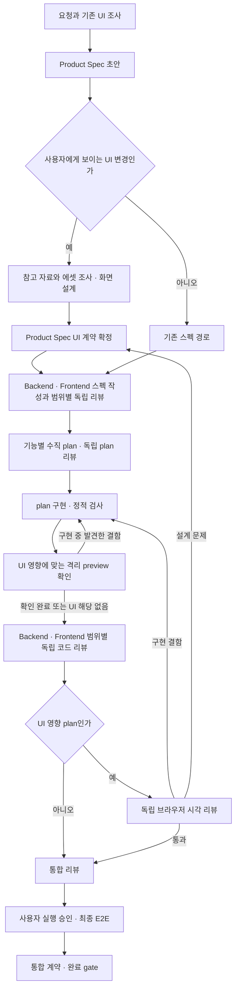

# 프런트엔드 workflow 종합 구현 계획

작성일: 2026-11-12. 조사 기준 Harness commit: `35ba84a317c4675f48371a36c43ca2be0501ea6a`.
상태: 종합 계획의 frontend/OpenAPI 범위는 구현 미착수. OpenAPI 통합 기술 조합은 2026-11-12 사용자 승인으로 확정했다. 2026-11-13 사용자가 main 대화에서 worktree별 workflow를 직접 조율하던 결정을 철회하고 target worktree로 이동한 뒤 orchestrator를 호출하도록 요청했다. 아래 해당 workflow 범위의 이전 결정은 더 이상 현행 기준이 아니다. 제품 기능 범위는 별도로 승인되지 않았다.

## 목표와 기본 결정

UI가 포함된 요청도 `spec-me → to-ticket → implement-wrapper → sync-contracts`를 사용한다. 기존 프런트엔드 designer·implementation·visual reviewer 역할을 이 흐름의 조건부 단계로 연결한다. 별도 frontend tracker나 병렬적인 완료 기준을 만들지 않는다.

핵심은 참고 자료에 근거한 화면 설계를 frontend Product Spec의 승인 대상에 넣고, 그 계약을 plan·구현·정적 검사·독립 시각 리뷰가 함께 소비하도록 하는 것이다. backend 구현 기준은 별도 backend 스펙 묶음으로 분리한다. 미감 전체를 lint 점수로 판정하지 않는다.

기술 블로그 사례 조사로 다음을 보강했다: 디자인 선택의 이유와 실제 component API를 함께 인계하고, 구현 중 격리 preview에서 짧게 확인하며, 독립 리뷰에는 변경 전후와 상태별 증거를 제공한다. 반복된 지적은 승인된 지침·공통 primitive·결정론적 검사 중 가장 좁은 소유 위치에 반영한다. 출처와 예시는 아래 「기술 블로그 사례와 적용 근거」에 정리했다.

이 계획이 제안하는 기본 결정은 다음과 같다.

| 항목 | 결정 |
|---|---|
| workflow 소유권 | 기존 공통 workflow가 스펙·계획·tracker·구현·수정·완료를 계속 소유 |
| 스타일 기준 | 최초 구축은 최소 기준 수립, 기존 제품의 새 화면은 기존 스타일 계승, 재설계는 요청 범위 명시 |
| 설계 정본 | 공통 Product Spec은 목표·UC·전체 AC 색인. backend/frontend 각각의 Product/Architecture Spec이 자기 구현 기준을 소유하고 공통 시각 언어는 프로젝트 DESIGN 정본 |
| 리뷰 범위 | 백엔드 스펙·코드는 backend 스펙 묶음으로만, 프런트엔드 스펙·코드는 frontend 스펙 묶음으로만 리뷰. 통신 계약 호환성은 별도 통합 축 |
| 코드 구조 | 각 구현 프로젝트의 `src/` 아래 Context별 논리 모듈, 내부는 `api/model/infra/ui`. `api`는 composition/application service, `model`은 업무 모델, `infra`는 기술 구현, `ui`는 진입 controller·presentation |
| CQRS·영속 접근 | 사용자 지정 backend 범위의 조회와 변경을 분리. command는 Aggregate repository·ORM, query는 SQL/projection 전용 adapter. 기본은 같은 DB이며 별도 저장소·event sourcing은 추가하지 않음 |
| HTTP 통합 기술 | backend OpenAPI exporter → Redocly CLI → Orval → Zod·TypeScript 검사. MSW는 frontend 선행 개발/상태 preview에, oasdiff는 기존 소비자 호환성 관리에 필요할 때 적용 |
| 설계 표현 | 새 화면/큰 구조 변경은 시각 자료 제공. 최초 구축/재설계는 대표 styled comp도 제공. Figma는 선택 경로 |
| 기계 판정 | 필수 산출물·참조/hash·snapshot·독립 reviewer·검증 coverage·채택한 정적 규칙을 검사 |
| 의미 판정 | 요구 충족·미감·스타일 연속성·예외 정당성은 독립 reviewer가 실제 화면과 승인 기준으로 판단 |
| 도구 도입 | 내부 UI 자료와 기존 실행 도구 우선. 외부 reference·review skill은 필요한 단계에만 연결 |
| 배포 범위 | source뿐 아니라 fresh install·update·provider 변환·Doctor·Git 가시성까지 검증 |

구현 순서와 완료 조건은 아래 「구현 작업 단위」와 「검증·전체 완료 조건」을 따른다. 실무 사례와 도구의 원문 근거도 같은 문서에 보존한다. 조사 목록의 모든 도구를 설치 대상으로 취급하지 않는다.

## 전체 실행 흐름



## primary checkout compose와 worktree 내부 orchestration

이전 결정은 main 대화가 여러 worktree를 이동 없이 조율하는 방식이었다. 최신 사용자 요청은 그 동작을 제거하고 다음 규칙으로 대체한다: primary checkout에서는 새 worktree compose만 수행하고, 검증된 경로를 반환한 뒤 멈춘다. 사용자는 반환된 경로로 이동해 orchestrator를 다시 호출해야 첫 stage가 시작된다. 질문·승인·재개도 해당 worktree 내부에서만 처리한다. 다른 worktree를 `--root` 또는 `--worktree-ref`로 지정하는 호출은 거부한다.

### 기본 구조와 실행 흐름

각 workflow 호출의 cwd는 target worktree여야 한다. primary checkout의 compose만 예외로 허용하며, compose 이후에는 사용자 이동과 orchestrator 재호출이 필요하다. 사용자 입력은 현재 디렉터리의 worktree에만 기록하며 main에서 다른 workflow로 라우팅하지 않는다.

```text
main의 동일 사용자 대화
  ├─ 요청 A → compose A → worktree A → workflow A의 stage·상태·산출물
  └─ 요청 B → compose B → worktree B → workflow B의 stage·상태·산출물
각 stage 결과 → 해당 worktree/execution 검증 → 같은 사용자 대화에서 다음 단계 조율
```

별도의 세션별 연결 파일은 만들지 않는다. 기존 `<worktree>/.io/worktree.json`의 `workspace`·`common`·`worktree_id`와 `agent_sessions.orchestrator`의 provider/session 연결을 재사용한다. 동일 메인 세션이 둘 이상의 worktree에서 결과를 받을 수 있다. 각 workflow 상태·stage 대화·산출물·검증은 해당 worktree의 기존 정본에 두고 main으로 합치지 않는다. Git 등록 worktree와 현재 세션이 조율하는 정본 목록의 탐색·검증은 기존 startup 코드를 재사용한다. 저장소나 세션의 전역 current-worktree 포인터·선택 flag는 추가하지 않는다.

compose가 반환한 execution ID·등록된 Git worktree·repository common directory·canonical record·준비 상태를 검증한 뒤, 그 worktree의 session 기록에 결과를 받을 메인 세션을 연결하고 즉시 다음 stage를 준비한다. 기존 기록 API·durable write·lock을 재사용하며 같은 요청의 중복 생성과 같은 stage의 중복 실행을 차단한다. 다른 기능의 workflow가 같은 메인 세션에 있다는 이유만으로 신규 생성을 거부하지 않는다. 실패하면 생성 worktree와 기존 실행 기록을 보존한다.

### 같은 대상을 사용해야 하는 위치

| 위치 | 변경 기준 |
|---|---|
| startup hook·context resolver | primary checkout에서 활성 workflow가 있으면 `worktree_required`와 이동 경로를 제공. workflow CLI는 cwd가 target과 다르면 `--root`·`--worktree-ref` 사용 여부와 관계없이 거부 |
| 사용자 입력·질문·승인 기록 | 요청·질문·승인은 worktree와 원래 stage/execution에 귀속. 사용자 입력을 원래 main이나 임의의 최근 workflow에 기록하지 않음. 여러 대기 질문 중 답변 대상이 모호할 때만 작업 이름을 확인 |
| stage·검사·Git·파일 읽기 | 실행은 명시적 `workdir`/`cwd`, Git은 대상 경로, 파일은 대상 절대 경로를 사용. 대상에 설치된 Harness 지침·runtime revision과 readiness를 확인. CLI의 root/worktree 불일치 거부를 느슨하게 풀지 않음 |
| write guard | 호출이 명시한 worktree/execution과 실제 쓰기 경로·stage 소유권을 대조. 사용자 CLI cwd가 main이라는 이유로 guard를 생략하거나 main/다른 worktree의 잘못된 쓰기를 허용하지 않음 |
| stage 결과·Wake·재개 | 같은 메인 대화로 결과를 받되 event의 `worktree_ref`·execution·stage로 원래 workflow를 재개. 다른 workflow의 완료/대기 상태나 승인에 적용하지 않음. 기존 stage 대화 재개·중복 실행 방지 유지 |
| context 복구 | compact·재접속 후 worktree별 기존 정본과 session 연결을 다시 읽음. 처리할 이벤트·명령의 정확한 대상만 검증해 실행하고, 없는 정본은 추측하거나 main으로 fallback하지 않음 |

worktree A의 실행을 시작한 뒤 B의 요청을 처리해도 A의 실행 대상은 바뀌지 않는다. 독립 workflow 각각의 상태/대화/질문/검증을 보존하고 동일 worktree 안의 상충 stage 실행 제한은 유지한다. 다른 세션의 소유권을 임의로 덮어쓰지 않는다. 특정 작업의 worktree가 삭제되거나 손상돼도 그 작업을 다른 worktree로 자동 대체하지 않는다.

### compact 이후에도 원본을 사용하는 방법

대화 summary와 모델 기억은 작업 위치의 정본이 아니다. compose 성공 시 각 `worktree.json`의 session 연결과 해당 workflow 원본을 기록하고 compact 뒤 다시 읽는다. 별도 연결 파일이나 선택 schema는 도입하지 않는다.

복구는 `host provider/session ID → Git 등록 worktree와 기존 정본 목록 → 처리할 요청/event의 worktree/execution 확인 → 해당 workflow 원본` 순서다. canonical path·worktree ID·repository common directory와 대조하며 stage·plan·질문·승인 근거도 기존 기록에서 읽는다. summary에 적힌 경로·승인을 정본으로 쓰지 않는다. 현재 startup의 복수 workflow 판정과 진행률 처리를 worktree별로 바꾸는 것은 실제 구현 대상이다.

복구와 실행은 다음 두 경로를 함께 사용한다.

1. 사용자 입력을 받는 hook은 host가 제공한 provider/session ID로 등록 worktree의 기존 정본을 조회해 현재 대상·stage를 다시 주입한다. 모델이 summary에서 UUID·경로를 재작성해 제공하는 값은 세션 식별의 정본으로 사용하지 않는다.
2. 모든 Harness 실행 진입점은 실행 전 같은 resolver를 호출해 원본을 다시 읽고 검증한다. 첫 입력 hook이 이미 실행된 turn 중간에 compact가 발생해도 다음 실행에서 검증한다. compact 전용 hook이나 새 사용자 입력이 다시 발생할 것을 전제로 두지 않는다.

provider adapter가 실행 경로에 caller identity를 전달하고, 명시적 대상·실제 workdir·쓰려는 경로를 확인한다. 대화에 남은 경로가 다른 경우 임의의 main/다른 worktree에서 실행하지 않고 불일치 오류를 반환한다. root를 받는 CLI의 기존 정합성 검사를 공통 resolver와 연결하고, 직접 tool 호출의 잘못된 쓰기도 PreToolUse guard로 검사한다. 지원되는 tool 경로·프로필에서 실제 차단되는지 회귀로 확인하며, 지침 주입만으로 모든 도구가 강제된다고 선언하지 않는다.

기존 `recordWorkflowSession`·worktree lock·`durableJson`의 쓰기 경로를 재사용한다. 관찰·compact 복구는 workflow의 위치나 결과 수신 세션을 임의로 바꾸지 않는다. 각 execution은 확정된 worktree/ref와 실행 identity를 자신의 입력에 보존하며, 결과 전달도 그 입력을 따른다.

처리할 대상의 정본이 없거나 기록 손상·삭제된 worktree·다른 저장소·소유권/실행 불일치가 있으면 해당 실행을 차단하고 원인을 보고한다. 같은 메인 세션에 복수 worktree가 있다는 것 자체는 오류가 아니다. 대화 요약·최신 시각으로 대상을 추측하지 않는다. 보장 범위는 「compact 뒤에도 지정한 workflow 원본을 사용하거나, 검증할 수 없으면 실행하지 않음」이며 디스크 원본 유실은 별도 문제다.

필수 회귀는 main에서 compose 후 첫 stage를 시작하지 않는 것, `--root`·`--worktree-ref`로 다른 worktree를 우회할 수 없는 것, target 내부에서 입력·stage 준비·실행이 되는 것, A/B 입력 분리, consumer update·Doctor·Git 소유권을 확인한다. 실제 consumer에서도 새 workflow는 사용자 이동 뒤에만 첫 stage가 시작되어야 한다.

### 현행 근거와 host 기능의 경계

현행 workflow-compose GUIDE와 startup-state 설명은 새 세션을 전제하고, startup hook·command context·write guard는 cwd 중심으로 대상을 찾는다. 생성 후 명령 몇 개에만 workdir을 지정해서는 후속 입력·guard·재개가 함께 전환되지 않으므로 위 경로를 같이 고친다. 기존 `worktree_ref`와 orchestrator session ID 구조를 재사용하고 별도 orchestrator agent나 실행 서버는 만들지 않는다.

[Codex 공식 명령 문서](https://learn.chatgpt.com/docs/developer-commands?surface=cli)의 `/cd`·`/worktree`와 [App Server](https://learn.chatgpt.com/docs/app-server)의 turn별 cwd를 사용해 target worktree 내부로 이동한다. UI 표시 경로와 실제 실행 worktree가 다를 수 있으므로 workflow CLI는 cwd가 target과 다른 경우 요청을 거부한다. shell의 일시적 `cd`만으로 host conversation cwd가 바뀌었다고 간주하지 않는다.

### 구현·설치·검증 범위

- workflow-compose는 primary checkout에서 생성만 수행하고 검증된 경로를 반환한다. 사용자는 그 경로로 이동해 orchestrator를 다시 호출한다. 선택된 workspace의 preflight·설정 누락을 확인하며 원래 main의 setup 결과를 그대로 대신하지 않는다.
- 결정론적 회귀로 main의 cross-worktree 명령 거부, worktree 내부의 답변·재개, 서로 다른 worktree 입력 격리, stale ref·다른 저장소·실제 쓰기 경로 불일치·중복 실행 거부를 확인한다.
- 실제 consumer workflow에서도 사용자가 target worktree로 이동한 다음 stage가 시작되고 산출물이 해당 worktree에 남는지 검증한다. 실제 서버 E2E의 기존 승인·실패 정책은 유지한다.
- 변경된 GUIDE·hook·resolver·dispatch/result는 source discovery/변환·fresh install·update·Doctor·ignore를 함께 반영한다. installed-consumer에서 기존 worktree 기록/로그 등 Harness 생성물만 ignore되고 프로젝트 소유 source·Spec·EXEC·계약은 Git에 보이며 로컬 변경이 보존되는지 확인한다. 세션별 연결 인덱스 파일은 추가하지 않는다.

## 현재 구조와 빈틈

| 근거 | 현재 동작 | 통합에 필요한 변경 |
|---|---|---|
| `.codex/internal-skills/frontend-design/GUIDE.md` | 참고 사례 조사, design brief, Figwright, 구현·시각 리뷰·수정 흐름이 이미 있다 | 디자인 단계가 승인 스펙을 만들도록 인계하고, 구현·리뷰는 공통 소유 단계로 이동 |
| `.codex/workflows/frontend-design.yaml` | design → implementation → visual_review의 독립 workflow | 기존 진입점을 공통 흐름으로 이전한 뒤 중복 실행 경로 제거 |
| `AGENTS.md`, orchestrator의 capability-routing | 새 화면·대규모 재설계는 독립 frontend workflow, implement 등의 하위 단계 호출 금지 | 현재 규칙을 명시적으로 개정해야 한다. 기존 규칙을 둔 채 중첩 호출하지 않는다 |
| `spec-me.yaml`, `to-ticket.yaml`, `implement-wrapper.yaml` | 스펙·계획·코드 리뷰는 있지만 UI 계약을 연결하는 조건부 단계가 없다 | UI 설계·검증의 적용 여부와 인계를 정본 snapshot에 연결 |
| `frontend-visual-review/GUIDE.md` | 실제 screenshot, 반응형·상태·접근성 검사 요구 | 공통 완료 gate가 검증할 구조화된 evidence와 reviewer provenance 연결 |
| `.harness/src/workflow/implementation-completion.mjs` | standards/spec 두 역할의 리뷰를 검사한다 | 기존 코드 리뷰 계약은 유지하고 조건부 visual evidence 검사를 추가 |
| `.harness/src/workflow/loader.mjs`, `stage-gates.mjs` | stage condition/gate는 등록된 값만 허용 | YAML에 이름만 추가하지 않고 condition·gate evaluator·입출력 검증도 구현 |

현행 frontend brief는 tracked 문서가 없어도 된다. 새 흐름에서는 승인·수정·재개 시 유실되지 않도록 결정을 스펙에 남긴다. `docs/architecture/domain-model.md`가 연결한 `docs/contracts/architecture.md`는 조사 workspace에 없으므로, 구현 시점에 현행 계약의 실제 위치와 준비 상태를 다시 확인한다.

## 백엔드·프런트엔드 스펙과 리뷰 분리

사용자 추가 요구에 따라 이전 단일 Product/Architecture 스펙 기반 리뷰안을 다음으로 변경한다. 아래 범위별 스펙 경로와 리뷰 scope는 새 구현 대상이다. 현재 runner가 이미 지원하는 기능으로 보고하지 않는다.

```text
docs/specs/<id>/
  product-spec.md                   # 전체 목표·UC·공통 AC 색인·각 소유 스펙 링크
  architecture-spec.md              # Context map·배치/통신 개요·소유 스펙 링크
  backend/
    product-spec.md                 # 백엔드 소유 동작·규칙·수용 조건
    architecture-spec.md            # Context·Aggregate·서비스·저장·서버 진입 구조
  frontend/
    product-spec.md                 # 화면·상태·스타일·interaction·수용 조건
    architecture-spec.md            # UI 모델·component·token·API client·실행 mapping
  openapi.json                      # HTTP API가 있으면 backend에서 export한 고정 snapshot
  interface-contract.md             # 필요한 업무 의미·호환 정책·event 설명, HTTP 구조는 중복하지 않음
  ui/                              # 승인할 시각 설계 source
```

한쪽만 있는 작업에는 해당 side의 두 스펙만 작성하고 반대쪽 빈 문서를 만들지 않는다. 상위 문서는 전체 작업의 연결과 각 규칙의 소유자를 보여 주는 색인이다. side별 스펙에 같은 업무 정책을 이중 소유시키지 않고 기존 UC/BR/AC ID를 참조·재사용한다. 서버 업무 규칙의 권위는 backend, 입력 안내·오류 표시·상태 전이는 frontend가 소유한다.

| 리뷰 대상 | 읽는 구현 기준 | 확인하는 책임 |
|---|---|---|
| Backend 스펙 리뷰 | backend Product/Architecture Spec, 적용 backend 저장소 기준 | 업무 규칙 owner·Context·Aggregate·composition service·트랜잭션·저장·서버 controller·보안·실행 전제 |
| Frontend 스펙 리뷰 | frontend Product/Architecture Spec, 승인 DESIGN·해당 시각 자료·적용 frontend 기준 | 화면/상태·스타일 계승·반응형·접근성·component/data/view state owner와 API 사용 |
| Backend 구현 리뷰 | backend source diff·관련 호출자/검증 + backend 스펙 묶음 | backend 요구와 구조 충족. frontend 스펙의 배치·스타일을 근거로 지적하지 않음 |
| Frontend 구현 리뷰 | frontend source diff·관련 호출자/검증 + frontend 스펙 묶음·설계 참조 | frontend 요구·구조·상태·시각 기준 충족. backend Aggregate/저장 구현을 이 리뷰의 의무로 추가하지 않음 |
| 통합 계약·최종 E2E | 공통 통신 계약과 승인된 전체 시나리오 | 요청/응답·인증·오류·호환성과 사용자 흐름 연결. 상대 side 내부 구조나 시각 설계의 재리뷰로 확대하지 않음 |

HTTP endpoint·parameter·request/response DTO·security 구조는 backend 공개 경계에서 export한 `openapi.json`이 소유한다. `interface-contract.md`는 필요한 경우 operation을 참조해 업무 의미·인증/오류 처리 의미·version/호환 정책과 OpenAPI 범위 밖 event를 설명하고 HTTP 구조를 수기로 복제하지 않는다. 각 side 스펙은 자신이 제공/소비하는 항목을 명시적으로 참조한다. side reviewer는 자기 스펙이 참조한 외부 계약의 해당 항목만 확인하며 상대 스펙 전문을 받지 않는다. 공통 계약은 다른 side 스펙을 우회 주입하는 통로가 아니다. 공통 계약 자체의 양쪽 정합성은 통합 검증이 소유한다.

구현·스펙 리뷰 입력은 runner가 `scope: backend | frontend`와 고정 snapshot을 생성한다. `standards_reviewer`와 `spec_reviewer`라는 기존 역할은 유지하되 `(scope, role)`별 독립 실행·결과를 수집한다. 혼합 변경은 backend 두 코드 리뷰와 frontend 두 코드 리뷰가 각각 필요하고, frontend에는 별도 visual review도 필요하다. backend-only에 frontend 리뷰를 만들지 않는다. 독립 스펙 reviewer도 side별로 자기 입력만 검토한다.

source scope는 스펙·plan에 선언한 실제 source roots/파일 소유자와 framework 구성을 runner가 검증해 정한다. `ui/`라는 경로명이나 `.ts` 확장자만으로 frontend로 판정하지 않는다. 특히 서버 `ui/PostController`는 backend다. 원래 diff를 분할할 때 미분류 파일·공유 파일을 버리지 않고 owner 또는 통합 계약 대상으로 분류하며, 분류가 확정되지 않으면 완료 판정을 보류한다.

각 side의 구현자·리뷰어는 동일 source snapshot과 그 side 스펙을 사용한다. side별 결과·identity·coverage·hash를 따로 보존하고 한쪽 pass로 다른 쪽을 대체하지 않는다. backend 내부 스펙만 바뀌면 frontend 리뷰를 무조건 무효화하지 않으며, 양쪽이 참조한 공통 계약이 바뀌면 영향받는 양쪽 snapshot과 통합 검증을 갱신한다. 상위 색인·발행·plan set은 여전히 하나다.

현행 `spec-review` 입력 제한, 고정 Spec 경로 discovery, `plan-review`의 두 스펙 snapshot, tracker `specs`, wrapper review input·finding basis 인용 대조, 역할별 evidence map와 completion의 두 리뷰 고정 검사를 함께 수정한다. `product_spec`/`architecture_spec` basis 종류는 유지하고 scope가 결정한 side 경로에서 인용을 검증한다. frontend 결과에 backend 기준을 끼워 넣거나 scope를 바꿔 같은 pass를 재사용하는 것을 거부한다.

이하 UI 산출물·UI 승인·시각 리뷰에서 말하는 Product/Architecture Spec은 frontend 스펙 묶음을 뜻한다. 상위 Product/Architecture 문서와 그 side 스펙의 역할을 혼동하지 않는다. 기존 경로만 가진 진행 중 작업은 스펙 소유 단계에서 side 분류·경로·review snapshot을 전환하고, 없는 frontend 스펙을 backend 스펙으로 대신하지 않는다.

`ui_impact`는 화면 검증 여부이고 backend/frontend source 소유권과 별개다. 예를 들어 backend controller만 수정했다면 source 리뷰는 backend scope다. 공유 build/config/schema 변경은 실제 영향 side로 각각 리뷰하되 자기 스펙만 적용한다. 통합 계약 검증이 필요한 변경은 그 축도 완료해야 하며 미분류 diff를 제외한 채 통과시키지 않는다.

## Context별 DDD 디렉토리 구조 검토와 채택

### 검토 결론

제안한 구조는 **책임과 의존 방향을 아래처럼 정의하면 DDD와 양립하는 프로젝트 규칙으로 채택 가능**하다. DDD가 `api/model/infra/ui`라는 이름이나 `src/` 경로 자체를 표준으로 정한 것은 아니다. `composition service`는 여기서 application/use-case orchestration 역할이며, DI 설정을 모으는 composition root와 구분한다.

```text
<implementation-project>/src/
  <bounded-context>/
    api/                  # composition/application services, 공개 command/result 계약
    model/                # Entity, Aggregate, Value Object, 업무 행위·불변식
    infra/                # repository·외부 시스템 adapter 등 실제 기술 구현
    ui/                   # server controller·presentation adapter
```

Java/Kotlin의 source convention은 `src/main/java|kotlin/<base-package>/<context>/...`로 위 책임을 배치한다. 이는 `src/` 아래 구현 원칙을 유지하는 언어별 매핑이다. backend/frontend가 별도 프로젝트면 각 프로젝트의 기존 source root 아래에 적용하고, 이 규칙만을 위해 새 monorepo나 독립 배포 서비스를 만들지 않는다.

| 디렉토리 | 책임 | 두면 안 되는 것 |
|---|---|---|
| `api` | 요청을 use case로 수행하는 composition service, transaction·작업 순서·model/repository/다른 공개 API 조율, 공개 command/result | HTTP routing/controller, Aggregate 불변식을 대신 결정하는 업무 로직, DB·SDK 구현체 |
| `model` | Entity·Aggregate·Value Object의 상태와 행위, domain policy/service, Aggregate repository 같은 도메인 소유 계약 | HTTP DTO·controller, DB/SDK 구현 의존, orchestration service가 setter로 조합할 데이터 껍데기 |
| `infra` | repository 구현, persistence mapping, HTTP/메시징/파일·외부 provider adapter | 업무 규칙의 새로운 owner, 다른 Context DB/model 내부 직접 접근 |
| `ui` | backend HTTP/controller·요청 검증·DTO 변환·응답/presentation, `api` 유스케이스 호출 | 유스케이스 orchestration과 transaction 본체, DB 직접 호출, domain invariant의 이중 구현 |

프런트엔드 source에도 Context별 묶음을 적용하되 backend 모델을 복제하지 않는다. frontend의 `ui`에는 view/component와 presentation controller·hook 등이, `model`에는 frontend가 소유한 화면 상태·view model·행동이 들어간다. `api`는 frontend 유스케이스 조율, `infra`는 실제 HTTP/browser storage adapter를 담당한다. framework route entry는 규정 경로 안에서 얇게 연결하고, bootstrap·전역 shell·공유 디자인 primitives의 기술적 경계를 업무 Context로 꾸며내지 않는다. 실제로 필요 없는 계층은 빈 파일·더미 service로 채우지 않는다.

### 의존·공개 경계

- 변경 호출은 `ui → api → model`이고 `infra`가 repository 구현을 제공한다. 조회 호출은 `ui → api → infra`의 전용 SQL/projection 경로로 DTO를 반환하고 domain 모델을 필수 경유하지 않는다. 모델 소유 repository 계약은 `model`, application 전용 외부 port는 `api`의 필요한 위치에 둔다.
- `model`이 `ui/api/infra` 구현을 import하지 않게 한다. 구체 adapter의 DI wiring은 기존 bootstrap/framework 설정에서 수행하고 업무 composition service와 혼합하지 않는다.
- 다른 Context는 해당 Context가 공개한 `api`의 service/DTO/event만 사용한다. 상대 `model/infra/ui`·repository·DB 내부에 접근하지 않는다. public API에 내부 Entity·ORM 객체를 그대로 노출하지 않는다.
- Context 간 필요한 동기 조율은 소유 composition service에서 명시하고 순환 의존을 만들지 않는다. 배포·transaction·eventual consistency는 별도 근거로 결정하며 무조건 이벤트나 microservice로 바꾸지 않는다.
- Context는 언어·규칙·데이터/변경 소유권 근거로 먼저 정하고 그 경계를 논리 모듈로 표현한다. feature·Aggregate마다 새 Context 또는 Gradle/npm 하위 프로젝트를 만들지 않는다. 독립 build module이 필요한지는 기존 codebase-design의 격리 근거로 판단한다.

### MS 가이드에서 채택할 핵심 원칙

Microsoft 예제의 프로젝트/폴더 구성이나 특정 CQRS 도구를 그대로 도입하지 않는다. 요청한 `src/<context>/{api,model,infra,ui}`와 side별 리뷰 분리는 유지하며 다음 책임 원칙을 반영한다. CQRS 채택은 아래에 기록한 사용자의 후속 결정으로 구체화한다.

1. `api`의 application/composition service는 유스케이스·작업 순서·transaction을 조율하고 업무 판단은 소유 domain model에 위임한다.
2. `model`은 Entity·Aggregate·Value Object의 데이터와 행위·불변식을 소유하고 presentation/application/infra 구현에 의존하지 않는다.
3. Aggregate repository 계약은 `model`, persistence 구현은 `infra`에 둔다. controller·외부 응답에 내부 Entity를 그대로 노출하지 않는다.

이는 [MS DDD 계층 설명](https://learn.microsoft.com/en-us/dotnet/architecture/microservices/microservice-ddd-cqrs-patterns/ddd-oriented-microservice)과 [persistence 설명](https://learn.microsoft.com/en-us/dotnet/architecture/microservices/microservice-ddd-cqrs-patterns/infrastructure-persistence-layer-design)에 따른다. 폴더 분리 외에 별도 .NET 프로젝트·mediator·event bus·read DB를 생성하는 요구로 확대하지 않는다.

### CQRS 예제의 배치와 적용 경계

아래는 MS eShopOnContainers의 ordering 예시를 요약한 설명이며 이 계획이 생성할 기본 scaffold가 아니다.

```text
Ordering.API/
  Controllers/OrdersController.cs
  Application/
    Commands/                 # command와 command handler
    Queries/                  # IOrderQueries·OrderQueries, 조회용 ViewModel/DTO
Ordering.Domain/
  AggregatesModel/            # Aggregate·Entity·Value Object·repository 계약
Ordering.Infrastructure/
  Repositories/              # Aggregate repository persistence 구현
```

쓰기 흐름은 controller→command handler→Aggregate 행위→repository 구현→DB다. 읽기는 controller→OrderQueries→SQL/Dapper→조회용 DTO로 진행하며 Aggregate를 복원하거나 Aggregate repository를 반드시 거칠 필요가 없다. 실제 [OrderQueries source](https://github.com/dotnet-architecture/eShopOnContainers/blob/main/src/Services/Ordering/Ordering.API/Application/Queries/OrderQueries.cs)는 `Application/Queries`에 있고 그 안에 SQL 접근 구현도 포함한다. MS의 project 이름이 `API`라는 이유로 그 내부 전체를 controller나 HTTP 계약으로 해석하지 않는다.

MS는 이를 같은 DB를 사용하는 단순화된 CQRS로 설명하고 모든 Context에 강제하지 말라고 명시한다. [CQRS 적용 설명](https://learn.microsoft.com/en-us/dotnet/architecture/microservices/microservice-ddd-cqrs-patterns/eshoponcontainers-cqrs-ddd-microservice), [읽기 구현](https://learn.microsoft.com/en-us/dotnet/architecture/microservices/microservice-ddd-cqrs-patterns/cqrs-microservice-reads)

사용자의 후속 지시에 따라 이 프로젝트의 backend 영속 데이터 조회·변경에는 CQRS와 서로 다른 데이터 접근 경로를 적용한다. 이전의 “Context별 선택 적용” 제안은 이 범위에서 대체한다. 공개 command/query 유스케이스는 `api`, domain 상태 변경은 `model`, SQL/ORM 기술 구현은 `infra`, controller는 `ui`로 배치한다. MS의 SQL-in-Queries 원본과 동일한 물리 배치라는 뜻은 아니다. 읽기에는 Aggregate repository를 억지로 만들지 않되 권한·데이터 노출 범위·Context 소유권은 계속 지킨다.

분리 대상은 지금 계획 중인 소비 프로젝트의 backend 설계·생성·리뷰 기준이다. Harness 제어 파일·Beads·tracker 저장을 관계형 ORM으로 다시 쓰거나 frontend에 서버 Entity를 복제하지 않는다. 영속화가 없는 기능에는 빈 command/query infrastructure를 만들지 않는다. mediator·handler class는 필수로 추가하지 않고 기존 composition service가 command 유스케이스 역할을 맡을 수 있다.

### CQRS 채택과 서로 다른 영속 접근 방식

기본은 동일한 primary DB·schema에서 command와 query가 서로 다른 코드·모델·데이터 접근 방식으로 동작하는 것이다. 쓰기는 ORM의 Aggregate repository, 읽기는 명시적 SQL/projection과 조회 DTO를 사용한다. 쓰기 repository의 `find/list`를 QueryService에서 그대로 호출하고 이름만 나누는 것은 이 결정을 충족하지 않는다. 반면 command가 변경할 Aggregate를 repository로 읽어오는 것은 정상적인 쓰기 유스케이스의 일부다.

구체 ORM·SQL 실행 library는 대상 앱의 실제 stack·기존 의존성·DB를 확인한 뒤 backend Architecture Spec에서 고정한다. Dapper·EF Core를 .NET 이외 프로젝트에 강제하지 않는다. 단순히 같은 ORM 조회를 두 service로 감싼 것을 “서로 다른 접근 방식”이라고 기록하지 않고 command의 tracked domain persistence와 query의 SQL/projection 실행 경로를 source·의존성·검증으로 구분한다.

```text
src/<context>/
  api/
    commands/             # 업무 의도의 입력·composition service·최소 결과
    queries/              # 조회 조건·조회 API·DTO·필요한 query port
  model/                  # Aggregate·Entity·Value Object·repository 계약
  infra/
    persistence/
      command/            # ORM mapping·Aggregate repository 구현
      query/              # SQL·projection·DTO mapping 구현
  ui/                     # controller → command/query API
```

위 하위 폴더는 해당 코드가 실제 필요할 때 생성한다. command service 위/아래에 같은 요청을 전달하는 handler를 추가하지 않는다. 공개 query 계약과 SQL 구현의 경계는 실제 DI/테스트/기술 격리에 필요한 최소 구조로 표현하고 쓰이지 않는 interface를 만들지 않는다.

### Command·Query 호출 계약

다음 표는 이 프로젝트에 적용할 호출 조건이다. MS가 모든 세부 항목을 동일하게 의무화했다는 뜻은 아니며, [CQRS의 읽기·쓰기 모델 분리](https://learn.microsoft.com/en-us/azure/architecture/patterns/cqrs), [조회 DTO 경로](https://learn.microsoft.com/en-us/dotnet/architecture/microservices/microservice-ddd-cqrs-patterns/cqrs-microservice-reads), [Aggregate repository 경로](https://learn.microsoft.com/en-us/dotnet/architecture/microservices/microservice-ddd-cqrs-patterns/infrastructure-persistence-layer-design)를 사용자 요구와 기존 책임 기준에 맞춰 구체화한 것이다.

| 조건 | Command 호출 | Query 호출 |
|---|---|---|
| 목적 | `createPost`, `cancelOrder` 같은 업무 의도를 실행. 임의 Entity 필드 patch로 불변식을 우회하지 않음 | `getPostDetail`, `listMyOrders`처럼 필요한 조회 결과를 정의. workflow 시작·상태 변경·쓰기 부작용을 섞지 않음 |
| 입력 | 변경 의도·대상 ID·필요한 값, 실제 충돌 정책에 필요한 version·중복 방지 key | 대상 ID·허용 filter/sort·제한된 page size/cursor. 응답 필드와 조회 범위를 계약으로 고정 |
| 신뢰·권한 | 서버가 검증한 actor/tenant로 해당 행위 권한 확인. caller가 보낸 소유자 ID만 신뢰하지 않음 | 동일한 actor/tenant 경계를 SQL 조건과 반환 필드에 적용. 조회라고 인증·권한·비공개 정보 제한을 생략하지 않음 |
| 업무 판단 | 타입/형식 검증 후 Aggregate 행위가 domain invariant를 검사. transaction 안의 최신 상태로 허용 여부 결정 | 승인된 조회·공개 정책을 적용하고 DTO를 구성. 합계·집계·표현 계산은 가능하나 변경 가능 여부의 권위 있는 판단을 대신하지 않음 |
| 데이터 접근 | repository로 Aggregate를 불러오거나 생성하고 행위를 실행한 뒤 ORM으로 저장. model의 기술 독립성 유지 | query 전용 SQL/projection adapter로 필요한 열/행만 조회. 영속 Entity·ORM proxy·lazy relation을 응답에 노출하지 않음 |
| 경계·오류 | 유스케이스의 명시적 transaction 경계 안에서 변경을 완료/rollback. not-found·forbidden·business rejection·conflict를 구분 | parameter binding, 동적 sort/column allowlist, pagination 한도와 안정된 정렬. 허용된 자기 Context 데이터만 조회하며 임의 상대 DB join 금지 |
| 동시성 | 낙관적 version·DB 제약·필요한 lock 등 실제 불변식에 맞는 수단으로 lost update/경합 방지. 직전 Query 결과를 검증으로 대체하지 않음 | 조회 상태는 이후 바뀔 수 있음을 전제. mutation/flush 없이 읽고, 여러 SQL의 동일 snapshot이 필요하면 명시적 read transaction/isolation 지정 |
| 재시도 | 중복 생성·결제 등 중복 효과 위험이 있는 호출은 실제 dedup key·DB uniqueness/결과 기록으로 보호. key scope·유효기간·다른 payload 처리와 timeout 후 결과 확인 정의 | 업무 상태를 바꾸지 않으므로 안전하게 재조회 가능. 결과가 시간에 따라 바뀔 수 있으며 timeout/cancellation을 무시한 무한 재시도는 하지 않음 |
| 반환 | 동기 명령은 commit 성공 후 성공 응답. 생성 ID·version·결과 code 등 최소 결과 반환 가능. 내부 Entity 대신 명시적 result DTO | 요구에 맞는 DTO·목록·page 정보 반환. ORM 추적 객체나 숨은 후속 SQL 없이 반환 시 필요한 값이 결정돼 있어야 함 |
| 일관성 | 성공 응답은 약속한 쓰기 완료를 뜻함. 외부 효과는 DB transaction과 원자적이라고 가정하지 않고 기존 계약대로 처리 | 기본은 같은 primary의 committed data 조회. 별도 cache/replica를 넣으면 read-after-write·staleness·화면 갱신 계약을 따로 승인 |

Query의 read-only는 업무 데이터와 상태를 변경하지 않는다는 뜻이다. 기존 운영 로그·trace·승인된 감사 기록을 업무 mutation으로 오인해 제거하지 않는다. 반대로 GET 요청에서 조회수 증가·마지막 열람 시각 저장이 필요하면 그것은 명시적인 command side effect로 모델링하고 Query에 숨기지 않는다. read-only annotation만으로 쓰기 방지를 입증하지 않고 실제 실행 경로를 확인한다.

권한 있는 조회 결과도 command 시점의 보증이 아니다. 예를 들어 Query가 `canCancel=true`를 반환했어도 이후 배송될 수 있으므로 cancel command는 최신 Aggregate 상태와 권한을 다시 확인한다. 충돌은 원래 행위를 무조건 재시도하지 않고 계약된 conflict 응답·상태 재조회·사용자 복구 경로로 처리한다.

DB 분리·replica·event sourcing·event bus·비동기 projection은 이번 기본 결정에 포함하지 않는다. 이후 채택하면 동기화·중복 전달·staleness·failure recovery를 별도 아키텍처 결정으로 다룬다. 같은 DB를 써도 schema 변경 시 command ORM mapping과 query SQL/DTO를 함께 이전해야 한다.

### 스펙·구현·리뷰에 남길 CQRS 근거

backend Product Spec은 command의 의도·업무 결과·거절 조건과 query의 공개 범위·필터·페이지 결과를 각 UC/AC에 연결한다. backend Architecture Spec에는 `호출 → source owner → Aggregate/repository 또는 query adapter → 테이블·SQL/ORM → 반환 DTO → transaction/일관성·중복/충돌 정책 → 검증` mapping을 둔다. frontend Spec은 자신의 request/response·loading/error/conflict·재조회 동작만 정의하고 backend 내부 persistence를 리뷰하지 않는다.

검증은 domain 업무 규칙 단위 검증과 데이터 접근 실제 동작을 구분한다. command의 transaction rollback·경합/중복 보호, query의 행/필드 권한·결과 mapping·페이지 경계·업무 mutation 부재, schema 변경 후 양쪽 접근의 호환성을 의미 있는 회귀로 확인한다. backend source review와 필요한 DB integration 검증은 backend 기준으로 수행하고, 실제 사용자 E2E는 기존 승인·중단 정책을 따른다. mock repository 호출 횟수만으로 영속 접근 분리를 입증하지 않는다.

### 조사 근거와 적용 한계

확인일: 2026-11-12. 아래는 원저자·공식 문서의 원칙이며 위 폴더명 대응은 사용자 요청에 대한 적용 판단이다.

| 근거 | 확인한 원칙 | 이 계획의 판단 |
|---|---|---|
| [Microsoft: Designing a DDD-oriented microservice](https://learn.microsoft.com/en-us/dotnet/architecture/microservices/microservice-ddd-cqrs-patterns/ddd-oriented-microservice) | application은 작업을 조율하고, domain은 모델·업무 규칙을 소유하며 infrastructure와 분리한다. domain model은 Entity만 있는 것이 아니라 Value Object·Aggregate도 포함 | `api`를 application 역할로, `model`을 행위를 가진 domain 역할로 정의하면 타당. 문서의 microservice 예제를 Context=배포 서비스 강제로 확대하지 않음 |
| [Fowler/Stafford: Service Layer](https://martinfowler.com/eaaCatalog/serviceLayer.html) | 외부 client에 제공할 application operations와 transaction/응답 조율의 경계 | composition service를 공개 유스케이스 진입점으로 배치할 근거. `api`라는 디렉토리 이름을 표준이라고 주장하지 않음 |
| [Mark Seemann: Composition Root](https://blog.ploeh.dk/2011/07/28/CompositionRoot/) | application entrypoint 가까이에서 객체 graph와 DI를 조립하는 위치 | 유스케이스를 조율하는 composition service와 wiring을 담당하는 composition root를 구분 |
| [Spring Modulith: Fundamentals](https://docs.spring.io/spring-modulith/reference/fundamentals.html), [Verification](https://docs.spring.io/spring-modulith/reference/verification.html) | 공개 API와 내부 구현을 구분하고, 모듈 순환·내부 접근·허용 의존을 검증한다. `api` 하위 package를 공개하려면 실제 named interface/설정 필요 | 폴더 이름만으로 격리가 생기지 않음. 기존 설치 시 named interface·dependency 검사를 적용. 다른 stack에 새 Spring 의존을 강제하지 않음 |
| [Martin Fowler: Bounded Context](https://martinfowler.com/bliki/BoundedContext.html) | Context는 일관된 모델·언어와 명시적 관계를 다루는 경계 | 먼저 Context 근거를 확인하고 소유 모듈을 배치. 폴더나 feature 이름으로 경계를 발명하지 않음 |

Eric Evans의 DDD Reference는 검색 결과에서 domain을 UI/application/infrastructure와 격리하는 원칙을 확인했으나 PDF 본문 직접 열람은 403으로 실패했다. 이를 본문 전체 검토 근거로 쓰지 않고, 직접 확인한 위 공식 자료에 결론을 한정한다.

### 현행 지침 이전

현재 `codebase-design`은 `ui/app/domain/infra`를 기본으로 설명한다. 새 프로젝트·승인된 구조 이전에서는 책임을 유지하며 `app → api`, `domain → model`로 바꾸고 `ui/infra`는 유지한다. `ddd-design`, model-continuity, Architecture template, implement·code-review·examples·fixtures·exports·import/dependency 규칙과 소비자 배포까지 같은 변경에서 갱신한다. 논리 역할의 application/domain 용어는 유지하고 폴더명과 구분한다.

기존 프로젝트의 이전은 old path→new path, caller/import·build/framework discovery·tests·문서 이전을 계획에 명시한다. 범위 안의 구형 경로는 제거하고 두 구현을 남기지 않는다. 관계없는 source를 이번 프런트엔드 변경만으로 전면 이동하지 않으며 실제 구조 이전은 해당 backend/frontend 스펙에 범위를 포함한다. 이 규칙은 Harness가 생성·검토하는 소비 프로젝트의 구현 구조이며 Harness 자체 `.harness/src` 전면 재배치를 이번 작업에 추가하지 않는다.

## 단계별 통합 계약

### 1. 진입과 적용 여부

화면·form flow·사용자에게 보이는 component·layout·interaction 변경은 UI 설계 대상으로 분류한다. backend와 UI가 섞인 요청도 같은 plan set 안에서 처리한다. copy-only 수정은 전체 reference 조사 없이 기존 UI 계약을 사용하고, frontend build 설정처럼 화면·interaction 영향이 없는 변경은 해당 없음과 근거를 남긴다.

확장자나 React 사용 여부만으로 판정하지 않는다. Product Spec 요구와 영향받는 route/component를 근거로 삼고 plan reviewer가 분류 누락을 확인한다. backend-only 요청은 기존 흐름을 유지한다.

#### 최초 구축과 기존 스타일 계승

UI 영향 여부와 별개로, 대상 화면이 어떤 시각 기준을 따라야 하는지 먼저 정한다. **기존 제품에 새 화면을 추가하는 것은 기존 스타일 계승이 기본**이다. route나 component가 새로 생긴다는 이유로 최초 구축으로 분류하지 않는다. 이 판단은 기존 Product Spec UI 절과 plan 인계에 남기며 별도 설정 파일이나 workflow를 만들지 않는다.

| 상황 | 디자인 기준과 설계 작업 | 구현·리뷰 기준 |
|---|---|---|
| 처음부터 구축: 참고할 제품 UI가 없음 | 사용자 제공 브랜드·에셋·reference를 먼저 확인하고, 부족한 축만 외부 사례로 보강한다. 최소 색상 역할·type scale·spacing·radius·surface·버튼/form·shell 기준을 정한다 | 대표 화면과 핵심 상태를 먼저 구현해 기준을 확인한다. 이후 화면은 같은 tokens/components와 승인된 시각 방향을 계승 |
| 기존 UI 확장: 새 화면/기능 추가 또는 기존 화면 수정 | 대상 제품의 실제 화면·공통 shell·tokens·theme·components·상태 표현을 조사해 기존 스타일을 기준으로 삼는다 | 새 화면을 기존 대표 화면과 같은 조건으로 나란히 비교한다. 글꼴·색 역할·밀도·여백·control 크기·surface·icon·motion·상태 표현의 연속성 확인 |
| 명시적 재설계 | 사용자 요청의 변경 범위와 유지할 부분을 구분하고, 바꿀 디자인 축과 영향을 스펙에 명시한다 | 승인 범위 안의 차이만 허용하고 공유 component 변경이 기존 화면에 미치는 영향도 리뷰 |

기존 브랜드 지침이나 Figma가 있으면 사용자가 지정한 정본과 현재 적용 버전을 확인한다. 별도 지정이 없다면 대상 제품에서 현재 사용 중인 theme·shared components와 대표 화면을 우선 근거로 삼는다. 문서·Figma·실제 UI가 충돌하면 현재 사실과 목표 기준을 구분해 기록하고, 화면 조사로 해결되지 않는 중요한 선택만 사용자에게 묻는다. agent가 오래된 Figma나 새 외부 사례를 임의로 정본으로 삼지 않는다.

기존 디자인 문서나 tokens가 없는 것도 흔한 경우다. 이때는 대상 화면과 가장 가까운 기존 화면, 공통 navigation/form/list 등 필요한 예시에서 실제 font·색상·간격·밀도·control/state 패턴을 추출한다. 필요한 관찰 근거만 UI 계약에 남기고, 디자인 시스템 전면 정리나 새 문서 작성을 선행 필수 작업으로 만들지 않는다. 여러 스타일이 섞여 있으면 해당 제품 영역의 현행 패턴을 우선하고 선택 이유를 기록한다.

기존 UI 확장에서 외부 reference는 기존 패턴이 해결하지 못하는 layout/interaction을 보완하는 자료다. 참고 사이트의 palette·font·radius·장식으로 기존 스타일을 교체하지 않는다. 신규 component가 필요하면 기존 tokens·variants·primitive 문법으로 확장한다. detector나 외부 스킬의 일반 취향보다 승인된 프로젝트 기준이 우선한다.

최초 구축에서는 지금 필요한 화면과 상태를 표현할 최소 기준만 만들고, 대표 화면에서 확인한 기준을 `docs/design/DESIGN.md` 등 프로젝트의 기존 design 정본에 남긴다. 공통 기준은 그 문서가 소유하고 Product Spec은 해당 버전을 참조한다. 각 화면·plan·agent가 새 스타일을 다시 고르지 않게 하고, 공통 기준 변경은 영향을 받는 화면을 함께 확인한다. 대형 component library나 dark mode 등 요청되지 않은 범위는 추가하지 않는다.

계승은 기존 접근성 결함이나 broken layout까지 복제하라는 의미가 아니다. 적용 기준을 위반하는 부분은 수정 근거·범위를 남기고 주변 시각 언어를 유지한다. 공유 component의 스타일을 바꾸면 기존 화면도 영향 범위에 포함한다. 재개 시에도 같은 기준 화면·theme·버전을 전달하고, 기준이 변경되면 관련 스펙·plan·review snapshot을 갱신한다.

### 2. 스펙: 디자인 결정을 승인 대상으로 만들기

Product Spec 초안에서 사용자 작업·UC·AC를 정리한 뒤 `frontend_designer`가 현재 UI·tokens·components·Storybook·사용자 참고 자료를 조사한다. 재사용할 자료가 없으면 관련 제품 사례를 통상 3~5개 조사하되, 기존 브랜드가 충분한 작은 변경에 외부 사례 수를 강제하지 않는다.

designer의 결과를 `spec_document_writer`가 `frontend/product-spec.md`의 UI 계약 절에 반영한다. frontend 스펙 밖에 같은 UI 요구를 다시 쓰지 않는다. 기존 `docs/design/DESIGN.md`는 프로젝트 공통 시각 언어로 참조하고 이번 변경의 UI 계약은 frontend Product Spec이 소유한다. 상위 Product Spec은 전체 UC·AC의 소유 스펙과 연결을 색인한다.

필수 내용:

- 화면/route와 UC·AC 연결, 사용자 작업과 정보 우선순위.
- 대표 layout/wireframe, primary action, navigation과 keyboard/focus 동작.
- 재사용할 component·variant·token·아이콘·폰트·이미지와 source 경로.
- 해당 component/interaction을 선택한 이유, 실제 API 사용 예시, 이번 화면에서 허용되는 변형. 이미지의 겉모습만 전달하지 않는다.
- dominant reference와 채택/제외 원칙, source URL·확인일·열람 근거.
- desktop/narrow viewport의 기대 배치와 긴 한국어·밀도 높은 콘텐츠 조건.
- 적용 가능한 loading/empty/error/disabled/pending/success와 복구 동작.
- 프로젝트에 적용할 접근성·motion·copy 기준과 예외.
- 화면별 관찰 가능한 수용 조건. “예쁘게” 대신 읽기·위계·정렬·일관성으로 표현.

frontend Architecture Spec은 component/state 경계, data fetching·API 연결, UI 상태 owner, tokens/theme source, 테스트 및 실행 방법을 결정한다. backend Architecture Spec은 Context·모델·composition service·저장·서버 controller와 transaction을 결정한다. 업무 규칙을 frontend와 backend에 중복 소유시키지 않는다. 기존 승인 묶음에서 side별 검토 결과를 모으며 별도 상시 승인 단계를 늘리지 않는다.

Figma가 정본인 경우 file/root node identity와 선택한 디자인 snapshot을 연결한다. Figma 링크만 남기면 이후 변경을 탐지할 수 없으므로 export/hash 또는 변경 식별 근거를 보존한다. Figwright는 현행 기본 경로를 유지하고, 공식 Figma MCP는 사용자가 선택했을 때 지원할 대안으로 둔다.

### 3. 플랜: 화면 목록 대신 기능의 완성 단위

`to-ticket`은 승인 UI 계약을 소비해 기능별 수직 plan을 작성한다. 예를 들어 로그인은 form·인증 연결·오류 표시·focus 복구를 한 사용자 결과로 묶는다. 모든 화면을 디자인/markup/API 연결/검증 티켓으로 기계적으로 나누지 않는다. 여러 plan이 실제로 공유하는 tokens/component 변경만 선행 plan으로 분리한다.

각 UI 영향 plan에는 대상 화면, 적용 UI 계약/AC, 최초 구축/기존 스타일 계승/승인된 재설계의 적용 근거, 기준 화면·theme·design 버전, 재사용 assets, 상태·viewport, 구현 경계, 정적 검사, 시각 리뷰 범위와 필요한 실행 조건을 기록한다. 기존 `scope`, `acceptance_criteria`, `test_contract`, `specs`를 재사용한다.

조건부 dispatch의 최소 구조 입력으로 canonical plan에 `ui_impact`(`visual`, `interaction`, `none`)와 판정 근거를 추가한다. 기존 split-plan schema가 `additional_properties: false`이므로 schema·validator·renderer·tracker 재조회·plan snapshot·발행 본문을 함께 고친다. UI 상세를 JSON에 다시 복제하지 않는다.

`visual`은 사용자에게 보이는 표현 변경, `interaction`은 조작·상태 전이 변경이며 시각 영향도 포함할 수 있다. 둘 모두 UI 계약·조건부 리뷰 대상으로 처리하고 `none`만 이유와 함께 제외한다. 최초 구축/계승/재설계는 디자인 근거 문서에 기록하며 별도 runtime mode 설정을 추가하지 않는다.

새 계획은 분류를 명시하고 reviewer가 스펙과 대조한다. 기존 계획의 필드 부재를 `none`으로 간주하지 않는다. 기존 완료 기록은 보존하고, 재개 시 영향을 받는 미완료 UI plan만 정상 plan-review 절차로 갱신한다. UI 조건·스펙이 바뀌면 기존 planning snapshot의 재검토 규칙을 따른다.

### 4. 구현: 기존 소유자와 프런트엔드 전문성을 연결

`implement-wrapper`가 plan·tracker·commit·재개·수정 횟수의 유일한 소유자로 남는다. UI plan은 기존 `frontend_implementation_agent`와 `frontend-implement`의 구현 지침을 사용하도록 runner에서 배정한다. 해당 agent의 현재 “commit/tracker를 다루지 않음” 경계는 유지하고 runner가 기존 commit 절차를 담당한다.

혼합 plan은 전체 구현 소유자가 backend/API와 UI handoff를 관리하고, UI agent는 지정된 UI 파일만 담당한다. 역할 선택·handoff·review identity가 기존 runner와 호환되는지 fixture로 검사하며, agent가 독립 frontend workflow를 재귀 호출하지 않게 한다.

역할별 쓰기 경계도 함께 수정한다. designer는 지정된 ticket UI 설계 source와 승인 범위의 DESIGN 초안만 작성하고, spec writer가 Product/Architecture 문서를 정리한다. 구현 agent는 plan의 source/tests만, reviewer는 session evidence만 작성한다. commit·tracker 전이는 기존 runner/wrapper가 수행한다. 이전 standalone GUIDE의 메모 중심 인계, 별도 correction loop·완료 보고와 새 계약이 동시에 남지 않도록 정리한다.

기존 UI primitive와 tokens를 우선 사용한다. 설정된 lint/typecheck/build 및 관련 단위 검증을 수행한다. UI 수만큼 테스트를 만들지 않고 해당 UI가 소유한 관찰 가능한 상태·행동을 검증한다. 외부 스킬은 승인 스펙이나 라이브러리 사용 규칙을 덮어쓰지 않는다.

구현 중에는 다음 짧은 순환을 사용한다. 이는 별도 티켓·독립 승인 stage를 늘리는 것이 아니라 한 plan 안의 작업 순서다.

1. 필요한 component의 API·variants·실제 사용 예시를 조회한다. Storybook이 있으면 해당 story/docs만, 없으면 source와 가까운 기존 화면을 읽는다.
2. layout과 핵심 상태부터 작은 변경으로 구현한다. 한 plan을 구성하는 작업은 작게 나누되 기능별 수직 plan 원칙은 유지한다.
3. 기존 격리 preview에서 실제 render를 확인하고 해당 범위 lint·기존 interaction/a11y 검사를 실행한다. source 검사와 browser 검사 결과를 구분한다.
4. 증상·검사 실패·화면 근거로 수정하고 같은 조건으로 다시 확인한다. 승인 기준이나 baseline을 결과에 맞춰 낮추지 않는다.
5. 최신 diff와 화면 증거를 묶어 독립 reviewer에게 인계한다. 구현자의 자체 확인은 독립 review pass를 대신하지 않는다.

이 순환은 wrapper의 기존 수정 한도·중단·checkpoint 정책 안에서 실행한다. 서비스·인프라를 사용하는 최종 E2E 실패에는 적용하지 않는다.

### 5. 리뷰와 완료 판정

기존 standards/spec 코드 리뷰 역할을 side별로 유지한다. UI 영향 plan에만 `frontend_visual_reviewer`의 독립 리뷰를 추가한다. 변경 side마다 두 코드 역할을 검사하고 전체 plan에 정확히 두 결과만 있다고 가정하지 않는다. 모든 plan에 세 역할을 고정 요구하지 않는다.

정적 검사 결과와 시각 판정을 구분한다:

| 층 | 검사 | 완료 판정 |
|---|---|---|
| 코드·디자인 시스템 | 기존 lint/typecheck, 설정된 token/component 규칙 | 승인된 필수 명령의 실패는 차단 |
| 패턴·미감 휴리스틱 | Impeccable source detector 등 | 처음에는 권고. 승인된 프로젝트 규칙만 차단 대상으로 승격 |
| 렌더링 | 실제 browser screenshot, viewport/state별 비교 | UI 계약·AC 위반인 BLOCKER/MAJOR가 없어야 통과 |
| 기능 통합 | 승인된 최종 사용자 흐름 E2E | 기존 사용자 실행 승인·실패 후 중단 정책 적용 |

시각 리뷰는 screenshot의 route/state/viewport, 실제 확인 범위, reference snapshot, review 대상 코드 snapshot, lint 결과, reviewer 실행 identity를 보존한다. 파일 존재나 agent가 쓴 `passed: true`만으로 통과시키지 않는다. 최신 코드·스펙·plan과의 일치, 독립 실행·완료 provenance, 미확인 핵심 상태와 미해결 findings를 gate가 검사한다.

review finding의 근거는 해당 side의 Product/Architecture Spec 또는 적용되는 승인 저장소 기준으로 연결한다. frontend 시각 지적은 frontend UI 절·승인 설계에 연결한다. 기존 `basis.source`의 `product_spec`/`architecture_spec` 종류를 재사용하고 scope별 실제 경로에서 인용을 검증한다.

리뷰 인계에는 간단한 검토용 증거 묶음을 추가한다. 변경 전 화면이 존재하면 같은 콘텐츠·viewport의 before/after, 핵심 상태별 screenshot/preview 위치, 연결된 AC, 실제 변경 파일과 검증 결과를 제공한다. 새 화면은 승인 wireframe/reference와 구현 화면을 대응시킨다. 긴 변경 요약만 제출하거나 생성된 recap만으로 통과시키지 않고 원본 diff·render·로그로 이동할 수 있게 한다. MDX viewer나 별도 review 서비스를 필수로 만들지는 않는다.

기존 제품의 새 화면은 wireframe 대조에 더해 기존 기준 화면과의 스타일 연속성을 확인한다. 같은 역할의 요소를 같은 theme·viewport 범주에서 비교하고 route/state/content 차이를 명시한다. tokens를 썼다는 사실만으로 일관성을 통과시키지 않는다. 반대로 모든 화면을 똑같은 배치로 강제하지 않고 작업에 맞는 구조 차이와 승인되지 않은 시각 언어 변경을 구분한다. 기준 화면·theme가 없거나 계승 비교를 하지 않은 핵심 화면은 확인 완료로 기록하지 않는다.

시각 수정도 기존 wrapper의 repair/checkpoint를 사용한다. 현재 frontend 전용 최대 3회 loop를 별도 카운터로 유지하지 않는다. 구현 결함은 해당 plan 구현으로, 요구·디자인 변경은 `spec-me`로, 분할·범위 오류는 `to-ticket`으로 돌린다. 수정 후 해당 snapshot의 코드·시각 evidence를 재검증한다. 전체 UI가 합쳐진 뒤에는 변경 영향이 있는 화면·공유 shell을 통합 리뷰에서 확인한다.

### 6. 브라우저 리뷰와 E2E 경계

기존 standalone visual reviewer는 서버를 띄우도록 되어 있지만, 공통 verification policy는 plan별 E2E를 금지하고 최종 E2E 전에 명시적 실행 승인을 요구한다. 통합 시 이 충돌을 함께 해소한다.

plan별 시각 리뷰는 격리된 component/page preview 또는 준비된 dev 환경에서 화면·표현 상태를 확인한다. fixture/stub evidence는 실제 인증·DB·외부 연동의 증명이 아님을 표시한다. 기존 preview가 없으면 스택에 맞는 최소 실행 방식을 Architecture Spec과 EXEC에 명시하고, Storybook 도입 자체를 필수 기능으로 만들지 않는다.

실제 서버·DB를 통과하는 인증/쓰기 등 end-user flow는 최종 E2E에서 `e2e_test_runner`와 E2E GUIDE로 실행한다. 시각 reviewer가 E2E를 우회 실행하지 않는다. 최종 E2E 실행·실패 정책은 그대로 유지하며, 초기 plan 리뷰에서 선택한 preview가 이 경계를 지키는지 확인한다.

## 중간 산출물 계약

기존 제안의 “brief를 전달한다”를 다음 산출물 계약으로 구체화한다. 기존 상위 Product/Architecture Spec·plans는 유지하되 backend/frontend 하위 스펙, `ui/`와 `runtime/frontend/` 구조는 이 통합안에서 추가하는 경로다. 지금 이 계획에서 예시 앱의 산출물을 실제 생성했다는 뜻은 아니다.

산출물은 사람이 열어 보는 문서·시각 자료·재현 가능한 UI와 runner가 검증하는 stage 결과를 함께 제공한다. 산출물 종류마다 새 Markdown 파일을 만들 필요는 없다. 각 side의 요구·구조는 해당 Product/Architecture Spec, 공통 시각 언어는 DESIGN, HTTP 구조는 OpenAPI snapshot, 그 밖의 통신 의미는 필요한 interface contract가 소유하며 표·이미지·파일 참조로 연결한다.

### 단계별 생성물과 다음 소비자

`<id>`는 기존 `plan_set_id`, `<run>`은 runner가 식별한 해당 실행이다. 절 anchor는 template에서 고정하며 agent가 임의로 바꾸지 않는다.

| 단계 / 산출물 | 저장 위치·형식 | 필수 내용 | 작성 역할 → 다음 소비자 / 완료 기준 |
|---|---|---|---|
| 조사 / UI 현황·스타일 근거 | `docs/specs/<id>/frontend/product-spec.md#ui-baseline` | 최초 구축/계승/재설계 판정, 대상 route, 기존 기준 화면·theme·component·token 경로, reference 출처·채택 이유, 근거 충돌 | designer → spec writer·reviewer. 사용한 실제 자료와 미확인 자료를 구분 |
| 시각 방향 / 공통 디자인 기준 | 프로젝트의 기존 design 정본. 없으면 `docs/design/DESIGN.md` | 색 역할·type·spacing·density·radius·surface·control/state 원칙, 재사용 primitives, 적용 범위·예외 | designer + spec writer → 구현·리뷰. 최초 구축은 최소 기준 작성, 기존 UI는 현행 기준 참조·필요한 차이만 갱신 |
| 구조 설계 / 사용자 흐름·wireframe | `frontend/product-spec.md#ui-flows` + `docs/specs/<id>/ui/<screen-id>.svg` 또는 명시적으로 선택한 Figma frame/version | screen ID·UC·AC 연결, 진입·전이·복구 흐름, 정보 위계·primary action, 넓은/좁은 화면 구성 | designer → 스펙 리뷰·계획. 새 화면·구조 변경에는 열어 볼 수 있는 시각 자료 필요. 단순 수정은 기존 화면 참조와 주석으로 대체 |
| 상세 설계 / 화면·상태 정의 | `frontend/product-spec.md#ui-states` | screen/state, trigger, 표시 내용, 허용 action, focus, error recovery, viewport 차이, AC. 해당 없음의 근거 | designer + spec writer → plan·구현·QA. 적용 가능한 핵심 상태 누락 없음 |
| backend 설계 / 소유 동작·구현 구조 | `docs/specs/<id>/backend/product-spec.md`, `backend/architecture-spec.md` | backend 규칙·AC와 Context·모델·composition service·controller·infra·transaction 및 실제 source scope | backend spec writer → backend 스펙/구현 reviewer. frontend 시각 요구를 검토 기준으로 섞지 않음 |
| 통신 설계 / 양쪽 연결 계약 | HTTP API가 있으면 `docs/specs/<id>/openapi.json`, 필요한 의미만 `interface-contract.md` | backend 공개 DTO에서 export한 HTTP 구조·operation, snapshot hash/revision, 필요한 인증/오류 의미·호환 정책·event | backend 스펙/구현 소유 단계 → Redocly·Orval·통합 검증. 각 side는 자기 스펙이 참조한 계약만 소비 |
| API 생성 / frontend 호출 경계 | frontend 구현 root의 `src/<context>/infra/http/generated/`, 프로젝트 소유 Orval 설정·lockfile | 고정 OpenAPI에서 생성한 client·wire 타입·Zod schema. 실제 필요하면 별도 UI hooks·MSW. generator/config/version과 입력 hash 연결 | frontend 구현자 → frontend reviewer·typecheck·runtime parse. 직접 편집 금지, 실제 source mapping은 Architecture Spec에 명시 |
| API 검증 / 재생성·경계 검사 | 프로젝트 검사 명령과 runner의 정본 result/artifact 참조 | Redocly·재생성 drift·TypeScript 결과, 실제 호출 경로의 Zod mismatch 검출, 해당 시 oasdiff 결과와 변경 판단 | 각 검사 owner → side reviewer·통합 검증·완료 gate. mock 성공과 실제 backend 준수 근거를 구분 |
| 구현 인계 / component·token·API 매핑 | `docs/specs/<id>/frontend/architecture-spec.md#ui-handoff` | screen/state → component와 실제 props/variant → tokens/theme → data/state owner/API → preview 방법. Figma 선택 시 node와 mapping | architecture/spec writer → 구현·리뷰. 제품 규칙을 복제하지 않고 승인 스펙과 실제 API로 연결 |
| 작업 계획 / 기능별 plan·index | `docs/plans/<id>/plans.md`, `docs/plans/<id>/<plan-id>.md` | UI 영향·범위, 참조하는 screen/state/AC, 의존성, 구현·검증 방법, 시각 리뷰 범위 | to-ticket → plan reviewer·구현 wrapper. 현행 planning gate와 사용자 계획 승인 사용 |
| 구현 중 / 재현 가능한 상태 preview | 기존 component 옆 `*.stories.*` 등 프로젝트 소유 source, 또는 `<session_directory>/runtime/frontend/<plan-id>/<run>/preview/` | 실제 component와 theme/provider, 고정한 mock data·state, 실행 명령과 재현 위치 | implementation agent → visual reviewer. 실제 연동 여부 표시, preview를 실제 저장·권한 검증으로 오인하지 않음 |
| 검증 / 화면 증거·리뷰 보고서 | 아래 session 경로와 runner의 정본 `result_ref` | route/state/viewport/theme, 코드·설계 snapshot, screenshot index, 검사 명령·결과, findings·미확인 범위·reviewer identity | 독립 reviewer → wrapper 수정·완료 gate. 최신 대상·독립 실행·핵심 coverage 검증 |
| 통합 / 실제 흐름 검증·현행 계약 | 기존 E2E receipt와 stage 결과, `docs/contracts/`의 해당 현행 계약 | 승인 시나리오 결과·제한·정리, 최종 UI 동작·공통 기준의 변경 | e2e runner·sync-contracts → 최종 완료 gate. 최종 E2E의 별도 실행 승인과 기존 계약 gate 유지 |

### 무엇을 시각 자료로 남기는가

큰 화면 작업에서 텍스트 설명만으로 “디자인 완료”를 반환하지 않는다. Figma 경로를 선택하지 않은 새 화면은 사람이 열어 볼 수 있는 authored SVG wireframe을 기본으로 제안한다. 기존 UI 계승이면 기준 화면의 실제 관찰 근거와 새 화면의 대응 관계도 함께 남긴다. 정지 그림으로 부족한 interaction에만 아래 prototype을 추가한다.

wireframe은 구조 설계이고 최종 스타일 확인은 별개다. 최초 구축·명시적 재설계는 스펙의 승인 기준으로 사용할 대표 styled comp를 `docs/specs/<id>/ui/<screen-id>.html` 같은 자체 포함 정적 설계 source 또는 Figma frame으로 제시한다. 별도 제품 앱·새 dependency를 만들지 않는다. 이 표현으로 토큰·type·밀도·surface 방향을 확인한 뒤 실제 구현에서 반응형·상태·접근성을 검증한다. 기존 제품의 새 화면은 기존 화면·components·tokens가 충분한 기준이면 별도 comp를 생략하고 그 근거를 남긴다.

Figma frame과 로컬 comp를 모두 정본으로 만들지 않는다. 선택한 설계의 identity/version·승인 기록과 참조 관계를 Product Spec의 UI 산출물 표에 남긴다. Figma를 선택했으면 네이티브 구조·실제 node와 mapping을 제공하고 screenshot 하나만으로 모든 구현 정보를 대신하지 않는다. 시각 comp는 디자인 의도이지 실제 기능 동작 증거가 아니다.

모든 생성 HTML은 브라우저로 열 수 있어야 하고 모든 SVG는 렌더링을 확인한다. 설계 source의 문법 검사만으로 시각 검토 완료를 주장하지 않는다. 실행·도구 준비가 안 되면 미검토로 기록하고 해당 design 완료를 보류한다.

### 실행 evidence의 위치와 보존

실제 browser screenshot·trace·로그·측정 결과는 기존 runtime artifact 규칙대로 session 아래에만 쓴다. 위 `ui/`의 SVG/HTML은 승인·버전 관리하는 설계 source이며 runtime screenshot 보관 경로가 아니다.

제안 디렉터리 구조는 다음과 같다. 역할별 실행 `<run>`을 분리해 구현자의 자체 검증과 독립 reviewer의 결과가 덮어써지지 않게 한다. runner 정본 결과 파일을 이 디렉터리로 옮기거나 별도 완료 상태 파일로 대체하지 않는다.

```text
<session_directory>/runtime/frontend/<plan-id>/<run>/
  screenshots/       # route/state/viewport별 실제 이미지
  checks/            # lint/typecheck 등 명령 결과
  evidence.md        # 실제 확인 범위·원본 evidence 링크·findings
  preview/           # 필요한 경우에만 임시 fixture/prototype
```

기존 stage result의 `artifacts`와 `result_ref`가 문서·화면·evidence 위치를 인계한다. 결과의 artifact 목록과 Product Spec UI 절의 설계 산출물 표에서 사람이 접근할 경로를 찾을 수 있어야 한다. 원시 screenshot·로그·session 절대 경로를 tracker/PR에 게시하지 않는다. 로컬 사용자 보고에는 실제 접근 가능한 링크를 제공하고, 외부 공유가 필요하면 기존 게시 권한과 artifact 정책을 별도로 따른다.

프로세스·재생성 가능한 임시 파일과 리뷰 evidence를 구분한다. 완료 gate와 다음 단계가 소비하는 evidence는 세션 보존 정책에 따라 유지하고, reviewer 종료 때 무조건 삭제하지 않는다. app source·stories·설계 source·스펙은 프로젝트 소유로 Git에 남기며 installer가 덮어쓰거나 ignore하지 않는다.

### 스펙에서 다음 단계로 넘어가는 최소 조건

- Product Spec UI 산출물 표에 대상 screen, 관련 UC/AC, 기준 스타일, 설계 자료 경로/버전, 상태 정의, 승인·미확인 사항이 연결돼 있어야 한다. 별도 artifact registry 파일은 만들지 않는다.
- 필수 생성물은 stage 입력의 declared outputs에 선언하고 result artifact로 반환한다. 현행 runtime은 누락된 미선언 artifact를 버릴 수 있으므로, 화면 설계를 선택적 첨부처럼 처리하지 않는다.
- reviewer는 파일 존재뿐 아니라 해당 화면·상태가 실제 요구를 설명하는지, 조작·복구·responsive 기대가 정해졌는지 검토한다. agent의 brief 반환이나 Figma의 ready-for-dev 표시만으로 사용자 승인으로 기록하지 않는다.
- Spec/plan/review snapshot에 명시적으로 참조한 DESIGN·SVG/HTML·Figma version/evidence도 포함한다. 현행 Spec review 입력은 Product/Architecture Spec으로 제한되고 plan snapshot도 해당 두 Spec과 plans를 중심으로 계산하므로, 참조 파일의 변경이 현재 자동 감지된다고 가정하면 안 된다. 구현 시 제한된 UI/design reference의 검증·hash·재검토 경로를 함께 확장한다. 임의 경로·workspace 밖 파일의 무제한 수집은 허용하지 않는다.
- 변경된 설계가 핵심 수용 조건에 영향을 주면 소유 스펙 단계에서 수정하고 기존 승인·plan-review·review currentness 규칙에 따라 재검토한다. 같은 경로의 이미지를 덮어쓴 뒤 기존 승인과 리뷰를 그대로 쓰지 않는다.

### 최초 구축과 기존 UI 확장의 산출물 차이

| 산출물 | 최초 구축 | 기존 UI 확장 |
|---|---|---|
| 스타일 기준 | 최소 DESIGN 기준과 대표 styled comp 생성 | 기존 화면·theme·components/version을 기준으로 기록. 새 디자인 체계 생성은 기본 제외 |
| 참고 자료 | 사용자 자료와 외부 사례의 채택 근거 | 가까운 기존 화면의 관찰·매핑 우선. 외부 자료는 부족한 부분만 |
| wireframe | 새 핵심 화면의 구조·responsive 설계 | 새 화면/큰 구조 변경만 생성, 단순 수정은 기존 자료와 변경 주석 재사용 |
| 상태·handoff | 새 화면의 상태와 실제 구현 mapping 작성 | 기존 패턴을 참조하고 바뀌는 상태·mapping만 명확히 추가 |
| 시각 리뷰 | 승인 comp 대비 구현과 후속 화면의 공통 기준 계승 | 기존 기준 화면과 새/수정 화면의 연속성, 공유 component의 기존 사용 화면 영향 |

### 산출물 예시: 게시글 작성

아래는 산출물 내용의 **가상 예시**다. 실제 생성 파일이나 완료 evidence가 아니다. 식별자는 예시이며 실제 요구의 UC/AC와 연결한다.

```text
frontend/product-spec.md
  UI-WRITE: /posts/new, 기존 form 스타일 계승
  기준: 기존 account form + 현재 theme/component 경로
  설계: ui/post-write.svg
  수용 조건: AC-WRITE-ERROR — 저장 실패 시 입력 보존·재시도 가능

frontend/architecture-spec.md
  UI-WRITE → 실제 프로젝트의 form/button/error components
  preview 재현 방법·API 결과와 UI 상태 연결

plans.md → post-write.md
  UI-WRITE와 AC-WRITE-ERROR 연결·시각 검증 범위
```

| screen/state | trigger | 사용자에게 보이는 결과·조작 | 재현 evidence |
|---|---|---|---|
| UI-WRITE / saving | 저장 시작 | 입력 보존, 진행 상태, 중복 제출 방지 | 고정한 preview state, narrow/desktop screenshot |
| UI-WRITE / error | 저장 실패 | 입력 보존, 오류 표시, 재시도 가능, 정한 focus 동작 | 실패 응답 fixture의 preview와 독립 리뷰 결과 |

preview evidence와 별도로 최종 E2E가 실제 인증·저장 흐름을 확인한다. 단순 screenshot으로 실제 저장 실패 처리나 중복 제출 방지를 증명하지 않는다.

## 실제 업무에서 사용하는 중간 산출물 조사

확인일은 2026-11-12다. 공개된 팀 운영 문서·원저자 사례·도구 문서를 사용했다. 특정 팀의 방식이 업계 공통 의무라는 뜻은 아니며, 아래의 Harness 적용은 조사 결과를 바탕으로 한 제안이다.

| 출처와 성격 | 공개 자료에서 확인한 산출물·사용 방식 | 이번 계획에 반영 |
|---|---|---|
| [GitLab Product Designer Workflow](https://handbook.gitlab.com/handbook/upstream-studios/product-design/workflow/), [Collaboration Model](https://handbook.gitlab.com/handbook/upstream-studios/product-design/workflow/collaboration-model/) — 제품팀 운영 handbook | 탐색용 journey/flow·storyboard·prototype과 개발용 annotated design specs·Draft MR을 구분한다. 후자는 상태가 정의되고 engineering feasibility를 검토한 결과다 | 탐색 자료와 승인 구현 기준을 구분하고, 모든 작업에 같은 fidelity나 prototype을 강제하지 않음 |
| [Birdy Grey Engineering: Product + Design Collaboration](https://docs.birdygrey.com/hydrogen-storefront/workflows/product-design-collaboration/) — storefront 팀 운영 문서 | Figma에서 Product/Engineering과 반복 검토 후 기술 설계 리뷰→Linear PRD→작업 분할. 티켓 최소 내용은 설명과 AC이며 UI·기능을 함께 다룬다. 예시는 검색 UI와 API를 하나의 사용자 결과로 묶음 | Product Spec·UI 설계→Architecture/handoff→기능별 plan 연결. screenshot/resource를 필수 문서 복제 수단으로 만들지 않음 |
| [Figma: Designer’s handbook for developer handoff](https://www.figma.com/blog/the-designers-handbook-for-developer-handoff/) — Jake Albaugh·Chad Bergman, 2025-04-01. `Build out flows as wireframes`, `Clarify intent` | wireframe flows, component API 논의, responsive 구현 주석과 prototype을 인계에 활용한다. GitHub가 FigJam code block으로 component API를 맞추는 예시를 소개 | 그림·실제 API mapping·responsive/state 설명을 함께 제공. 원본 디자인 링크만으로 인계를 끝내지 않음 |
| [Figma: Handoff with Figma and Jira](https://www.figma.com/blog/designer-developer-handoff-with-figma-and-jira/) — Herbert Lui, 2024-02-07. 팀 인터뷰 사례 | One.com은 high-fidelity interactive prototype으로 새 기능의 동작을 공유하고, Condé Nast는 큰 프로젝트의 공통 이해에 활용. Ingka Group은 low-fidelity 미완성 결과도 일찍 공유 | 초기 wireframe과 구현용 구체 설계의 목적을 구분. 모든 작업을 고충실도 Figma로 만드는 것은 필수 아님 |
| [GOV.UK: Develop a component or pattern](https://design-system.service.gov.uk/community/develop-a-component-or-pattern/), [Contribution criteria](https://design-system.service.gov.uk/community/contribution-criteria/) — 공개 디자인 시스템 운영 기준 | 기존 서비스 사례·연구 결과를 모아 구체 구현/prototype을 만들고, 접근성·일관성·사용 근거를 검토해 code·content·guidance를 게시 | 기존 UI 근거, 구현, 사용 지침, 검증 결과를 연결. 실제 사용자 조사나 보조 기술 검증을 하지 않았다면 했다고 기록하지 않음 |
| [Storybook: What’s a story?](https://storybook.js.org/docs/get-started/whats-a-story) — 공식 개발 문서 | story는 component의 렌더링 상태를 표현하는 source다. 여러 상태를 실행·비교하고 변경의 회귀를 확인 | `.stories.*` 같은 재현 가능한 상태를 구현 중간 산출물로 사용. 정지 screenshot과 역할을 구분하고 Storybook 없는 프로젝트에 강제 설치하지 않음 |
| [Vercel: On-brand pages with design.md](https://vercel.com/blog/how-our-agents-build-on-brand-pages-with-design-md) — 2026-08-31, 실제 agentic 사례 | 디자인 지침·stylesheet와 함께 고정 prompt/input/config·guidance version·render·review feedback을 보존해 비교 | source 정본과 run evidence를 분리하고, 같은 입력의 before/after를 추적. 단일 비교로 전체 품질을 입증하지 않음 |

이 사례들에서 채택할 최소 묶음은 **근거·UI 계약 + 열어 볼 수 있는 화면 설계 + 상태/구현 매핑 + 기능 plan + 재현 가능한 preview + 검증·리뷰 evidence**다. persona·전체 journey map·sitemap·대규모 UI kit·별도 handoff PDF는 문제 해결에 필요한 경우만 만든다. 산출물 수 자체를 완료 조건으로 삼지 않는다.

## 외부 스킬·MCP·검사 도구 조사

OpenAPI에서 frontend 타입·API client·runtime validator를 생성하는 agentic coding 사례는 별도 [조사 보고서](openapi-agentic-coding-research.md)에 정리했다. Claude Code 직접 적용 사례와 일반 typed-client 사례를 구분했다. 후속 사용자 승인에 따라 backend OpenAPI exporter·Redocly CLI·Orval·Zod·TypeScript 조합을 아래와 같이 채택했으며, 선정과 설치·동작 검증 완료를 구분한다.

### 승인된 OpenAPI 통합 기술 조합

2026-11-12 기술 비교 후 사용자 답변 “그렇게 하자 너 조합대로”를 근거로 다음 조합을 확정한다. 이는 Harness가 안내·생성·검토할 소비 프로젝트의 HTTP API 통합 기준이며 Harness 자체에 앱용 client나 모든 backend exporter를 설치한다는 뜻은 아니다.

| 기술 | 채택 범위·산출물 | 실행·검토 책임 |
|---|---|---|
| backend OpenAPI exporter | 기존 backend framework에 맞는 exporter 하나. 공개 command 입력·query/result DTO·error 응답에서 `openapi.json` 생성 | backend 스펙이 exporter·명령·실제 source를 정하고 backend 구현/리뷰가 export 정확성 확인. DB Entity는 공개하지 않음 |
| [Redocly CLI](https://redocly.com/docs/cli/commands/lint) | export한 OpenAPI의 구조·프로젝트 규칙 검사 | 코드 생성 전 실행. 최소 필요 규칙과 예외를 프로젝트 설정에 명시 |
| [Orval](https://orval.dev/docs/) | 고정 snapshot에서 TypeScript client·wire 타입·Zod schema 생성. query hooks는 기존 상태 관리 방식에 필요할 때만 생성 | frontend 구현/리뷰가 설정·사용처·재생성 drift를 확인. 다른 client generator를 기본으로 중복 설치하지 않음 |
| [Zod](https://zod.dev/basics) | 생성 schema를 실제 frontend HTTP 경계의 응답 parsing에 연결하고 오류를 UI 상태 처리로 전달 | frontend 실제 호출 경로에서 mismatch가 검출되는지 확인. schema 파일 생성만으로 검증 완료 처리하지 않음 |
| TypeScript | 생성 client와 사용처에 프로젝트 typecheck 실행. 별도 구성이 없으면 `tsc --noEmit` | frontend 구현/리뷰에서 API 변경에 따른 사용처 오류 확인. 타입 단언·`any`로 불일치를 숨기지 않음 |
| [MSW](https://mswjs.io/docs/) — 조건부 | backend 선행 구현이 어려운 frontend 개발 또는 상태 preview에 필요할 때 mock 생성·재사용 | 미연동 근거임을 표시. 실제 backend 응답 검증이나 최종 E2E를 대체하지 않음 |
| [oasdiff](https://github.com/oasdiff/oasdiff) — 조건부 | 기존 API 소비자 호환성을 관리할 때 기준/변경 snapshot 비교 | 통합 검증이 파괴 변경과 승인된 호환 정책을 대조. 의미 변화는 수동 리뷰 |

기본 순서는 `공개 DTO → OpenAPI export → Redocly → Orval → frontend 사용처 수정 → typecheck·Zod 경계 검사`다. 실제 backend 응답의 schema 준수와 사용자 흐름은 별도 검증한다. export를 위해 가능한 offline/build 경로를 우선하고 서버·인프라 실행은 기존 EXEC와 실행 정책을 따른다.

스펙 단계에서는 operation과 오류/인증 의미·source owner를 정한다. frontend 구현 전 backend 공개 DTO에서 export 가능한 snapshot을 확보하고 양쪽 스펙이 같은 hash/revision을 참조한다. frontend 선행 개발에 승인된 임시 명세를 쓴 경우 임시 상태를 기록하고, backend export와 대조·재생성하기 전 최종 통합 완료로 처리하지 않는다.

review snapshot에는 OpenAPI 내용과 hash, Orval 설정·고정 버전, 실제 generated source 범위를 연결한다. schema/config/version 변경은 영향받는 side와 통합 검증의 evidence를 갱신한다. backend reviewer는 backend 기준으로 DTO·export를, frontend reviewer는 frontend 기준으로 client 소비·Zod 실행·상태 처리를 검토하며 상대 스펙 전문은 전달하지 않는다.

생성 wire 타입은 domain Entity가 아니다. 기본 frontend client·Zod 출력은 `src/<context>/infra/http/generated/`에 두고, 선택한 UI hooks는 해당 Context의 `ui`에 배치한다. 기존 frontend 프로젝트에 도입할 때 현재 HTTP client·인증·에러 처리와 caller를 먼저 확인하고 Orval 연결에 필요한 최소 이전만 수행한다. 생성 코드를 직접 편집하거나 같은 HTTP DTO를 수기로 재정의하지 않는다.

OpenAPI snapshot·Orval/Redocly 설정·의존성 lockfile·필요한 generated source는 프로젝트 소유다. 생성 source의 commit 또는 build 재생성 정책은 해당 Architecture Spec에 하나로 명시하고, 고정 입력으로 재현되는지 CI에서 확인한다. 실제 명령·서버 준비·검사 실패 해석은 `docs/agents/EXEC.md`에 기록한다. Harness 설치·업데이트가 이 파일을 강제로 덮어쓰거나 ignore하지 않는다. 구체 exporter·버전·client runtime 지원은 구현 대상 stack에서 확인하되 이 확인을 generator 재선정으로 취급하지 않는다.

아래는 2026-11-12 원 제작자 저장소/공식 문서 조사 결과다. 설치·성능 비교를 실제 수행한 결과는 아니다. 이 세션에는 Awwwards·Figwright MCP 도구가 노출되어 있지만 실제 연결 상태와 기능 범위는 별도 확인 대상이다.

| 후보와 출처 | 제공 기능 | 통합 위치와 권장도 | 조건·한계 |
|---|---|---|---|
| [Awwwards MCP](https://github.com/INSANE0777/Awwwards-mcp), [awwwards-inspiration](https://github.com/INSANE0777/awwwards-skills) | 실제 사이트·element·screenshot·palette·motion 자료 탐색 | 디자인 단계의 외부 reference 조사에 우선 채택 | 커뮤니티 MCP. 홍보·수상 사이트 편향이 있어 업무용 UI의 유일한 근거로 쓰지 않음 |
| [Impeccable](https://github.com/pbakaus/impeccable), [detector](https://impeccable.style/docs/detector/), [critique](https://impeccable.style/docs/critique/) | audit/critique/polish/harden/adapt와 결정론적 detect CLI | 리뷰·수정 지침과 source detector를 우선 시험 도입 | source 검사는 패턴, URL 검사는 rendered page 항목을 다룸. 휴리스틱은 미감의 완전한 판정이 아님 |
| [@shadcn/lint](https://github.com/shadcn-ui/lint) | raw color·arbitrary value·component restyle 등 디자인 시스템 규칙 | Tailwind v4 프로젝트의 정적 검사 후보로 우선 채택 | shadcn/ui 필수 아님. React/Vue/Svelte, ESLint/Oxlint 지원. 허용 token·variant·예외는 프로젝트가 정의 |
| [Vercel web-design-guidelines](https://github.com/vercel-labs/agent-skills/tree/main/skills/web-design-guidelines), [공식 기준](https://vercel.com/design/guidelines) | 접근성·forms·focus·motion·UX 코드 리뷰 | standards reviewer의 체크리스트로 채택 | 실행형 linter가 아닌 agent review 스킬. 매번 최신 기준 fetch 방식은 재현성을 위해 사용 snapshot 기록 필요 |
| [Anthropic frontend-design](https://github.com/anthropics/skills/tree/main/skills/frontend-design) | 주제에 맞는 시각 방향·type·palette·layout 설계 | 기존 frontend designer의 참고 자료로 제한 채택 | 내부 `frontend-design`과 이름 충돌. 전역 스킬로 중복 등록하지 않고 출처를 구분 |
| [shadcn skill](https://ui.shadcn.com/docs/skills), [shadcn MCP](https://ui.shadcn.com/docs/mcp) | project-aware component·registry·문서 탐색 | shadcn 프로젝트의 asset/component discovery | 모든 소비 프로젝트에 shadcn을 강제하지 않음. 설치는 기존 registry·구성에 맞춰 수행 |
| [Figwright](https://github.com/awdr74100/figwright) | Figma 읽기/쓰기, component/token/icon grounding | 기존 Figma-first 경로 유지 | plugin·file claim·연결 확인이 필요. 세션의 도구 노출만으로 준비됐다고 판단하지 않음 |
| [공식 Figma MCP](https://developers.figma.com/docs/figma-mcp-server/tools-and-prompts/) | 디자인 context·screenshot·variables·Code Connect 등 | 사용자가 선택한 Figma 도구의 대안 | Figwright 전용 현재 규칙 개정 필요. 두 도구의 API를 혼용하지 않고 실제 capability 확인 |
| [Playwright MCP](https://github.com/microsoft/playwright-mcp), [Playwright CLI](https://github.com/microsoft/playwright-cli) | browser navigation·interaction·screenshot | 기존 browser 도구 재사용, MCP는 필요한 환경에서 선택 | CLI+skills와 MCP를 중복 필수 설치하지 않음. screenshot을 실제로 열어 판단해야 함 |
| [Storybook agentic UI 흐름](https://storybook.js.org/blog/storybook-11-beta/) | component-docs와 ui-workflow 스킬, CLI/MCP를 통한 component 조회·검증·리뷰 | 이미 Storybook을 쓰는 프로젝트의 첫 번째 내부 component context 후보 | 11은 조사일 기준 beta. 설치 버전의 실제 기능을 확인하고 beta 업그레이드를 강제하지 않음 |
| [eslint-plugin-jsx-a11y](https://github.com/jsx-eslint/eslint-plugin-jsx-a11y), [Stylelint](https://stylelint.io/user-guide/rules/), [axe-core](https://github.com/dequelabs/axe-core) | JSX 정적 접근성, CSS 정책, rendered DOM 접근성 | 스택과 기존 설정에 따라 사용 | axe는 runtime 검사. 이 도구들의 통과가 전체 접근성·미감 통과를 뜻하지 않음 |

권장 기본 조합은 기존 designer + Awwwards inspiration, Impeccable의 제한된 review/detect 기능, 프로젝트 lint, 실제 screenshot review다. Tailwind v4면 `@shadcn/lint`, shadcn이면 registry skill/MCP, Figma 정본이면 Figwright를 더한다. 이미 있는 도구로 같은 목적을 달성하면 새 도구를 설치하지 않는다.

### 외부 도구를 Harness에 붙이는 방식

외부 workflow 전체를 그대로 실행하지 않고 기존 소유 단계의 참고 지침·명령으로 제한한다. 초기에는 내부 reference 문서에서 사용 범위와 출처를 연결하고, 재배포가 필요하면 고정 revision·license·notice를 함께 관리한다. 스킬의 빈번한 upstream 변경은 실행 중 자동 반영하지 않는다.

- `awwwards-inspiration`은 참고 조사에 사용한다. 원본 사이트의 이미지·폰트·브랜드를 자동 복제하는 `recreate` 경로는 기본 흐름에 넣지 않는다. 디자인 참고와 배포 가능한 asset을 구분하고 source·license·사용 근거를 기록한다.
- Awwwards는 서버 profile마다 tool 이름이 달라질 수 있다. 실제 tools 목록으로 capability를 확인한다. 최신 README의 전체 tool 집합이 현재 환경에도 있다고 가정하지 않는다. upstream 문서의 Node 전제도 Harness의 현재 `>=20`과 다르므로 선택 integration별 readiness로 검사한다.
- Impeccable의 `init`/`document`가 새 `PRODUCT.md`·`DESIGN.md`를 만들게 두지 않고 기존 정본 스펙·design 문서를 입력으로 매핑한다. 자동 hook 설치와 live mode의 별도 agent 실행도 초기 도입에서 제외한다. detector CLI부터 명시적으로 호출한다.
- detector의 현재 문서상 exit code는 findings가 `2`, scan 실패가 `1`이다. 채택 버전에서 확인하고, 둘을 구분해 기존 명령 evidence에 기록한다. 휴리스틱 findings를 전부 build failure로 취급하지 않는다.
- 예시 명령은 `impeccable detect --json <source-path>`와 `impeccable detect <preview-url>`다. 실제 사용 시 고정한 로컬 버전/실행 파일을 사용하고 실행·readiness·정리 방법을 EXEC에 적는다. URL 검사는 브라우저 의존성과 서비스 실행 경계를 따른다.
- MCP가 없으면 기존 UI·사용자 reference·브라우저/웹 조사로 진행하고 부재를 기록한다. 사용자가 특정 Figma 경로를 필수로 지정했을 때만 그 도구의 미준비를 blocker로 삼는다. fallback으로 다른 화면 설계를 임의 확정하지 않는다.

## 기술 블로그 사례와 적용 근거

확인일은 모두 2026-11-12다. 아래는 원저자의 기술 블로그에 나온 흐름과 예시의 요약이며, Harness 적용안은 그 사례에서 도출한 제안이다. 제품 소개 글의 성능·품질 주장을 독립 검증 결과로 취급하지 않는다.

| 글·저자·게시일 | 글에서 설명한 흐름과 예시 | Harness 적용과 한계 |
|---|---|---|
| [Teaching agents product design at Vercel](https://vercel.com/blog/teaching-agents-product-design-at-vercel) — John Phamous, 2026-06-25. `Inside the product-design skill`, `How the skill routes`, `Use linters for faster feedback` | 구현된 코드에 없는 디자인 결정 이유를 저장소 지침으로 남긴다. shape/implement/review/copy/harden에 맞는 자료를 선택한다. 항목 수처럼 기계적으로 판별할 규칙과 파괴적 행동의 의미처럼 맥락이 필요한 판단을 구분한다 | 화면 설계에 선택 이유·허용 변형을 포함하고 필요한 reference만 읽는다. 기존 workflow stage가 요청 범위를 소유한다. Vercel의 자체 Geist 규칙을 소비 프로젝트에 복사하지 않음 |
| [How our agents build on-brand pages with design.md](https://vercel.com/blog/how-our-agents-build-on-brand-pages-with-design-md) — John Phamous, 2026-08-31. `The three parts`, `Reviewing every run`, `Turning corrections into rules and checks`, `Build your own` | 디자인 지침·제약된 CSS vocabulary·평가 순환을 연결한다. 본문 폭에 갇힌 상업 조건 표 문제를 지침과 검사 양쪽으로 고치고 동일 입력으로 비교한다 | 규칙·공통 primitive·자동 검사 소유를 구분하고, 변경 전 baseline과 같은 조건의 비교를 남긴다. 해당 사례의 표 너비 규칙을 모든 화면에 보편화하지 않음 |
| [Storybook 10.4](https://storybook.js.org/blog/storybook-10-4/) — Michael Shilman, 2026-05-18, 갱신 05-19. `Automated setup`, `Change detection` | agent가 project context와 mocks를 준비하고 component states를 렌더링·검증한다. 공개 예시는 Router/Redux/ThemeProvider와 MSW를 연결하고 CSS 확인으로 theme 적용을 확인한다. 변경·관련 stories에 리뷰를 집중한다 | 기존 provider/theme/router를 포함한 preview를 먼저 확인한다. bare component만 띄우고 실제 화면과 같다고 판단하지 않는다. 예시의 story 개수·라이브러리·assertion은 필수 템플릿이 아님 |
| [Storybook 11 beta](https://storybook.js.org/blog/storybook-11-beta/) — Michael Shilman, 2026-11-09. `Storybook skills` | component-docs로 API·examples를 조회하고, ui-workflow로 구성·검증·review를 연결한다. `storybook tools test run`과 `storybook tools review create`를 소개한다 | 이미 Storybook을 쓰면 해당 기능의 지원 여부를 확인해 재사용한다. 11 beta의 도구를 구버전에도 있다고 가정하거나 전 프로젝트에 업그레이드를 요구하지 않음 |
| [Introducing /visual-plan: Scannable Claude Code plans](https://www.builder.io/blog/claude-code-plan) — Alice Moore, 2026-06-24. `The plan is a contract`, `The git diff is collapsing` | 계획에 wireframe·schema·빈 상태를 보여주고 구현 후 diff/preview에 연결된 recap으로 대조한다. 댓글 추가 예시로 화면과 데이터 모델을 함께 설명한다 | 승인 UI 계약에 wireframe/state matrix를 붙이고 결과에는 근거 있는 검토 묶음을 제공한다. recap은 탐색용이며 원본 코드·화면 검토를 대체하지 않음. 별도 MDX 시스템은 도입하지 않음 |
| [My LLM coding workflow going into 2026](https://addyo.substack.com/p/my-llm-coding-workflow-going-into) — Addy Osmani, 2025-12-18. `Start with a clear plan`, `Break work into small, iterative chunks`, `Provide extensive context and guidance` | 스펙→작은 계획→한 단계씩 구현·검증하고 관련 코드·공식 문서·좋은 예시를 제공한다 | 한 UI plan 내부의 작은 구현·관찰 순환을 보강한다. 범용 코딩 경험담이므로 프런트엔드 효과를 독립 입증한 실험으로 보지는 않음 |
| [디자이너에게 AI로 뭐든 만들어보라고 한다면](https://toss.tech/article/ai_contest) — 토스 디자인 챕터, 2026-06-19. `말 대신 동작하는 걸로 설득하다` | 증권 PC 화면의 패널 이동·창 크기 반응을 실제 제품 코드 기반 프로토타입으로 보여주며 디자인 의도를 공유한다 | 동작 자체가 핵심인 UI는 정지 wireframe만으로 확정하기 어렵다면 최소 격리 프로토타입을 설계 evidence로 검토한다. 상세 agent 실행기·검사 방법이 공개된 글은 아니므로 그 부분의 근거로 확대하지 않음 |

### 스펙과 구현 사이에서 보강할 것

복잡한 drag/drop, responsive 재배치, editor 동작처럼 정지 그림으로 오해하기 쉬운 경우에만 작은 prototype을 설계 근거로 쓴다. 가짜 API·정적 데이터로 한정하고 product branch의 구현 완료나 실제 통합 검증으로 기록하지 않는다. prototype 파일·실행 방법은 기존 runtime artifact 규칙과 EXEC를 따른다. 단순 form에는 별도 prototype 단계를 강제하지 않는다.

설계 인계는 다음 최소 항목이면 충분하다. 별도 handoff 문서가 아니라 Product Spec·plan의 기존 내용을 묶어 전달한다.

| 항목 | 예시 |
|---|---|
| 사용자 작업·수용 조건 | 게시글을 작성하고, 실패해도 작성 내용이 보존된다 |
| UI 근거 | 기존 작성 form, 승인 wireframe, 적용 Product Spec AC |
| 사용할 실제 API | 프로젝트의 Button loading prop, Field error 표시 방식, Dialog focus 복귀 예시 |
| 표현 상태 | 입력 전·검증 오류·저장 중·저장 실패·성공 |
| 실행 조건 | 프로젝트 theme/router/provider와 정적 mock data가 적용된 preview |
| 허용 변형 | 좁은 화면 action 영역 재배치; 공통 Button의 크기·radius를 page에서 재정의하지 않음 |

### 예시: 커뮤니티 게시글 작성 화면

다음은 위 사례를 적용한 **가상의 Harness 실행 예시**다. 외부 글이 이 기능을 구현했다는 의미나 실제 실행 결과가 아니다. 게시글 작성·오류 복구가 승인된 요구라는 전제다.

| 단계 | agent가 하는 일 | 남기는 근거 |
|---|---|---|
| 스펙 | 기존 form·button·error pattern을 조사한다. 입력→저장 중→실패/성공 흐름, 내용 보존과 focus 기준, narrow layout을 정한다 | Product Spec UI 절과 AC, 실제 component 사용 예시, wireframe/state matrix |
| 계획 | 작성 기능의 UI/API 연결을 한 수직 plan으로 잡고 책임과 검증 범위를 정한다 | `ui_impact: interaction`, 대상 route, AC, preview 및 최종 E2E 경계 |
| 구현 전 조회 | 프로젝트 Button·Field·Alert 등의 실제 존재 여부와 props를 확인하고 기존 구현을 재사용한다 | source/story 경로. 위 component 이름은 예시이며 존재하지 않으면 있다고 주장하지 않음 |
| 작은 구현 순환 | layout과 입력 상태를 구현하고, 격리 preview에서 saving/error 같은 UI 상태를 관찰한다 | 현재 viewport/state screenshot, lint 결과, 사용한 mock 응답과 실제 연동 미검증 표시 |
| 수정 | 예를 들어 좁은 화면에서 버튼이 가려지면 해당 layout 원인을 고치고 같은 조건으로 재확인한다 | 증상→원인→수정→재확인 evidence; 기준을 낮추지 않음 |
| 독립 리뷰 | primary action, 긴 한국어 줄바꿈, keyboard/focus, 실패 시 내용 보존 표현을 계약과 대조한다 | 변경 전후 또는 wireframe 대비 화면, state coverage, 코드 snapshot, 근거 있는 findings |
| 최종 E2E | 전체 통합 뒤 사용자 실행 승인을 받고 실제 인증·저장·완료 화면까지 확인한다 | 기존 E2E runner receipt. 실패 시 수정·재실행을 자동 시작하지 않음 |

### 반복되는 디자인 오류를 흐름에 환류하기

시각 리뷰 종료 후 모든 의견을 새 규칙으로 만들지 않는다. 반복되는 실패가 있으면 기존 `correct` 절차로 근거를 모으고 현재 기준과 적용 범위를 확인한다. 채택할 수정의 위치는 다음처럼 정한다.

- 사용자 작업·표현 선택의 판단이면 프로젝트 디자인 지침에 이유·적용 범위·예외·좋고 나쁜 예시를 남긴다.
- 공통 component/token의 표현력 부족이면 그 owner에서 고친다. 화면마다 임시 CSS를 복제하지 않는다.
- 승인된 규칙을 안정적으로 기계 판별할 수 있으면 기존 lint나 좁은 회귀 검사로 강제한다.
- 특정 구현의 일회성 오류면 그 구현만 수정한다. model의 한 번의 실패나 단일 screenshot을 전역 금지 규칙으로 승격하지 않는다.

예를 들어 같은 Button을 화면마다 임의 padding으로 바꾸는 문제가 반복되면 기존 size API/가이드의 부족인지 먼저 확인하고, 승인된 component 계약에 한해 restyle 검사로 막는다. 이 적용은 Vercel 사례에서 얻은 제안이며, 특정 브랜드 font나 모든 gradient를 일괄 금지하자는 뜻은 아니다.

도입 효과는 한 개의 대표 UI부터 입력·모델 설정·viewport·콘텐츠를 고정해 변경 전후를 비교한다. 원본 첫 결과와 reviewer 판단을 보존하고 규칙 준수·재사용·상태 누락·수정 왕복을 살핀다. 한 번의 비교는 개선 신호이며 신뢰도 입증이 아니다. 처음부터 범용 평가 서비스나 대형 benchmark를 만들지 않는다.

## 변경이 도달해야 하는 위치

| 범위 | 주요 파일/owner | 변경 |
|---|---|---|
| 진입·규칙 | `AGENTS.md`, `.codex/skills/orchestrator/SKILL.md`, `references/capability-routing.md`, `references/implementation.md`, skill-execution workflow 지도 | 독립 frontend 경로를 공통 단계로 라우팅하고 상충 지침 제거 |
| worktree별 독립 실행 | workflow-compose·startup-state/hook·CLI context·사용자 입력·write guard·stage dispatch/result·installer/Doctor | primary checkout에서 compose한 뒤 target 경로로 이동하고 orchestrator를 다시 호출. worktree/execution별 상태·입력·결과 분리. 전역 선택 포인터를 추가하지 않음 |
| 스펙 | `spec-me`, `product-spec`, `architecture-spec`, `spec-review` GUIDE·template·workflow, frontend designer profile | UI 계약과 참고/asset grounding, 승인·리뷰·재개 인계 |
| 중간 산출물 | Product/Architecture template, stage declared outputs·artifacts, `spec-review.mjs`·`plan-review.mjs`의 snapshot, frontend review result schema | UI 절 anchor·시각 설계 경로·state mapping·증거 목록을 선언하고 참조한 설계 변경의 stale review 검출 |
| 리뷰 분리 | spec-me/spec-review·code-review·wrapper의 입력 schema·basis 인용·review identity·completion, tracker `specs`·plan snapshot | backend/frontend 스펙 쌍과 source scope, `(scope,role)`별 pass 수집·부정 입력 거부, 공통 계약 영향 검증 |
| DDD 구조 | ddd-design·codebase-design·model-continuity·architecture template·implement/code-review 지침과 examples·fixtures | `src/<context>/{api,model,infra,ui}` 책임과 언어별 root, `app/domain` 경로 이전·caller/import·module dependency 검사 |
| CQRS·영속 접근 | backend Product/Architecture template, codebase-design·implement/backend code-review 기준, 설치 지침·fixtures | command의 Aggregate repository/ORM와 query의 SQL/projection·DTO 경로를 구분하고 호출별 권한·transaction·중복/경합·read-after-write 계약과 source mapping을 인계 |
| OpenAPI 통합 | backend/frontend template·GUIDE, plan/snapshot·review 입력, consumer 실행 지침·fixtures | exporter→Redocly→Orval→Zod·TypeScript, HTTP 구조의 수기 중복 제거, 고정 입력·설정·생성 범위와 검사 evidence 연결. MSW/oasdiff는 조건부 |
| 설계 source 소유권 | spec writer 출력 계약, `.harness/src/workflow/stage-commit.mjs`의 승인 경로 | 현재 spec-me commit 경로는 ticket specs 등을 포함하지만 `docs/design/`는 포함하지 않음. 합의된 DESIGN 정본과 ticket UI source만 stage 출력·commit 대상으로 허용하고 다른 프로젝트 파일로 확대하지 않음 |
| 계획·발행 | `to-ticket`, `plan-review`, tracker schema/contracts/render/authoring | UI 영향과 AC·검증 범위가 canonical plan·발행·재조회·snapshot에서 보존 |
| 구현·리뷰 | `implement-wrapper`, `implement`, frontend 관련 GUIDE·profile, code-review·repair 문서 | 공통 소유자로 구현·수정·review dispatch 통일 |
| runtime | `.harness/src/workflow/{loader,stage-gates,stage-input,output-schema,implementation-completion,completion}.mjs`, wrapper review/checkpoint seam | 조건, 결과 schema, 최신 evidence, 독립성·완료 검증 |
| 배포 | `.harness/src/installer/{update,transforms,local-exclude,legacy-assets}.mjs`, `.harness/src/doctor/doctor.mjs` | discovery·provider 변환·구형 자산 이전·필수 inventory/diagnostics |
| 정본·실행 | `docs/architecture/enforcement.md`, 현행 통합 계약, `docs/agents/EXEC.md` | 자동/수동 판정 경계와 명령·서버·준비·정리 문서화 |
| 회귀 | workflow loader/gates, plan-review/tracker, review identity/completion, provider install/update 소비자 검사 | 정상 경로와 생략·변조·낡은 evidence 차단 |

위 파일은 변경 후보이며 모두 무조건 수정하는 목록이 아니다. 구현 시작 시 callers·exports·schemas·fixtures를 추적해 실제 영향에 맞춘다. 새 범용 plugin manager나 browser adapter 계층은 만들지 않는다.

## 설치·업데이트·Doctor·Git 소유권

현재 installer는 internal skills/supporting files·workflow YAML·agent profiles·runtime source를 discovery하고 provider별 경로/agent 형식을 변환한다. 새 문서가 source에 있다는 것만으로 배포 완료로 보지 않고 fresh install과 기존 consumer update 양쪽에서 결과를 검사한다.

Harness 관리 자산은 lock/inventory와 `.git/info/exclude` 경로를 갱신한다. 새 runtime screenshot·cache는 기존 session artifact 위치를 재사용한다. 프로젝트 소유 Product/Architecture Spec, `docs/design/DESIGN.md`, lint 설정, `docs/agents/EXEC.md`, `docs/agents/execution.json`, `docs/contracts/**`는 강제 관리 자산이나 넓은 ignore 패턴에 넣지 않는다.

Doctor는 필수 내부 단계/지침 누락, 구형 frontend 실행 경로 잔존, 조건/gate/role 해석 실패를 진단한다. HTTP frontend 통합을 선언한 프로젝트에는 승인 조합의 명령·설정·snapshot 참조 누락을 진단하고, MSW/oasdiff와 선택 MCP·linter는 적용을 선언한 경우에만 readiness를 진단한다. HTTP frontend 통합이 없는 backend-only 프로젝트에 Orval/Zod 누락 오류를 만들지 않는다. 앱 runtime 실행은 Doctor의 기본 검사가 하지 않는다.

업데이트는 사용자 수정 자산을 덮어쓰지 않고 기존 conflict 처리를 따른다. 구형 독립 workflow의 실행 중 기록은 삭제하거나 완료로 바꾸지 않는다. 먼저 원래 요청·산출물·정본 stage를 확인하고, 재개 시 동일 목표를 공통 계획으로 인계하는 명시적 전환 결과를 남긴다. 구형 진입 참조가 실제로 존재하는 동안만 호환 라우팅을 두며, 설치 inventory·문서·fixture에서 참조가 제거됐을 때 구형 경로를 삭제한다. active stage 자동 이관은 하지 않는다.

## 구현 작업 단위

다음 여섯 작업을 의존 순서대로 구현한다. 이 표는 범위와 완료 조건을 정한 실행 계획이며 현재 발행된 구현 티켓이나 작업 상태를 나타내지 않는다. 각 작업에서 새로 배포되는 지침·schema·runtime과 installed-consumer 검사를 함께 반영한다. 마지막 작업으로 설치 반영을 미루지 않는다. worktree cwd enforcement는 작업 1에서 참조·정본 경계를 정하고 작업 2·3에서 hook/context/dispatch/재개를 연결하며, 작업 4에서 guard·결과 귀속을 검증한다.

| 순서·의존 | 책임 범위와 주요 변경 | 검토할 산출물 | 작업 완료 조건 |
|---|---|---|---|
| 1. 계약·산출물 정의 | Product/Architecture template의 UI 절·anchor, 최소 DESIGN 기준, 설계 source 경로, UI 조사와 신규/계승/재설계 판단, designer/spec writer 출력 범위, declared outputs·commit 허용 경로 | 예시 Product/Architecture UI 절, wireframe/comp·state matrix·mapping template, 역할·산출물 계약 | 신규/계승/단순 수정 사례의 필수·재사용·해당 없음이 구분되고 필수 파일 누락 인계가 차단됨 |
| 2. 스펙·참조 snapshot 연결 — 1 이후 | `spec-me`의 design 단계와 독립 리뷰 입력, DESIGN·SVG/HTML·선택 Figma snapshot 참조 검증, design/version 변경의 review 무효화 | 수정된 workflow·GUIDEs·snapshot 결과와 회귀 evidence | 스펙 본문이 같아도 참조 설계 변경을 감지하고, 기준·산출물이 다음 단계에 전달됨. backend-only 기존 동작 유지 |
| 3. 계획·공통 구현 연결 — 2 이후 | `ui_impact` schema·validator·renderer·tracker·plan snapshot, UI contract에서 수직 plan 작성, 역할 선택, 혼합 plan의 소유권, wrapper repair/checkpoint 연결 | canonical plan과 발행 본문 예시, implementation handoff·재개 evidence | 화면/상태/AC·스타일 기준이 발행·재조회·재개에서 보존되고 UI source 수정·commit이 기존 wrapper 소유권 안에서 수행됨 |
| 4. 독립 시각 리뷰·완료 gate — 3 이후 | 실제 render·coverage index·코드/설계 identity, 독립 reviewer provenance, evidence 보존, findings→수정/스펙/계획 반환, 통합 UI 영향 확인 | reviewer 결과 schema와 보고서, 정본 result/artifact 참조, gate 검증 결과 | 누락·낡음·다른 plan·자체 pass·미확인 핵심 상태를 거부하고 정상 UI/backend 경로는 통과. 기존 두 코드 reviewer 검사는 유지 |
| 5. reference·정적 검사 도구 연결 — 1·4 이후 | 내부 source/Storybook→외부 Awwwards 순의 discovery, Impeccable의 제한된 critique/detect 활용, 스택에 맞는 기존 lint·선택 @shadcn/lint, Figma/브라우저 readiness와 EXEC | 도구별 사용 범위·버전/출처·선택 기준, 명령·예외·출력 처리, 실행 evidence | 도구 부재와 검사 실패를 구분하고, 선택하지 않은 도구는 의존하지 않으며, 실제 프로젝트 기준을 외부 휴리스틱이 덮어쓰지 않음 |
| 6. 진입 전환·배포·전체 검증 — 2~5 이후 | AGENTS/orchestrator 라우팅, 구형 standalone 경로·중복 loop 제거, fresh/update·provider 변환·Doctor·exclude, 통합 계약·문서, 실제 workflow 검증 준비 | source diff, installed-consumer 결과, 전환 검사·최종 검증 보고 | 신규 요청이 공통 workflow를 사용하고 구형 active 실행은 훼손되지 않으며, 프로젝트 소유 변경과 새 설계 source가 Git에 보임 |

사용자 추가 요구를 여섯 작업에 함께 반영한다. 작업 1에서 side별 스펙 template·source 소유권과 DDD 경로/책임을 정의하고, 작업 2에서 backend/frontend 독립 스펙 review와 참조 snapshot을 연결한다. 작업 3은 scope별 `specs` 참조·tracker/plan 보존·계층 배치·caller 이전을, 작업 4는 `(scope,role)` 입력·finding·pass 및 공통 계약 검증을 구현한다. 작업 6에서 새 스펙/구조 지침의 설치·Doctor·ignore와 구형 스펙 전환을 검증한다. 별도 frontend plan set이나 DDD 전용 tracker를 만들지 않는다.

CQRS 후속 결정도 같은 작업에 포함한다. 작업 1·2에서 backend 스펙의 command/query·data-access·호출 계약을 확정하고, 작업 3에서 승인한 소비 프로젝트 구현의 composition service·query API·ORM/SQL adapter·기존 caller를 이전한다. 작업 4에서는 실제 접근 분리와 권한·transaction·중복/동시성·DTO·읽기 부작용 조건을 검토한다. Harness 소스가 설치하는 template·GUIDE·schema와 실제 소비 앱의 구현 결과를 구분해 보고하며, 전자를 고친 것만으로 실제 앱이 CQRS로 전환됐다고 선언하지 않는다.

승인된 OpenAPI 조합도 작업 1에서 HTTP 정본·생성 source·검사 결과 계약을, 작업 2에서 schema/config/version snapshot과 side별 리뷰 참조를, 작업 3에서 exporter·Redocly·Orval 명령 및 frontend 호출·Zod 연결 인계를 반영한다. 작업 4는 drift·typecheck·실제 parsing 및 backend schema 준수의 서로 다른 증거를 검토한다. 작업 5에서 stack별 고정 버전·설정·선택 MSW/oasdiff와 EXEC를 연결하고, 각 작업의 installed-consumer 검증 및 작업 6에서 fresh/update·Doctor·프로젝트 파일 보존을 확인한다. 승인된 조합을 다시 후보 선택 질문으로 되돌리지 않는다.

tracker 구조는 `specs.backend`·`specs.frontend`에 각 `product_spec`/`architecture_spec` 경로를 두고 실제 필요한 side만 전달하는 안으로 정리한다. 상위 색인과 공통 계약 참조는 각자의 소유 필드로 명시한다. 현행 단일 `specs` 형식과의 version·legacy 입력 전환, validators·발행/재조회·fixtures·review admission을 함께 갱신한다. 기존 형식의 값을 추측해 frontend 기준으로 복사하지 않는다.

개별 작업의 내부 검증 중간 결과를 전체 기능 완료로 표시하지 않는다. 새 UI 진입점의 전환은 필수 산출물·review gate가 연결된 다음 수행한다. 설치 consumer에 동작의 일부만 전달된 상태를 완성된 frontend workflow로 노출하지 않는다.

### 외부 도구의 도입 범위 확정

최초 구현 범위는 내부 reference/asset 조사 규칙, 연결된 Awwwards discovery, Impeccable의 선택적 review/detect 명령, 기존 프로젝트 lint·browser 도구의 evidence 연결이다. 새 plugin manager나 범용 MCP adapter는 추가하지 않는다. 외부 skill 전문을 무조건 managed assets에 복사하지 않고, 먼저 내부 references에서 검증한 upstream revision과 사용 부분을 연결한다.

Figma는 현행 Figwright 경로를 통합한다. 공식 Figma MCP는 사용자가 선택한 경우 capability 확인 후 같은 산출물 계약으로 인계할 대안이며, 최초 구현 완료를 위해 두 Figma 경로를 모두 새로 구현할 필요는 없다. Storybook은 기존 설치와 지원 기능을 활용한다. 신규 Storybook 도입, beta 업그레이드, 자동 hook/live mode 설치, 모든 프로젝트의 @shadcn/lint 강제 설치는 범위에서 제외한다.

선택적인 디자인 reference·review 도구를 쓰지 않아도 승인된 기준과 실제 render evidence로 흐름을 완료할 수 있어야 한다. 승인된 HTTP 통합 조합이 적용되는 범위에서는 exporter·Redocly·Orval·Zod·TypeScript 검사를 생략하거나 대체 통과로 처리하지 않는다. 사용자가 특정 도구를 필수로 지정했거나 그 도구 외에는 요구된 근거를 확보할 수 없는 경우에는 준비 실패를 보고한다. 외부 tool/library 버전·license·지원 stack 확인은 실제 채택 직전에 수행하고 실행 중 자동 최신화하지 않는다.

### 기존 실행과 문서 전환

구형 frontend workflow의 실제 caller·설치 inventory·미완료 실행을 먼저 열거한다. 실행 중 record를 새 schema로 직접 덮어쓰지 않는다. 안전한 동일 worktree 인계가 가능하면 기존 목표·확정 설계·변경 source·미해결 findings를 보존해 정상 스펙/계획 admission으로 연결한다. 입증할 수 없으면 구형 실행의 업데이트/전환을 보류하고 구체 조건을 보고한다.

호환 진입점은 확인된 기존 소비자에만 두고 신규 요청을 구형 loop로 보내지 않는다. 구형 caller와 미완료 실행이 없어지고 consumer update 검사가 통과하면 standalone manifest·중복 role 지침·obsolete fixtures를 제거한다. source와 consumer에 구형·신형이 모두 기본 경로로 남는 상태는 완료가 아니다. backend-only 동작과 진행 중인 다른 workflow는 변경하지 않는다.

## 검증·전체 완료 조건

자동 회귀는 조건·인계·변조·snapshot·배포 동작을 증명하고, 실제 agent 실행과 화면 리뷰는 요구 해석·스타일 계승·시각 판단을 확인한다. 문구가 포함됐는지만 검사하는 테스트로 동작 검증을 대체하지 않는다.

검증은 다음 세 묶음으로 나눈다.

| 검증 묶음 | 방법 | 확인할 결과 |
|---|---|---|
| 결정론적 회귀 | 기존 schema/tracker/plan-review/review-identity/completion suite에 영향 사례 추가. 필요하면 제안 파일 `tests/frontend_workflow_consumer.test.mjs` 한 곳에 설치 consumer 시나리오 추가 | 필수 산출물·UI 분류·참조 변경·독립성·권한 경계·정상/거부 결과 |
| 설치 consumer | native Node CLI로 임시 Git consumer의 fresh install·구형 update·Codex/Claude 변환·Doctor·ignore·로컬 수정 보존 검사 | 최신 소스의 전체 계약이 설치되고 Harness 생성물만 숨겨지며 project-owned source/docs/config는 가시적 |
| 실제 workflow와 시각 검증 | EXEC의 정본 Harness E2E를 준수. 신규 UI·기존 UI 계승은 각각 실제 산출물·화면 비교로 확인 | agent가 지침을 실제로 따르고 중간 산출물을 만들어 인계하는지, 기존 스타일이 유지되는지 확인. fixture 검사와 별도 보고 |

첫 UI 구축 뒤 동일 제품에 화면을 더하는 계승 시나리오는 비교할 기존 화면이 있어야 한다. 정본 계산기·인증·커뮤니티 E2E를 임의의 작은 예시로 바꾸지 않는다. 계승까지 실행 검증하려면 기존 UI가 준비된 별도 후속 사용자 요청·시나리오를 EXEC에 구체화한 뒤 해당 범위로 실행하며, 최초 구축 E2E만으로 계승 검증도 통과했다고 쓰지 않는다. 최종 E2E가 필요한 지점의 실행 승인·실패 후 중단 정책은 그대로 적용한다.

필수 회귀·리뷰 사례:

- command와 query가 같은 write repository를 사용하며 이름만 나눈 구현은 거부하고, command 내부의 Aggregate 조회는 허용. query의 domain Entity/ORM proxy 반환·업무 mutation·권한 없는 행/필드 노출을 검출.
- stale Query 결과 이후 command의 최신 권한·불변식 재검사, transaction 실패 rollback, 실제 중복 효과 위험에 대한 dedup와 경합 시 conflict/불변식 보호를 검증.
- command ORM mapping·query SQL/DTO가 같은 schema와 호환되고 기본 primary read-after-write 계약을 충족. DB/replica/event sourcing을 명시적 근거 없이 추가하지 않음.
- backend 리뷰 입력에 frontend 스펙·시각 기준이 들어오거나 그 반대인 경우 거부. 서버 `ui` controller가 backend로 분류되는지 검증.
- 혼합 plan의 side별 standards/spec 결과를 모두 요구하고, 반대 scope의 같은 reviewer pass·다른 스펙 인용·누락 결과로 대체 불가.
- frontend-only 설계 변경이 무관한 backend 리뷰를 불필요하게 무효화하지 않고, 공유 통신 계약 변경은 영향 side와 통합 검증을 갱신.
- HTTP 통합에는 고정 backend export·Redocly·Orval 재생성·TypeScript·실제 Zod parsing 근거가 연결됨. DTO/schema/config/version 변경의 stale evidence와 생성 source 직접 편집을 검출하고, 잘못된 실제 응답·오류/빈 응답 경로를 확인. mock만으로 backend 준수를 통과시키지 않음.
- MSW/oasdiff는 적용 조건과 선언에 맞춰 실행하고, HTTP 통합 없는 프로젝트에 불필요한 의존성 누락 오류를 만들지 않음. fresh/update가 프로젝트 소유 OpenAPI·generator/lint 설정·lockfile·source를 보존하고 Git에 보이게 함.
- source root·Context·`api/model/infra/ui` owner 배치, 모델의 infra 역의존, 다른 Context 내부 접근·모듈 순환과 public Entity 누출을 구분해 검토. 폴더 존재만으로 DDD 준수를 통과시키지 않음.
- 구형 `app/domain` 경로를 바꿀 때 caller/import·exports·build discovery·tests·samples도 이전하고, 프로젝트-owned 기존 변경을 보존. 새 더미 service/빈 계층을 생성하지 않음.
- backend-only는 기존 리뷰·완료 경로 유지, UI-only와 혼합 기능은 동일 스펙·plan set·tracker를 사용.
- 최초 구축은 최소 시각 기준과 대표 화면을 확정한 뒤 후속 화면이 계승하고, agent·plan 변경 및 재개 후에도 같은 기준을 사용.
- 기존 제품의 새 route는 기존 스타일 계승으로 처리. 디자인 문서나 tokens가 없어도 실제 화면에서 근거를 추출하고 외부 reference로 브랜드를 덮어쓰지 않음.
- token 준수에도 font 역할·정보 밀도·control/state 표현이 달라지는 사례는 시각 리뷰에서 검출. 공유 component 수정은 기존 사용 화면도 확인.
- 기존 UI의 결함 수정과 요청하지 않은 재설계를 구분하고, 명시적 재설계는 승인 범위·유지 영역을 기준으로 검토.
- UI 요구가 있는데 분류나 화면/상태/AC 연결이 빠진 계획은 plan review에서 검출.
- lint 통과여도 screenshot·핵심 상태 coverage·독립 reviewer 기록이 없으면 시각 리뷰 통과 불가.
- 새 화면에 열어 볼 설계 자료가 없거나 상태 정의·handoff·AC 연결이 빠지면 스펙/계획 인계를 차단. 단순 수정은 기존 자료 재사용 근거 허용.
- Product/Architecture 본문이 같아도 참조 DESIGN·SVG/HTML·Figma 기준 버전이 바뀌면 관련 review snapshot을 갱신하고 낡은 승인 evidence 재사용 차단.
- stage 종료와 임시 파일 cleanup 후에도 다음 단계가 필요로 하는 실제 screenshot·리뷰 evidence를 열 수 있고 artifact index가 가리키는 대상이 존재.
- 다른 plan/commit/spec/reference의 리뷰, 이후 UI 변경으로 낡아진 리뷰는 완료 증거로 거부.
- raw token/variant 위반은 채택한 lint 설정대로 차단하고, 승인 브랜드를 detector 휴리스틱이 오탐한 경우 명시적 예외 유지.
- Figma 선택 필수/선택적 상황, 도구 부재·연결 실패·profile 차이를 구분하고 허위 evidence 없이 처리.
- fresh install과 update 양쪽에서 Codex/Claude provider 변환, GUIDEs·supporting references·schemas·runner·Doctor inventory 확인.
- 임시 consumer에서 프로젝트 파일 변경과 Harness 설치/생성 결과를 함께 만든 뒤 `git status --short`, `git check-ignore -v`로 관리 자산 제외와 프로젝트 문서/앱 변경 가시성을 검증. tracked 수정도 업데이트 충돌·보존 대상에 포함.

일반 회귀는 EXEC의 native `node --test` 명령으로 실행하고 변경 범위에 맞는 기존 suite를 선택한다. 실제 Harness workflow E2E는 별도 실행 범위이며, `/home/jiwoo/workspace/harness-test`와 EXEC의 정본 두 `codex exec` 요청을 그대로 사용한다. 중단·질문·실패에 관찰자가 답변하거나 재실행하지 않는다. 도구 fixture나 정적 검사를 실제 workflow E2E의 대체로 보고하지 않는다.

소스 commit/push와 consumer 갱신이 승인된 실행에서는 소스 commit을 upstream에 먼저 push하고 해당 SHA를 확인한 다음 consumer를 업데이트한다. 청소가 필요하면 모든 변경 경로의 소유권을 먼저 분류·백업하고 열거한 Harness 생성물만 정리한다. 완료 보고에 소스 SHA와 consumer 업데이트·검증 결과를 함께 남긴다.

전체 완료는 다음을 함께 충족한 경우다.

1. UI-only·혼합·backend-only 요청이 올바르게 분류되고 기존 공통 workflow에서 진행된다.
2. 최초 구축·계승·재설계의 설계 근거와 필요한 시각 산출물이 명시되고 승인·인계·재개에서 보존된다.
3. Product/Architecture·공통 DESIGN·plan·code·review가 같은 기준을 가리키며 변경된 기준에 낡은 evidence를 재사용하지 않는다.
   backend/frontend 스펙 쌍과 source scope를 분리하고, 각 side의 자기 기준 리뷰 및 필요한 통신 계약 검증이 충족돼야 한다.
4. UI plan의 독립 코드·시각 리뷰와 핵심 상태/viewport coverage가 충족되고 미해결 BLOCKER/MAJOR가 없다. 의미적 판단과 자동 검사 범위를 구분한다.
5. 필수 명령·선택 도구 결과·실제 E2E 결과를 실제 실행 범위대로 보고하며, 확인하지 않은 흐름을 성공으로 표시하지 않는다.
6. fresh/update·Doctor·provider 변환·Git 가시성·project-owned 변경 보존이 installed-consumer에서 검증된다.
7. 구형 독립 흐름의 신규 진입·중복 수정 루프·obsolete 참조가 정리되고 기존 미완료 실행의 처리 결과가 기록된다.
8. 변경한 현행 통합 계약·enforcement·EXEC가 실제 구현과 일치하고 최종 완료 gate를 통과한다.
9. 승인 대상 프로젝트의 구현 코드가 언어별 `src/` root 아래 Context별 `api/model/infra/ui` 책임으로 배치되고 구형 경로 소비자 이전과 공개 경계 검증이 완료된다.
10. 승인 backend 범위의 command와 query는 각각 ORM Aggregate persistence와 SQL/projection 경로로 분리되고, 각 호출의 권한·업무 규칙·부작용·transaction·충돌/중복·응답·일관성 계약과 검증 근거가 연결된다.
11. HTTP frontend 통합 범위에 승인한 exporter·Redocly·Orval·Zod·TypeScript 흐름이 연결되고 같은 schema snapshot을 소비하며, 재생성·typecheck·runtime parsing·실제 backend 준수의 검증 결과를 구분해 보존한다.
12. primary checkout에서 compose가 경로를 반환하고 멈추며, 사용자가 target worktree로 이동한 뒤 workflow가 시작·재개된다. A/B 상태·질문·승인·결과 분리, main의 cross-worktree 명령 거부, worktree 내부 write guard와 설치 consumer 동작이 검증된다.

## 구현 착수 시 다시 확인할 조건

- 외부 도구의 채택 revision·license·실제 연결 capability와 실행 환경은 아직 확인 전이다. 이 선택은 위의 최소 도입 범위 안에서 결정한다.
- 현재 workspace에서 현행 통합 Architecture 계약이 연결 경로에 없고 startup hook도 setup 누락을 보고한다. 계획 작성은 가능하지만 실제 workflow 실행 전에는 해당 owner의 준비·검증 절차로 해결하고 상태를 기록한다.
- 구형 standalone frontend 실행의 consumer별 사용 여부는 전환 전에 조사한다. 확인된 소비자 없이 호환 코드를 장기 유지하지 않는다.
- 실제 workflow E2E와 기존 UI 계승의 실행 증거는 아직 없다. source 구현·회귀 통과와 별도로 수집해야 한다.

## 이번 조사에서 확인하지 않은 것

외부 도구 설치·실행, 계정별 Figma 사용 한도/요금, MCP 실제 연결, detector 오탐률 및 디자인 개선 효과를 실측하지 않았다. 구현 전에 채택 버전과 license를 확인하고 작은 실제 UI 변경으로 효과를 비교한다. 이 문서는 제안이며 현행 workflow 규칙과 실행 상태를 변경하지 않는다.
