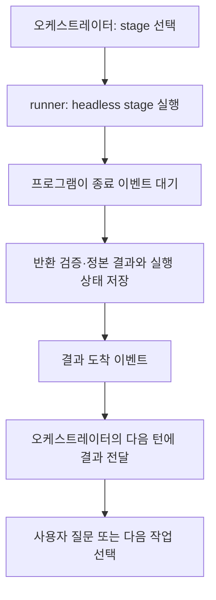

# 스킬 공개 범위 축소와 stage 실행 컨텍스트 개선 계획

작성일: 2026-11-05. 조사 기준: Harness source `419fdb0d`와 계산기 비교 실행의 실제 세션 기록.

이 문서는 스킬 내부화·삭제와 컨텍스트·재개·결과 전달 개선을 묶는다. 독립 계획 리뷰를 통과한 뒤 사용자가 2026-11-05에 **전체 계획 구현 — 스킬 정리와 지침·재개·리스너·컨텍스트 개선까지**를 선택했다. 아래 전체 범위가 구현 대상으로 확인됐으며, 실제 구현·검증 결과는 계획 내용과 구분해 보고한다. 작업 추적은 Beads `harness-woxz`에서 관리한다.

## 진행 방식

사용자의 2026-11-05 지시에 따라 이 작업은 **계획 → 독립 리뷰 → 사용자 확인 → 구현** 순서로 진행한다. Harness orchestrator, workflow 구성, 별도 Spec·티켓 작성, worktree 생성 절차를 실행하지 않는다.

1. 메인 세션이 이 계획의 범위와 변경 내용을 정리한다.
2. 독립 reviewer가 계획의 누락·충돌·실현 가능성을 검토한다. 지적은 계획에 반영한다.
3. 검토 결과와 수정된 계획을 사용자에게 보여주고 구현 범위를 확인받는다. 무응답을 확인으로 대신하지 않는다.
4. 확인된 범위만 `gpt-6-luna`, `medium` 서브에이전트가 현재 workspace에서 구현한다. 변경에 필요한 native 검증과 소비자 배포 확인을 수행한다.

순서 지정 전에 작성한 스킬 정리 수정본과 개인 전역 스킬 변경을 보존한 뒤, 사용자 확인에 따라 전체 구현을 이어간다. 소스 commit·push·실제 소비자 update는 통합 검증 뒤 수행한다.

## 1. 목표와 확인된 병목

사용자는 `orchestrator`, `eli5`, `setup`으로 Harness에 진입한다. 그 외 절차는 orchestrator와 해당 작업이 필요한 시점에 내부 GUIDE로 읽는다. 공개 이름·description·경로를 모든 실행에 상시 주입하지 않는다.

계산기 비교 실행에서 Product 질문 두 묶음을 반환하는 동안 하위 모델 응답 9회, 하위 도구 호출 7회, 부모 입력 준비·실행 4회, 부모 대기·로그 조회 10회가 발생했다. 하위 실행 시간 합계는 약 115초다. 동일 provider/session 재개와 이전 답변 전달은 정상이며, 답변 유실을 병목 원인으로 보지 않는다.

최초 모델 입력은 파일을 읽기 전부터 19,619토큰이었다. 기록에 보이는 주요 구성은 다음과 같다. 문자열 크기는 토큰별 기여도나 API 과금량이 아니다. metadata와 실제 메시지에 같은 지침이 기록된 경우 한 번만 센다.

| 구성 | 관측값 | 한계 |
|---|---:|---|
| 자동 스킬 안내 | 49개, 전체 약 17,100자 | 목록 항목만 13,455자이며 본문은 포함하지 않음 |
| 도구 정의 | 직렬화 JSON 44,325자 | 실제 전송 인코딩·항목별 토큰 기여도는 미측정 |
| 선택된 모델의 기본 지침 | 17,793자 | Harness Markdown이 아닌 모델 기본 작업 지침 |
| Ponytail 추가 지침 | 3,010자 | 별도 hook에서 들어와 스킬 목록 생략만으로 제거되지 않음 |
| 멀티에이전트 안내 | 2,671자 | 필수 독립 리뷰와 해당 역할 경계는 유지해야 함 |
| 작업 지정 문장 | 662자 | 입력 파일·workspace와 실행할 작업을 지정 |

질문 두 묶음까지 누적 모델 입력은 291,559토큰이며, 이 중 캐시 입력은 209,664토큰이다. 누적 입력에는 반복된 대화 이력이 포함된다. 재개 첫 요청에서 캐시 입력이 0으로 보고됐지만, 원인이 출력 schema·도구 정의·실행 재시작 중 무엇인지는 분리하지 않았다. 세 번째 실행은 usage limit으로 실패했으며 첫 실행 시점부터 사용률이 95%여서 해당 실행만으로 제한에 도달했다고 단정하지 않는다.

근거: 소스 workspace `.io/runtime/calculator-comparison/`의 `bottleneck-diagnosis-20261105.json`, `initial-context-analysis-20261105.json`, `initial-skill-catalog-20261105.json`, `initial-tool-definitions-20261105.json`. 이 경로는 로컬 진단 증거이며 소비자 설치 자산이 아니다.

## 2. 이번 구현: 공개 진입점과 개인 스킬 정리

### Harness

공개 `SKILL.md`는 `orchestrator`, `eli5`, `setup` 세 개만 둔다. 나머지 19개는 `.codex/internal-skills/<name>/GUIDE.md`로 옮기고 scripts·references·assets를 함께 이전한다. 공개 frontmatter와 공개 호출용 metadata를 제거한다. 원래 공개 경로의 alias나 wrapper는 남기지 않는다.

대상: `attention-span`, `beads`, `code-review`, `correct`, `diagnosing-bugs`, `e2e-test`, `evaluate-harness`, `frontend-design`, `gh-open-pr`, `grilling`, `harness-maintenance`, `harness-recover`, `implement-wrapper`, `knowledge-harvest`, `maintain-verification`, `spec-me`, `to-ticket`, `tracker-publish`, `victorialogs-local-setup`.

실행기·workflow loader·agent profile·공개 진입 지침·설치 검사·현재 문서의 호출을 내부 경로로 바꾼다. 내부 GUIDE 읽기는 Codex 또는 Claude의 native `Skill` 호출이라고 표현하지 않는다. Claude에도 같은 내부 절차를 설치하고, 공개되지 않은 스킬을 `Skill` 도구로 호출하지 않도록 한다.

### 개인 전역 스킬

`codebase-summary`, `commit-slices`, `figma-build`, `figma-codegen`, `notion-spec-to-implementation`, `rundown`, `spartan`, `tldr`은 사용자 전역의 비탐색 경로 `~/.agents/internal-skills/<name>/GUIDE.md`로 옮긴다. 관련 자료와 license는 보존한다. Figwright adapter처럼 이 자료를 실제로 사용하는 caller는 내부 GUIDE를 필요할 때 읽게 한다. 새로운 전역 상시 카탈로그는 만들지 않는다.

`attention-kind`는 활성 설치와 활성 참조에서 제거한다. 이를 다시 설치·상시 적용하는 관리 지침도 정리한다. 세션 이력과 과거 로그를 삭제하거나 다시 쓰지 않는다.

이번 범위는 지정한 전역 스킬과 Harness 자산이다. 다른 사용자 스킬·플러그인·인증·모델 설정을 일괄 변경하지 않는다.

### 배포와 검증

managed discovery와 transforms → fresh install → update의 기존 공개 자산 제거 → Doctor → Git 제외 규칙까지 같은 변경에서 확인한다. 기존 사용자 수정은 백업·소유권 확인 없이 제거하지 않는다. Harness 소스의 오래된 `.agents/skills` 사본도 파일별 백업을 확인한 뒤 정리한다.

Codex `.agents/skills/`와 Claude `.claude/skills/`에는 Harness 공개 진입점 세 개만 설치되어야 한다. 내부 GUIDE와 지원 파일은 설치·업데이트 대상이고 공개 카탈로그에는 들어가지 않아야 한다. 사용자 소유 스킬을 Harness 스킬로 오인하지 않는다. 생성물은 Git에서 제외하고 `docs/agents/EXEC.md`, `docs/agents/execution.json`, `docs/contracts/**`와 앱 변경은 계속 추적 가능해야 한다.

소스 commit과 upstream push 확인 후 실제 소비자를 업데이트한다. 미커밋 프로젝트 변경은 사전에 백업하고 update 후 내용과 Git 가시성을 대조한다.

## 3. 필요한 단계의 지침만 읽기

`spec-me` 진입 GUIDE는 내부 순서·역할·필수 gate를 짧게 설명한다. 상세 지침은 다음 시점에 읽는다.

| 내부 진행 단계 | 그때 필요한 지침 |
|---|---|
| Product 질문 | 질문 선정 규칙·coverage checklist·해당 프로젝트의 요구와 기존 결정 |
| Product 작성 | Product template·작성 규칙 |
| Architecture | Architecture 결정·작성 절차; 중요한 미결정이 있을 때만 기술 선택 GUIDE |
| 독립 리뷰 | Spec review 절차·현재 두 Spec·fresh reviewer profile |
| 다이어그램 | 확정 inventory의 해당 작성·렌더·완료 규칙 |

phase 전환 자체를 새 모델 호출·새 stage·새 에이전트로 만들지 않는다. 같은 실행에서 필요한 다음 지침을 읽으며 진행한다. Product 질문 전에 Architecture·리뷰·렌더 지침을 미리 전부 읽도록 유도하는 링크·호출 지시를 정리한다. 전체 workflow 지도는 다음 단계 판단이 필요한 orchestrator가 소유한다.

필수 독립 리뷰·실제 사용자 선택·승인·workspace 검증·현재성 gate는 유지한다. 중대한 미결정은 질문하고, 독립 질문은 묶으며, 위임된 선택은 근거와 함께 재사용한다.

## 4. 최초 실행과 재개 입력 구분

현재 runner는 재개에도 `Read <skill entry>`를 반복한다. 최초 실행은 해당 진입 지침과 현재 단계 입력을 제공하고, 같은 session 재개는 새 답변·피드백·현재 내부 단계·이어갈 위치만 전달하도록 바꾼다.

내부 진행 단계와 실제 전달된 지침의 버전은 기존 stage 실행 기록에서 runner가 관리한다. 모델에 해시 복사나 별도 완료·읽기 receipt를 요구하지 않는다. 전달되지 않았거나 바뀐 지침만 다시 제공한다. 새 session 또는 context 압축으로 필요한 정보가 빠진 경우 현재 단계의 핵심 규칙과 정본 참조를 복구한다. 필요한 지침이 대화에 남아 있다고 근거 없이 가정하지 않는다.

재개는 기존 `worktree.json`의 provider/session 연결과 process identity 검증을 유지한다. 이미 실행 중인 stage는 추가로 띄우지 않는다. 최초 읽기·신규 세션 복구와 같은 대화 재개를 명확히 구별한다.

같은 대화의 누적 이력은 남는다. 재독 제거가 모든 입력 토큰을 없애는 것으로 설명하지 않는다. 같은 phase 내의 재개에서는 도구 구성과 고정 지침을 안정적으로 유지하고, 캐시가 실제로 사용됐는지는 provider의 실제 usage로 측정한다.

## 5. 결과 이벤트로 오케스트레이터 재개

사용자 제안에 따라 모델을 쓰지 않는 프로그램이 stage 결과를 기다린다. 현재 `codex-process.mjs`와 Claude adapter의 자식 종료 이벤트 처리를 재사용한다. 모델이 `sleep → 로그 조회`를 반복해서 완료를 알아내게 하지 않는다.

### 이벤트 계약

- 대상은 `completed`, 질문 대기, 실패, 취소를 포함한 모든 실행 결과다. 종료 코드 0만으로 성공을 만들지 않는다.
- 기존 결과 검증을 통과하고 `result.json`과 현재 실행 상태를 저장한 뒤 알린다. 검증 실패·프로세스 실패도 명시적 실패 결과로 기록해 알린다.
- 알림에는 workspace 소유권을 확인할 `worktree_ref`, `execution_id`, 검증된 `status`·`code`·`summary`·`questions`·`result_ref`를 넣는다. 전체 로그와 전체 Spec을 복제하지 않는다.
- heartbeat·진행 로그는 프로그램과 UI에서 처리하고 오케스트레이터 모델의 재호출 조건으로 쓰지 않는다.
- `execution_id`와 현재 stage를 대조해 중복 또는 이전 실행 알림이 다음 작업을 다시 실행하지 못하게 한다. 수신·처리 상태는 기존 session 실행 기록에 두고 새 정본 ledger를 만들지 않는다.
- 감지·전달 프로세스가 재시작되면 알려진 활성 workflow의 저장된 미전달 결과를 대조해 복구한다. 파일 쓰기 중간 상태와 결과 저장 직후 crash도 복구 대상이다.

### 실행 환경 연결

현재 채팅에 새 턴을 여는 기능은 host adapter가 제공해야 한다. 리스너가 결과 파일을 발견하는 것만으로 현재 대화에 자동 입력할 수 있다고 가정하지 않는다. 오케스트레이터가 처리 중이면 결과를 큐에 두고, 수신 가능한 시점에 같은 대화의 다음 입력으로 보낸다. 같은 활성 세션에 별도 `codex exec resume`를 동시에 띄우지 않는다.

host가 제공하는 실제 입력·재개 수단은 구현 전에 확인한다. 대화형 host와 supervisor가 직접 소유한 headless orchestrator를 구분해 각 수단의 동일 session 재개·중복 방지·사용자 질문 전달을 검증한다. 완료 알림을 외부 사용자 메시징 서비스로 전송하는 설계는 포함하지 않는다.

## 6. 초기 스킬·도구·기본 지침 축소

### 할당된 stage의 자동 카탈로그 생략

메인 공개 진입 목록과 작업이 이미 할당된 하위 실행의 목록을 구분한다. Codex stage 실행에는 `skills.include_instructions=false`를 적용하고 runner가 정해진 내부 GUIDE와 현재 단계 입력을 전달한다. 초기 skill 검색이 필요 없는 실행에 개인·플러그인 카탈로그를 상시 넣지 않는다.

기록상 `host_skills` 경로로 제공된 안내가 실제로 빠졌는지 새 실행의 초기 context로 확인한다. 설정 키가 수용됐다는 것만으로 제거 성공을 보고하지 않는다. Claude의 내부 GUIDE도 공개 `Skill` 검색 없이 진입하도록 같은 역할 경계를 적용한다.

### 필요한 기능과 도구만 제공

provider adapter의 실행 단위에서 역할에 필요한 기능을 선택한다. Product 질문은 문서 입력·출력 중심, 기술 조사는 필요한 웹·자료 도구, 독립 리뷰와 다이어그램은 해당 역할과 도구를 제공한다. 리뷰를 위해 필요한 native subagent 기능을 단순히 전체 해제하지 않는다.

CLI가 지원하는 plugin/app/MCP 비활성화와 도구 허용 목록을 사용하고, host가 직접 주입하는 도구는 그 host의 노출 제어까지 연결한다. 사용자 전역 설정을 편집해 모든 대화를 바꾸지 않고 실행별 설정으로 적용한다. 필요 없는 이미지 생성·플러그인 설치·전체 에이전트 역할 목록이 자동으로 붙는 경로를 확인한다.

### 하위 작업용 기본 지침

카탈로그·도구 축소를 먼저 측정한 뒤 `model_instructions_file`을 사용하는 짧은 하위 작업용 기본 지침을 검토한다. 작업 범위·사용자 선택·승인·workspace 경계·오류 처리·필수 검증·결과 형식과 명시적 사용자 제약을 보존한다. 해당 역할과 관계없는 대화 표현·PR 작성법·범용 탐색 안내를 반복하지 않는다.

Ponytail hook은 별도 주입 경로로 취급한다. 사용자가 지정한 최소 구현·검증 원칙을 보존하면서 하위 작업에 필요한 형태로 전달하는 방법을 확인한다. 기본 지침 파일 변경이 hook 주입까지 자동으로 없애는 것으로 설명하지 않는다. 관리 정책·권한·안전 검증을 프롬프트 절감 명목으로 약화하지 않는다.

공식 근거: [Codex 설정](https://learn.chatgpt.com/docs/config-file/config-reference), [에이전트별 기능과 지침](https://learn.chatgpt.com/docs/agent-configuration/subagents), [스킬 탐색과 설정](https://learn.chatgpt.com/docs/build-skills). 실제 설치 CLI 버전과 host가 설정을 적용하는지도 함께 검증한다.

## 7. 구현 순서와 검증 기준

이번 스킬 정리 후, 단계별 지침 로딩 → 변경분 중심 재개 → 이벤트 결과 전달 → 하위 실행 카탈로그·도구 제한 → 기본 지침 축소 순서로 구현한다. 각 변화의 효과를 분리할 수 있도록 이전 단계의 실제 실행 근거를 보존한다.

| 경로 | 확인할 결과 |
|---|---|
| Fresh install·update | 공개 세 개, 내부 GUIDE 존재, 제거 대상 공개 경로 없음, 지원 자료와 상대 링크 정상 |
| Codex·Claude | 같은 내부 절차 실행, 없는 공개 skill 호출 없음, 필수 리뷰와 gate 유지 |
| 같은 session 질문 재개 | 기존 답·위임 재사용, 변경 없는 지침 재독 제거, 미전달·압축된 핵심 context 복구 |
| 이벤트 전달 | 정상·질문·실패·취소 모두 전달, 모델 polling 없음, 중복 stage dispatch 없음 |
| 중단·재시작 | 결과 저장 직전·직후와 전달 직후 중단 복구, 미완료 작업을 완료로 오인하지 않음 |
| 초기 context | 지정 스킬 목록 제거와 도구 축소를 실제 로그에서 확인, 총 입력과 캐시 입력을 별도 측정 |
| 품질·속도 | 같은 요청·답변·모델·effort·종료 범위에서 산출물과 필수 gate, 모델 응답·도구 호출·시간·토큰 비교 |
| Git·Doctor | 관리 자산 ignore, 앱·준비 문서 변경 보존, inventory·공개 경로 진단 정상 |

설치·라우팅·전달·복구는 먼저 native 단위·소비자 회귀로 확인한다. 실제 모델 실행은 고정된 요청과 사전 정의한 의미적 oracle로 비교하며 동적 답변 문구의 exact match를 사용하지 않는다. 서버·인프라를 사용하는 E2E는 승인된 시나리오와 runner로만 실행한다. 비용·시간 절감률은 실제 비교가 끝나기 전에 확정하지 않는다.

소비자 배포는 모든 후속 변경에서도 source push와 upstream 확인을 먼저 수행한다. 기존 데이터·경로·호출 방식의 호환을 유지하기 위한 alias나 이중 실행 경로는 만들지 않고, 변경된 정본과 실제 caller·설치·진단·fixture를 함께 갱신한다.

## 8. 구현 검증과 시작 컨텍스트 실측

2026-11-05 구현 뒤 native 전체 회귀 검사 `node --test tests/*.test.mjs`가 69/69 통과했고, 별도 읽기 전용 통합 리뷰도 통과했다. listener는 실제 분리된 task/control session을 가진 임시 설치 소비자와 Git worktree에서 결과 도착·질문·실패·취소·중단 복구·중복 전달·호스트 timeout을 검증했다. 전체 검사에서는 실제 대화에 테스트 알림이 전송되지 않도록 host 환경을 분리하고 호스트 CLI를 stub으로 대체했다.

초기 컨텍스트는 같은 임시 설치 소비자, 같은 짧은 요청과 출력 schema, 같은 `gpt-6-luna / medium`으로 native CLI 두 세션을 새로 실행해 비교했다. 비교의 기본 실행도 이미 스킬 정리가 반영된 현재 환경이다. 과거 49개 목록을 가진 전체 계산기 workflow와 직접 비교한 수치가 아니다.

| 관측 항목 | 기본 실행 | 범위를 제한한 실행 |
|---|---:|---:|
| 최초 입력 토큰 | 15,006 | 8,076 |
| 캐시 입력 토큰 | 0 | 0 |
| 출력 토큰 | 15 | 15 |
| 자동 스킬 목록 | 15개 | 0개 |
| 자동 스킬 안내 문자열 | 7,402자 | 0자 |
| 기본 지침 문자열 | 17,793자 | 471자 |
| 도구 정의 직렬화 JSON | 39,762자 | 33,135자 |

최초 입력은 약 46.2% 줄었다. 두 실행 모두 도구를 사용하지 않는 시작 요청이므로 전체 workflow의 품질이나 완료 시간 개선을 증명하지 않는다. 도구 정의 문자열 차이를 같은 비율의 토큰 비용으로 환산하지 않는다. 역할에 필요한 기본 도구와 권한 안내는 계속 제공되며, 필요한 도구를 쓰지 않겠다는 모델의 판단만으로 이미 전달된 정의를 입력에서 없앨 수는 없다.

현재 대화로의 실제 호스트 전송도 별도로 확인했다. 호출 세션 신원과 수신 세션이 같은지 확인한 뒤 진단 데이터 한 개를 큐에 넣었으며, 같은 request ID로 재전송했을 때 `duplicate: true`와 같은 queue ID가 반환됐다. 이는 실제 큐 수락·중복 억제 검증이며 현재 턴 종료 후의 수신 완료 또는 전체 workflow E2E 완료로 과장하지 않는다.

로컬 원본 근거는 `.io/runtime/skill-exposure/verification/`와 `context-probe/measurements.json`에 보존한다. 개인 스킬과 원본 생성 사본의 변경 전 백업은 같은 runtime 디렉터리의 `personal-backup/`, `source-agent-copies/`에 보존했다. 이 진단·백업 파일들은 공개 스킬·소스 산출물에 포함하지 않는다.
