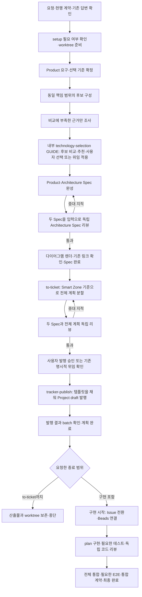

# spec-me 기술 선택과 workflow 단순화 구현 계획

작성일: 2026-11-05. 조사 기준: Harness source `6540de03`.

이 문서는 기존 기술 선택 개선 계획에 workflow 전체의 기록·해시·승인·리뷰 부담 조사와 오케스트레이터 가이드 정비를 합친 구현 제안이다. 현재 실행기·스킬·설치 자산을 수정하거나 진행 중인 workflow를 복구한 결과가 아니다.

## 1. 목표와 실행 흐름

기준을 정하고, 같은 기준으로 후보를 비교한 뒤, 사용자가 감수할 트레이드오프를 선택하게 한다. 기술 선택 절차는 공개 스킬 카탈로그에 등록하지 않는 내부 GUIDE로 분리한다. 작성자는 Spec과 계획의 내용을 작성하고, 실행기는 경로·식별자·기록·현재성 검사를 맡는다. 오케스트레이터에는 단계 선택에 필요한 요약과 미완료 의무를 제공해 정해진 gate 안에서 다음 하위 스킬을 고르게 한다.

위 흐름은 기본 Spec·계획·구현 경로다. Learning 토론, 프로젝트 지식 게시, frontend-design, standalone E2E는 각각 적용 조건에 맞는 분기다. Learning 토론을 요청한 경우의 결정 검토는 기술 선택과 Spec 확정 사이에 둔다.

## 2. 현재 workflow 조사 결과

조사 범위는 진입 hook·compose·입력 준비·provider dispatch·질문과 재개·Spec 결정·독립 리뷰·계획 분할·발행·구현 dispatch와 완료·E2E·계약·설치/update/Doctor다. 선언된 workflow와 실제 runtime의 읽기·쓰기·검사 경로를 대조했다. 모든 분기의 실제 실행 시간이나 과거 실패의 단일 원인을 재현한 조사는 아니다.

| 확인한 구조 | 근거 | 과도하거나 충돌하는 부분 | 계획에 반영할 변경 |
|---|---|---|---|
| writer receipt는 이미 제거됨 | `spec-me/SKILL.md`, `tests/worktree_record_contract.test.mjs` | writer receipt 삭제만 반복해서 제안하면 남아 있는 문제를 해결하지 못함 | 남은 리뷰·승인·발행·실행 기록을 각각 정리 |
| reviewer가 입력 파일별 해시를 반환함 | `plan-review/GUIDE.md`, `spec-review/GUIDE.md`, `skill-execution.mjs` | 실행기가 발급한 값을 모델이 복사하고 다시 대조함 | reviewer는 판정·지적을 반환하고 실행기가 admission과 실제 agent metadata를 연결 |
| 계획 snapshot이 로컬 링크를 재귀 탐색함 | `workflow/plan-review.mjs:97` | 링크된 Markdown이 추가 링크를 끌어들여 검토·무효화 범위가 확장됨 | 두 Spec·계획 index·전체 split plan으로 검토 범위를 명시 |
| 계획 snapshot이 부가 파일도 고정 포함함 | `workflow/plan-review.mjs:112` | glossary·통합 계약·실행 설정 변경만으로 계획 리뷰가 stale이 될 수 있음 | 부가 자료는 작성자가 필요한 내용을 Spec·계획에 반영하며 자동 snapshot 확장을 제거 |
| 계획 상태 제외가 일관되지 않음 | `workflow/plan-review.mjs:13,120,171` | canonical plan 설명용 해시는 `status`를 제외하지만 review snapshot은 파일 전체를 해시함 | 기존 `status` 제외 처리를 계획 snapshot에도 일관되게 적용; 본문 변경은 계속 감지 |
| 리뷰 뒤 다이어그램을 생성함 | `spec-me.yaml`, `adversarial-spec-review.md`, `stage-gates.mjs` | 이때 Spec 링크까지 추가하면 통과한 두 Spec이 바뀌어 stale이 되는 경로가 있음 | 필요한 링크와 해당 없음 결정을 리뷰 전에 작성; 렌더 단계는 diagram 파일만 생성 |
| 자료 수집이 승인된 durable Evidence에 연결됨 | `decision-knowledge.md`, `knowledge/evidence.mjs`, `decision/artifacts.mjs` | 이번 비교에 쓸 문서 사실 하나도 snapshot·요약 승인·게시·참조 절차로 확대됨 | 결정에 필요한 출처 인용과 프로젝트 지식 게시 절차를 분리 |
| Learning 결정 검토와 Spec 리뷰가 별도로 존재함 | `architecture-review/GUIDE.md`, `spec-review/GUIDE.md` | 자료 사용 승인과 기술 선택 승인이 여러 번 끼어들 수 있음 | 실제 선택·트레이드오프는 사용자에게 묻고, 일상적인 출처 조사 승인 연쇄를 제거 |
| 실행 결과가 원문·result·return에 걸쳐 존재함 | `harness-result.mjs`, `stage-input.mjs` | 여러 표현의 필드·해시 불일치를 복구 코드가 특별 취급함 | `result.json` 정본과 실행기에서 파생하는 반환만 유지; 모델의 중복 파일 작성 제거 |
| publisher가 별도 완료 파일을 작성함 | `tracker-publish/SKILL.md` | 발행 journal·완료 파일·stage result에 mapping과 상태를 중복 작성함 | journal에 성공한 mutation을 기록하고 실행기가 stage 결과를 생성 |
| 완료 hook의 일부 항목은 입력 boolean만 검사함 | `gates/lifecycle.mjs`의 `required_outcome`, `evidence`, `evidence_flush` | 모델이 적은 `true`를 위한 별도 완료 자료가 생기며 실제 동작 검증과 중복됨 | 실제 산출물·리뷰·journal·종료 결과에서 유도; 독립 근거가 없는 중복 선언 제거 |
| coverage gate 이름 일부는 manifest에만 선언됨 | `workflow/loader.mjs`, `workflow/stage-gates.mjs` | `product_coverage` 등은 등록된 stage evaluator와 같지 않아 자동 검사로 오인 가능 | 자동 검사와 작성·리뷰 판단을 가이드에 구분; 기존 검사에 연결되지 않는 선언 정리 |
| 동일 snapshot을 여러 경계에서 검사함 | `plan-review/GUIDE.md`, `stage-input.mjs`, `skill-execution.mjs`, `completion.mjs` | pass 후 작성자 재개·작성 완료·발행 전·최종 완료에서 중복 조율이 발생 | 변경 가능한 경계와 외부 mutation 직전 검사는 유지하고 같은 동작 안의 중복 호출 제거 |

해시 계산의 CPU 비용이 긴 실행의 주원인이라고 단정하지 않는다. 코드상 확인된 부담은 모델의 해시 복사, 별도 파일 작성, 넓은 무효화 범위, 자료 승인 대기, 같은 입력의 재검토·재개다. 구현 후 기존 process log의 시각으로 각 항목의 시간을 비교한다.

## 3. Product 단계에서 선택 기준 확정

기술 이름을 선택하기 전에 다음 중 프로젝트에 적용되는 기준과 우선순위를 정한다.

| 기준 | 확인할 내용 |
|---|---|
| 기능 충족 | 로그인·비밀번호 복구·계정별 이력 격리 등 필수 기능 |
| 구축 시간 | 출시 기한, 팀 경험, 재사용 가능한 기존 기능 |
| 운영 부담 | 서버·DB·인증·복구를 누가 관리하는가 |
| 비용 | 예상 사용량, 허용 월 비용, 증가 시 비용 구조 |
| 데이터 제어 | 접근·이전·삭제·인증 정책의 통제 범위 |
| 성능 | 대표 요청, 데이터량, 동시 사용량과 응답시간 목표 |
| 변경 가능성 | 커스터마이징, 서비스 이전, 예상 변경 |

기준은 필수 조건과 선호 조건으로 구분한다. 수치가 필요한 항목은 목표·단위·조건·출처를 기록하고, 정성 기준은 구체적인 판정 조건을 기록한다. 임의의 가중 점수나 모든 지표의 수치화를 강제하지 않는다. 미확정 목표는 사실처럼 채우지 않는다.

기존 답변과 위임을 먼저 적용하고, 독립적으로 답할 수 있는 필수 질문은 한 묶음으로 제시한다. 선행 답변에 따라 달라지는 질문만 다음 묶음으로 미룬다.

Product Spec에는 요구사항·품질 목표·비용/운영/데이터 제약·우선순위와 허용 가능한 절충을 기록한다. 후보별 기술 구현 세부사항은 Architecture에서 작성한다.

## 4. 후보 구성과 비교 근거 수집

`Django + 직접 관리하는 DB + 배포/메일 구성`과 `Next.js + Supabase + 배포/메일 구성`처럼 같은 기능과 운영 책임을 제공하는 후보 조합을 비교한다. 이미 충족하는 기존 구성을 유지하는 안도 유효한 후보다. 실제 대안이 없는 결정에 비교용 후보를 억지로 만들지 않고 제약을 설명한다.

후보를 확정하기 전에 요구사항과 비교 기준을 먼저 정한다. 근거 조사는 후보 목록을 바꿀 수 있다. 각 후보의 장점을 모아 채택을 정당화하는 방식으로 작성하지 않는다.

수집 단위는 출처 문서 전체가 아니라 결정에 영향을 주는 주장과 확인할 사실이다. 예를 들어 운영 책임의 주체, 필요한 인증 구현 작업, 변경 가능한 인증 정책, 동일 사용량의 비용, 데이터 이전 제약과 같은 조건의 성능을 조사한다.

기존 ADR·제약·승인된 프로젝트 지식·실측을 먼저 사용한다. 부족한 주장만 추가 조사하고 주장 옆에 출처 URL/문서 위치·적용 버전/조건·확인일을 남긴다. 공식 문서는 기능·제약·책임의 사실을 확인하는 출처다. 선택 이유는 그 사실을 프로젝트 기준에 대입한 비교로 설명한다.

이번 결정에 쓰는 일반 출처마다 Source → Claim → Principle → Evidence를 생성하거나 별도 원문 snapshot·해시·자료 사용 승인·요약 게시를 요구하는 경로는 제거한다. 검증된 실측 Evidence나 승인된 Principle이 이미 있으면 재사용한다. 자료를 프로젝트 공통 Knowledge로 승격하는 경우에만 기존 knowledge-harvest의 독립 검토·승인·게시 절차를 사용한다. 기존 Knowledge lifecycle을 완화하거나 새 자료를 승인된 Principle처럼 표시하지 않는다.

## 4.1. 기술 선택 절차를 내부 skill로 분리

기술 선택 절차를 `.codex/internal-skills/technology-selection/GUIDE.md`로 분리한다. 공개 스킬 카탈로그나 `.agents/skills`/`.claude/skills`에 등록하지 않고, `SKILL.md`와 공개용 description도 만들지 않는다. 따라서 시작 시 스킬 이름·description을 모델에 노출하지 않는다. 호출자가 필요한 시점에 해당 GUIDE 경로를 읽으라고 지시하고, 실행기는 같은 provider의 기존 하위 agent dispatch를 사용한다. 별도 CLI 실행기나 중첩 오케스트레이터를 만들지 않는다.

`spec-me`는 기술 선택이 아직 끝나지 않았거나 기존 결정이 요구·제약을 더는 충족하지 못할 때만 이 GUIDE를 읽고 수행한다. 기존 결정이 충분하면 재사용하고 새 비교를 생략한다. caller에는 짧은 조건부 지시만 둔다. 예: “중요한 기술 선택이 남아 있으면 `.codex/internal-skills/technology-selection/GUIDE.md`를 읽고 그 절차를 수행한다.”

이 구조는 카탈로그 description을 상시 context에 넣지 않지만, 실제 호출에서는 GUIDE 본문과 필요한 입력이 context를 사용한다. 파일을 공개 등록하지 않고 내부 prompt로 읽히는 방식이므로 Codex/Claude의 native `Skill` tool 호출이라고 표현하지 않는다. provider마다 호출 수단이 달라도 기술 선택의 업무 절차와 결과 형식은 공유한다.

GUIDE는 기준 확정 → 동일 책임 범위 후보 비교 → 부족한 사실만 조사 → 사용자 선택/위임 반영 → 기존 Architecture Decision 갱신 순서를 소유한다. Product 요구와 System Targets를 읽고, 추가 질문이 필요하면 `spec-me`에 독립 질문을 모아 돌려준다. Product Spec 수정, Architecture Spec 작성, 독립 Spec 리뷰, 티켓 발행은 소유하지 않는다. 출처 발췌 수집을 reusable Knowledge 게시 절차로 확대하지 않으며, 게시가 명시된 경우에만 `knowledge-harvest`로 넘긴다.

## 5. 같은 기준으로 평가하고 사용자가 선택

기존 Architecture Decision에 비교 기준·후보별 평가·출처·실제 선택을 담는다. 별도 비교 receipt를 만들지 않는다.

| 기록할 내용 | 작성 기준 |
|---|---|
| 기준 | 요구 ID, 목표/단위 또는 판정 조건, 필수/선호, 우선순위 |
| 후보 평가 | 기준별 충족·미충족·미확인과 구체적 이유 |
| 근거 성격 | 실측 / 외부 측정 / 문서 사실 / 추정 / 미확인 |
| 선택 | 채택·기각 이유, 수용한 단점, 불확실성, 재검토 조건 |
| 사용자 결정 | 제시한 선택 내용과 실제 답변, 또는 적용한 명시적 위임 |

“운영이 어렵다”는 말은 직접 맡는 작업과 필요한 운영 환경으로 설명한다. “빠르게 시작한다”는 말은 재사용 가능한 기능과 추가 구현 범위로 설명한다. 근거 없이 개발 일수나 성능 차이를 숫자로 만들지 않는다.

응답시간의 수치 비교는 요청·데이터·부하·배포 환경·버전·측정 출처가 비교 가능한 경우에만 사용한다. 외부 벤치마크를 현재 앱의 실측으로 표시하지 않는다. 중요한 미확인 항목은 필요한 측정을 제안하거나 사용자가 수용할 불확실성으로 제시한다. Spec 작성마다 모든 후보 앱을 구현해 벤치마크하지 않는다.

사용자 질문에는 필수 조건 충족 여부, 기준별 차이, 후보별 감수할 비용, 현재 우선순위에 따른 추천을 함께 보여준다. 실제 선택·위임 범위를 기록하고 자료를 읽겠다는 동의를 기술 채택으로 해석하지 않는다. 이미 위임한 범위의 결정은 비교와 이유를 제시하고 진행하며 다시 같은 승인을 요청하지 않는다.

Architecture Spec의 기존 `Alternatives and Trade-offs`를 확장해 비교 결과와 채택 이유를 읽을 수 있게 한다. Decision YAML의 모든 필드를 다른 표와 보고서에 반복하지 않는다. 새로운 결정에는 기준·평가·선택 이유를 요구하되 과거 결정에 소급해 실패를 만들지 않는다.

## 6. receipt와 해시 처리 축소

목표는 모델이 절차 증명 문서를 작성하거나 해시를 계산·복사하지 않아도 workflow가 진행되는 것이다. 필요한 실행 기록은 기존 실행기가 `.io` 내부에 자동 저장한다.

| 현재 기록/요구 | 처리 방향 |
|---|---|
| writer receipt·writer 요청 envelope | 제거된 상태 유지; 대체 증명 문서 추가 없음 |
| reviewer가 반환하는 파일별 `inputs.sha256` | 모델 출력에서 제거; 실행기가 admission에 묶인 파일을 직접 확인 |
| reviewer/author ID·attempt ID·workspace 경로의 수작업 조립 | 실제 호출 metadata와 정본에서 실행기가 결합; 모델의 자기 주장으로 채우지 않음 |
| 일반 artifact의 모델 작성 `sha256` | 모델에 계산을 요구하지 않음; 필요한 소비자가 있으면 실행기가 자동 계산, 없으면 생략 |
| Decision 승인용 `subject_hash` | 사용자가 선택한 실제 내용에 실행기가 승인을 연결하고 계산; 모델에 해시 전달·복사 요구 제거 |
| 이번 결정의 외부 문서 snapshot·승인 해시 | 일반 비교 출처에는 요구하지 않음; 인용 사실·위치·적용 조건 보존 |
| `result.json`과 반환 envelope | 상세 결과의 정본은 하나; envelope·provider 원문은 파생 출력/진단 로그이며 모델의 추가 작성 과제에서 제거 |
| publisher의 `completion.json` | 별도 모델 작성 완료 파일 제거; journal 결과를 실행기가 stage result에 반영 |
| workflow completion 기록 | 실제 gate 결과를 기존 completion 코드가 자동 기록; 별도 Markdown 증명서 없음 |
| `worktree.json`과 provider/process 식별 정보 | 유지; 경로·소유권·동일 provider/session 재개·실행 중복 방지에 사용 |
| publication journal | 유지; 성공 mutation·mapping·불명확한 응답을 보존해 draft/Issue 중복 생성 방지 |
| 테스트 로그·실제 E2E receipt | 실행기가 자동 생성하는 실제 실행 결과 유지; 일반 단위 테스트마다 E2E receipt를 요구하지 않음 |
| 설치 lock·contract inventory의 해시 | 설치 충돌 감지와 최종 구현 계약 검사에 사용; 모델의 문서 작성 단계에서 처리하지 않음 |

review admission의 내용과 실제 파일이 리뷰 중 또는 인계 전에 바뀌면 현재성 검사는 계속 실패해야 한다. 단순 revision 번호나 모델의 `reviewed: true`로 대체하지 않는다. 해시는 실제 검토나 사용자 승인의 진위를 증명하지 않으므로 실행기에서 확인한 호출과 답변도 함께 연결한다.

여러 정본의 불일치를 허용하는 예외를 늘리는 대신 기존 runner/result 경로에서 정본과 파생 출력을 함께 기록한다. 결과를 저장한 뒤 상태를 반영하기 전에 중단된 경우에도 검증된 결과에서 상태를 복구할 수 있어야 한다. 과거 파일은 읽기 호환만 제공하고 자동으로 삭제·재작성하거나 백업하지 않는다.

## 7. 리뷰·gate·재개 절차 축소

Spec 독립 리뷰는 현재 합의대로 Product Spec과 Architecture Spec 두 문서만 읽는다. 필수 Aggregate, Entity/VO, Application Service, BC와 핵심 요구·업무 규칙·동작의 누락과 모순을 본다. 기술 출처나 공식 문서·Knowledge registry를 다시 심사하지 않는다.

계획 독립 리뷰는 두 Spec·계획 index·전체 split plan만 읽고 요구사항 구현 범위, Smart Zone, 의존성과 인계, 필요한 테스트가 적절히 나뉘었는지 확인한다. Spec을 다시 설계하거나 기술 선택을 처음부터 토론하지 않는다. Spec이 불충분하면 해당 위치와 영향을 들어 spec-me로 반환한다.

두 리뷰 모두 첫 회는 전체 지정 문서, 재리뷰는 변경 부분·미해결 지적·직접 영향 관계를 확인한다. 새로운 reviewer는 이전 판정을 맹신하지 않고 변경이 그 판정에 영향을 주는지 판단한다. 중대 지적은 묶어서 수정하고 minor는 완료를 막지 않는다. 기존 반복 제한과 중복 실행 방지는 유지한다.

Learning 결정 검토는 사용자가 학습 토론을 선택한 경우의 별도 분기로 둔다. 기본 선택 흐름에서는 비교표·근거·실제 사용자 선택/위임을 기록한다. Normal에서도 일곱 항목을 사용자에게 수작업으로 인증하게 하는 별도 보고서·승인 절차를 제거한다. mode의 현재 기본값과 gate를 함께 바꾸며, 기존 실행의 명시적 mode와 미해결 사용자 결정을 조용히 바꾸지 않는다.

`begin → 실제 fresh reviewer → record`의 연결·해시·호출 metadata 저장은 기존 review 실행 경로가 담당한다. 모델은 문서 내용과 findings를 처리한다. 새로운 범용 실행기나 두 번째 상태 머신을 만들지 않는다.

pass 후 작성자를 다시 호출해 현재성만 확인하고 완료를 선언하는 재개는 실행기의 검증된 종료 처리로 대체한다. 수정이나 추가 판단이 있을 때만 같은 작성자 대화를 재개한다. review record 직후 같은 함수 안에서 수행하는 중복 검사는 합치고, 새 프로세스 진입·발행 직전·최종 완료처럼 변경 가능성이 있는 경계 검사는 유지한다.

`required_outcome.passed`, `evidence.complete`, `evidence_flush.flushed`를 모델이 별도 문서에 적도록 요구하는 경로를 제거한다. Spec 존재·현재 리뷰, 계획 index·전체 계획·리뷰, 발행 journal·실제 발행 결과 등 해당 단계의 실제 데이터를 기존 gate가 사용하게 한다. 자동 판정할 수 없는 요구 충족의 의미는 독립 리뷰의 책임으로 명시한다.

다이어그램 적용 여부와 문서 링크를 Spec 리뷰 전에 확정한다. 리뷰 뒤 생성 단계는 `.puml`·`.svg` 렌더와 링크 확인만 수행한다. Spec 본문의 의미를 고쳐야 하면 수정 후 해당 리뷰를 다시 받는다. 서식·링크 변경을 임의로 무시하는 범용 의미 해시를 추가하지 않는다.

Product·Architecture template도 현재 요구의 중복 기입 여부를 확인한다. 모델·Aggregate·서비스에 이미 적은 책임·실패·검증 내용을 별도 표에 반복시키지 않고, 요구사항과 관계없는 운영·복구·관측성 항목의 장문 작성을 강제하지 않는다. 필수 Aggregate와 실제 인증·격리·저장·실패 요구는 보존한다.

## 8. 오케스트레이터용 전체 흐름 가이드

현재 전체 흐름 문서는 `docs/architecture/workflow-lifecycle.md`에 존재한다. 그러나 2026-10-23 기준이며 별도 Product 리뷰·옛 `.git` session 경로·worktree 소유 receipt·예전 발행 단계가 섞여 있다. 현재 orchestrator SKILL에는 이 문서로 가는 링크가 없다. `docs/architecture/enforcement.md`와 `docs/agents/EXEC.md`에도 과거 절차와 충돌하는 설명이 남아 있다.

설치 소비자도 읽을 수 있는 공통 가이드를 `.codex/internal-skills/skill-execution/references/workflow-map.md`에 둔다. orchestrator SKILL과 실행 조율 GUIDE가 진입 시 이 짧은 지도를 읽도록 연결한다. 상세 규칙을 지도에 복제하지 않고 각 담당 GUIDE로 연결한다. 기존 workflow-lifecycle 문서는 같은 흐름을 설명하는 유지보수용 안내와 코드 링크로 정비한다.

공통 가이드에는 다음을 포함한다.

- 전체 순서와 각 단계의 책임·입력·최종 산출물·다음 단계·요청 범위별 정지 지점.
- stage를 orchestrator가 실행하는 경우와 stage 내부 native subagent가 수행하는 경우.
- `worktree.json`·Spec·계획·stage result·review history·발행 journal의 정본 위치와 작성 주체.
- `spec-me` 내부 Spec 리뷰, orchestrator가 담당하는 계획 리뷰, 구현 코드 리뷰의 범위와 반환 경로.
- 질문 묶음·기존 답변 재사용·위임·기술 선택·발행 승인의 구분.
- provider 선택과 같은 provider/session 재개, 프로세스 생존 확인, 실패·취소·수정 요청 라우팅.
- GitHub Project draft 발행 → 구현 시작 시 Issue 전환 → Beads 연결과 상태 동기화.
- Spec·계획 단계의 통합 계약 읽기와 최종 구현 단계의 계약 갱신 경계.
- 실행기가 자동으로 처리하는 내부 기록과 모델이 실제 작성할 제품 산출물.
- 실패 시 기록을 보존하며, 자동 백업·worktree 삭제·상태 수작업 수정으로 재개하지 않는 규칙.

Codex·Claude가 같은 내용을 설치받게 한다. provider별 문서에는 호출 방식만 두고 별도 업무 절차를 복제하지 않는다. startup hook에는 지도 링크와 현재 단계만 제공하고 긴 전체 지침을 매 호출에 복사하지 않는다.

### 단계 선택에 필요한 입력과 자율성

오케스트레이터의 입력을 모든 하위 문서와 대화 기록의 덤프로 만들지 않는다. 기존 정본에서 다음 요약을 제공하거나 필요할 때 읽게 한다.

- 사용자의 최종 목표, 요청한 종료 단계, 현재 승인된 산출물과 현재 단계.
- 호출 가능한 하위 skill의 목적, 호출 조건, 산출물, 허용된 파일·외부 변경 범위. 내부 기술 선택 절차처럼 공개 catalog에 없는 호출은 구체 GUIDE 경로로 지시한다.
- 현재 stage 결과와 리뷰 verdict/findings, 미해결 지적, stale 여부, 완료되지 않은 필수 gate.
- 확인된 사용자 답변·선택·위임의 범위와 실제 승인 여부를 질문별로 구분한 요약.
- provider/session과 실행 중인 process의 상태, 실패 분류, 시도 횟수, 같은 실행을 재개할 수 있는 정본 참조.
- 필수 순서·독립 리뷰·외부 mutation 전에 필요한 승인처럼 오케스트레이터가 건너뛸 수 없는 경계.

대화 원문, 모든 Spec/계획 전문, 하위 agent의 숨은 추론, 중복 progress ledger를 startup context에 복사하지 않는다. 요약으로 결정할 수 없을 때 정본 산출물 또는 stage result를 찾아 읽는다. 하위 skill은 자신이 소유한 작업을 자율 수행하고 구조화된 상태·산출물 참조·차단 조건을 반환한다. 메인 오케스트레이터는 반환과 현재 workflow state를 바탕으로 다음 stage 선택, 이미 완료된 선택 절차 생략, 중복 조사 제거, 질문 묶음 전달, 필요한 소유 skill로의 revision 반환, 요청 종료 지점에서 멈춤을 결정한다.

자율성은 필수 gate를 없애지 않는다. 오케스트레이터는 필수 독립 리뷰, 실제 사용자 승인, 실행 전제, process 중복 방지, 외부 변경 소유권을 건너뛰거나 추정할 수 없다. stage 간 관계는 provider-neutral 가이드에 두며 Codex와 Claude는 같은 선택 규칙을 따른다. 실행기는 기존 정본 기록에서 이 요약을 만들고, 별도 orchestration ledger를 추가하지 않는다.

## 9. 구현 범위와 순서

| 순서 | 변경 범위 | 완료 결과 |
|---|---|---|
| 1 | orchestrator SKILL, 실행 조율 GUIDE·references, workflow-lifecycle·enforcement·EXEC | 현재/목표 흐름, 기록 소유자, 리뷰·정지 범위, 단계 선택 입력과 자율성 경계가 한 경로로 확인 가능 |
| 2 | review CLI·`spec-review.mjs`·`plan-review.mjs`·관련 schema·`skill-execution.mjs` | 모델의 해시/식별자 복사 제거, 계획 snapshot 범위 축소와 status 처리 일치, 현재성·독립성 유지 |
| 3 | `harness-result.mjs`·runner·`stage-input.mjs`·`execution-state.mjs`·completion·publisher | 결과 정본과 파생 출력 일치, 별도 완료 파일/boolean 문서 제거, 불필요한 pass 재개 제거 |
| 4 | `.codex/internal-skills/technology-selection/GUIDE.md`, spec-me 호출 지침·decision-knowledge·Product/Architecture topics/template·Decision schema/validation/artifacts/gates·Learning 검토 | 공개 description 없는 내부 호출, 기준 → 후보 → 근거 → 비교 → 선택 → Spec 흐름과 간소화한 출처 처리 연결 |
| 5 | manifest·bindings·agent 안내·wrapper 소비자·설치/update/transforms/Doctor/local-exclude·관련 회귀 | 모든 호출부와 설치 소비자가 같은 절차 사용; 내부 GUIDE 배포, 공개 복제본 부재, 폐기된 요구·schema·export·fixture 잔재 정리 |

위 변경은 새로운 receipt·traceability ledger·승인 보고서·generic policy engine을 만들지 않고 기존 실행 경로와 Decision/Spec 구조를 고친다. 필요한 비교 데이터만 기존 Decision schema에 추가한다. 과거 형식 판독과 새 형식 기록의 경계를 명시하며 영구적인 이중 기록은 유지하지 않는다.

설치 자산 discovery는 내부 GUIDE/reference를 이미 수집하므로 공통 workflow map은 이 경로를 사용한다. Codex/Claude 변환 후 링크, fresh install/update inventory, Doctor의 필수 자산 목록, `.io` 및 관리 자산의 Git 제외 규칙을 함께 확인한다. `docs/agents/EXEC.md`, `execution.json`, `docs/contracts/**`, 프로젝트 Spec·계획은 계속 프로젝트 소유로 Git에 보여야 한다.

실제 구현을 커밋한 뒤에는 Harness 원본을 먼저 push하고 upstream 포함을 확인한 다음 소비자를 update한다. 이번 계획 작성에서 commit·push·소비자 update·진행 중 workflow 재실행은 수행하지 않는다.

## 10. 검증 기준

검증은 실제 과거 실패 형태와 이번 조사에서 확인한 경계에 집중한다. 지침 문구 문자열을 확인하는 테스트로 동작 검증을 대신하지 않는다.

| 검증 사례 | 기대 결과 |
|---|---|
| 공식 기능 발췌만 있고 기준별 후보 평가·채택 이유가 없음 | 새 기술 결정 완료 거부 |
| 기술 선택이 필요한 `spec-me` 실행 | 내부 GUIDE가 실제 호출 입력에서만 읽히고 startup/public skill catalog에는 description이 노출되지 않음 |
| 기술 선택이 필요 없고 기존 결정이 유효함 | `spec-me`가 내부 GUIDE 실행을 생략하고 기존 결정 재사용 |
| Codex와 Claude에서 동일한 기술 결정 요청 | 두 provider가 같은 GUIDE 절차·결과 형식을 사용하며 native 공개 Skill 등록을 요구하지 않음 |
| 오케스트레이터에 다음 단계 결정을 요청함 | 현재 상태·미완료 gate·사용자 결정·실행 상태를 사용해 자율 라우팅; 필수 리뷰/승인은 생략하지 않음 |
| 같은 기준의 후보 평가와 실제 선택/위임이 있음 | 별도 원문 snapshot·자료 승인·receipt 없이 완료 가능 |
| 미측정 성능을 실측으로 표시하거나 필수 조건 미충족을 숨김 | 근거 상태/조건 누락은 구조 검사, 허위 주장·판정 타당성은 작성/기술 결정 검토에서 지적; 기계 검사만으로 증명한다고 하지 않음 |
| reviewer가 판정·findings만 반환함 | 실행기가 실제 admission·agent ID·현재 파일을 연결해 기록 |
| 작성자와 reviewer가 같거나 독립 호출이 확인되지 않음 | 리뷰 완료 거부 |
| 리뷰 중 또는 pass 뒤 두 Spec·계획 본문이 바뀜 | 해당 결과 stale, 영향 부분 재검토 |
| glossary·계약·실행 설정·Spec의 외부 링크 대상만 바뀜 | Spec/계획 리뷰 자체를 무효화하지 않음; 실제 실행 준비·계약 검사는 담당 단계에서 수행 |
| split plan의 lifecycle status만 바뀜 | 계획 내용에 대한 통과 리뷰 유지 |
| 리뷰 뒤 diagram 파일을 렌더함 | 미리 확정한 Spec이 바뀌지 않아 재리뷰 없음 |
| result 저장 직후 프로세스 중단 | 검증된 정본 결과에서 상태 반영 가능; 완료 위조·다른 세션 채택 없음 |
| draft 발행 일부 성공 뒤 중단·응답 불명확 | journal 기반 재개, 성공 항목 재생성 없음; 불명확 응답은 조회 후 처리 |
| 사용자가 to-ticket까지 요청함 | fresh plan 리뷰와 승인된 draft 발행 확인 뒤 중단; 구현·Issue 전환 없음 |
| Codex/Claude fresh install 및 update | 같은 지도·절차·schema 사용, Doctor 통과, 관리 파일은 제외되고 프로젝트 변경은 유지 |

이후 동일 계산기 요청으로 전체 실행을 비교한다. 기존 로그에서 단계별 경과 시간, 모델 호출/재개 수, 질문 묶음 수, 승인 대기 수, 생성된 절차 파일 수, 리뷰 회차와 stale 사유를 집계한다. 실행기 처리 시간과 모델 처리·사용자 대기 시간을 구분하며 개선율을 미리 만들어 쓰지 않는다. 기능 산출물·필수 독립 리뷰·중복 발행 방지를 함께 확인한다.

## 11. 조사 근거

- [오케스트레이터 선택·전환](../../.codex/skills/orchestrator/SKILL.md), [실행 조율](../../.codex/internal-skills/skill-execution/GUIDE.md), [입력/재개](../../.harness/src/workflow/stage-input.mjs), [실행 상태](../../.harness/src/workflow/execution-state.mjs).
- [Spec 절차](../../.codex/skills/spec-me/SKILL.md), [결정 근거](../../.codex/skills/spec-me/references/decision-knowledge.md), [Architecture 결정](../../.codex/skills/spec-me/references/architecture-decision.md), [Decision schema](../../.codex/schemas/decision/architecture-decision.schema.yaml), [stage gates](../../.harness/src/workflow/stage-gates.mjs).
- [Spec 리뷰](../../.harness/src/workflow/spec-review.mjs), [계획 리뷰 snapshot](../../.harness/src/workflow/plan-review.mjs), [review 시도 관리](../../.harness/src/workflow/review-attempts.mjs), [검토 결과 전달](../../.harness/src/workflow/skill-execution.mjs), [결과 정규화](../../.codex/scripts/harness-result.mjs).
- [발행 절차](../../.codex/skills/tracker-publish/SKILL.md), [구현 wrapper](../../.codex/skills/implement-wrapper/SKILL.md), [구현 dispatch](../../.harness/src/wrapper/dispatch.mjs), [공통 완료](../../.harness/src/workflow/completion.mjs), [lifecycle gates](../../.harness/src/gates/lifecycle.mjs), [E2E 실행 기록](../../.harness/src/workflow/execution.mjs).
- [기존 전체 흐름 문서](../architecture/workflow-lifecycle.md), [enforcement 설명](../architecture/enforcement.md), [실행 안내](../agents/EXEC.md), [설치 discovery/update](../../.harness/src/installer/update.mjs), [provider 문서 변환](../../.harness/src/installer/transforms.mjs), [Doctor](../../.harness/src/doctor/doctor.mjs), [Git 제외](../../.harness/src/installer/local-exclude.mjs).
